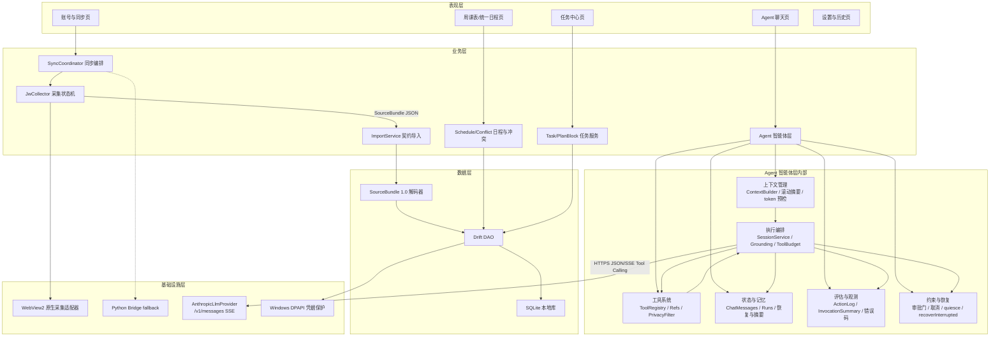
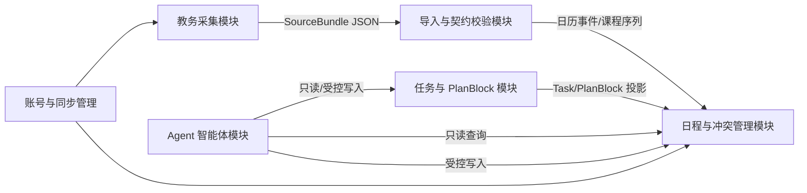
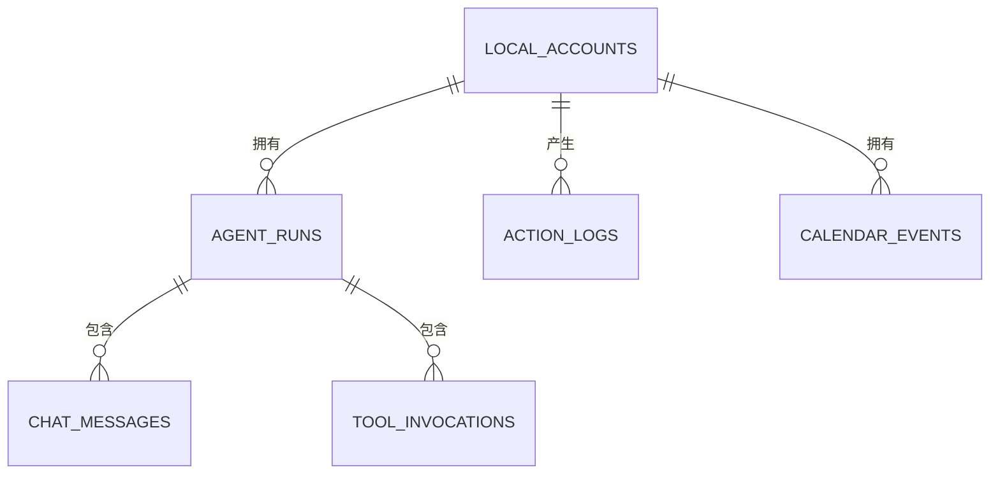

# 封面

| 项目 | 内容 |
|---|---:|
| **作品名称** | USTC Assistant · 中国科大校园学习生活助手 |
| **队员姓名** | 叶俊廷 |
| **学号** | PB24081569 |
| **参加赛道** | 智能体赛道 |
| **参加组别** | 本科生组 |

---

# 摘要

针对中国科大本科生课程查询、考试安排与个人日程管理中数据来源分散、无法统一且不能个性化编辑等问题，本作品设计并实现本地优先的校园学习生活助手 USTC Assistant。系统以 Flutter 客户端与 Drift/SQLite 构建统一日程中枢，通过原生 WebView2 完成教务统一身份认证登录与课程、考试采集，并规范化为 SourceBundle 1.0 契约后导入。同时接入校内 Anthropic 兼容模型服务，围绕智能体层的上下文管理、工具系统、执行编排、状态与记忆、评估与观测、约束与恢复六个方面，将大模型与本地日程深度融合，提供自然语言查询与受控写入。智能体构建“固定系统提示词 + 滚动摘要 + 近期消息 + 工具预算预检”的上下文机制，以及 15 只读 + 20 受控写/生命周期工具，所有写操作经风险分级审批门执行。测试显示：Python 数据层 140 项单测通过，Flutter 全量测试 1597 通过/0 失败，静态分析 0 issue，Windows Release 构建通过；采集数据包与 Python oracle 摘要一致（digest 前 8 位 f858a385）。

---

# 1. 需求分析与设计思路

## 1.1 项目背景与痛点

中国科学技术大学本科生日常查看课程信息主要有三种途径：教务系统网页、官方科大 App、“我的科大”App。三种途径均可查询基础课表，但存在以下问题：

1. **数据来源分散，无法形成统一日程视图**：课程表在教务系统，考试安排与课程表分离，个人事项只能记录在第三方日历工具中。用户需要多次切换应用才能拼出完整日程。
2. **缺少个性化编辑能力**：教务系统只提供查询界面，不提供面向个人的日程写入能力。用户无法在官方课表上添加自定义事项，也无法对调课、停课、临时冲突等情况做本地修正或覆盖。
3. **查询入口传统，缺少自然语言交互**：现有入口以表单和固定菜单为主，用户要完成“今天什么时候有课”“下周哪些任务临近截止”等组合查询时必须自行筛选，缺少一个可理解自然语言并连接本地日程数据的智能体层。

上述痛点可归纳为：**数据分散、不可个性化、缺少可连接日程与任务的智能入口**。本项目以此切入，先解决课表与考试的统一采集与本地日程建模，再重点建设一个受约束、可观测的智能体层，使模型能够在本地数据之上进行自然语言查询与受控写入。

## 1.2 设计目标

1. **统一日程**：课程、考试、个人日程、任务规划块进入同一时间轴视图。
2. **可迁移采集**：初版以 Python 探索学校网站数据获取方式，最终将采集逻辑迁移到 Flutter 原生 WebView2，消除 Python 运行时在移动端迁移中的限制；Python 保留为 oracle 与 fallback。
3. **契约化导入**：教务采集结果统一规范化为 SourceBundle 1.0，经 JSON Schema 校验后写入本地数据库；同 `bundleId + digest` 重复导入幂等重放，同 ID 不同摘要拒绝。
4. **本地优先**：核心日程数据在本地 SQLite 中可用；仅 Agent 对话访问校内模型服务。
5. **单源单通道**：同一来源同一时刻只允许一个采集通道活跃，不并行、不双写。
6. **智能体能力边界**：内置 15 个只读工具与 20 个受控写/生命周期工具，模型不可直达 SQL；所有写操作先提案、后审批、再执行，并可撤回。
7. **智能体可控性**：单次运行最多 8 轮模型调用；普通工具调用预算 12 次；`create_task` 批量任务单轮最多 32 个；重复调用、超大问题、越权动作均在执行前被确定性拦截。
8. **凭据安全**：教务凭据与模型 API Key 经 Windows DPAPI 保护后落库；日志、SQLite 字段、工具摘要中不出现明文 Key、密码、Cookie、Token 或完整账号。
9. **质量可验证**：Python 单测全绿，Flutter 全量测试全绿，`flutter analyze` 0 issue，Windows Release 构建通过。

## 1.3 整体设计思路

系统采用“**采集 → 契约 → 导入 → 日程 → 智能体**”的技术路径。开发期先以 Python + Playwright 探索教务网站页面结构与抓包逻辑，验证可行后移植为 Dart/WebView2 原生采集通道，以摆脱 Python 运行时依赖、适配后续移动端迁移；Python 链路降级为 oracle 与显式 fallback。采集结果规范化为 SourceBundle 1.0，经校验后写入 Drift/SQLite。上层统一日程模块完成课程、考试、个人事件投影与冲突检测。智能体层再将本地数据能力封装为 35 个工具，通过固定版本系统提示词、滚动摘要与消息窗口管理上下文，由运行循环完成模型调用、工具执行、审批暂停、状态落库与末态裁决，形成对本地日程数据安全、可观测、可恢复的智能体闭环。

## 1.4 范围边界

- **平台**：当前交付 Windows 端 Flutter 应用；Android/iOS 保留平台工程与静态接口，真实 WebView 适配不在本阶段交付范围。
- **数据源**：仅覆盖教务课程与考试；不包含二课、评课社区、新闻通知等外部来源。
- **运行模式**：本地优先，无自建云端服务；Agent 需在校园网环境或用户自行启动的 Panabit iWAN 下访问校内模型服务。
- **不涉及**：多用户协作、服务端同步、跨设备云同步。

---

# 2. 系统方案论证

## 2.1 技术选型对比

**表 1 客户端形态选型对比**

| 方案名称 | 技术栈 | 优点 | 缺点 | 适用场景 | 最终选择 |
|---|---:|---|---|---|---|
| 纯 Web 应用 | Vue/React + 浏览器 | 开发快、跨平台天然 | 本地 SQLite、DPAPI、通知等系统能力受限，无法承载 WebView2 采集器 | 纯查询类应用 | 否 |
| Flutter 跨平台客户端 | Flutter/Dart + Drift/SQLite | 一套代码多端复用；本地数据库、FFI、通知插件成熟；Windows/Android/iOS 均可构建 | Windows 原生 WebView2 需自研/自包含适配 | 需要本地数据库与桌面/移动端一致性的场景 | **是** |
| 原生三端独立开发 | WinUI/Android/iOS 独立开发 | 各端体验最佳 | 成本过高，业务逻辑需重复实现，个人项目难以并行交付三端 | 大型商业应用 | 否 |

**表 2 教务数据采集方案对比**

| 方案名称 | 技术栈 | 优点 | 缺点 | 适用场景 | 最终选择 |
|---|---:|---|---|---|---|
| Python 浏览器自动化 | Python + Playwright | 开发期快速验证页面结构；HTML/DOM 抓取生态完整；适合作为 oracle | 依赖 Python 运行时与浏览器内核，较难随 App 分发到移动端 | 数据探索、离线金标准生成 | 开发探索期采用，保留为 oracle/兜底 |
| Flutter 原生 WebView2 | WebView2 + Dart | 采集逻辑随 App 内聚，无 Python 运行时依赖，可迁移到移动端 WebView 适配器 | 需处理 CAS 认证、导航策略、DOM 脚本注入 | Windows 端日常采集通道 | **是** |
| 直接模拟教务 HTTP 接口 | HTTP 客户端 | 最轻量 | 官方接口未公开文档，需维护 Cookie/Ticket 等敏感态，易触发风控 | 不适用 | 否 |

**表 3 Agent 数据访问方案对比**

| 方案名称 | 技术栈 | 优点 | 缺点 | 适用场景 | 最终选择 |
|---|---:|---|---|---|---|
| 模型直出 SQL | LLM + SQLite SQL | 实现快 | 模型生成 SQL 不可控，误删、越权风险高 | 内部只读 BI | 否 |
| 外置常驻服务 + API 网关 | 常驻进程 + HTTP API | 进程边界清晰 | 增加部署包与运营复杂度，与本地优先定位冲突 | 大型分布式系统 | 否 |
| 进程内工具注册表 + 审批门 | Dart 工具注册表 + Tool Calling | 工具边界清晰；每个动作有风险等级与确认策略；可审计、可撤回 | 需维护工具 schema、审批 UI 与运行状态机 | 本地 Agent 读写 | **是** |

## 2.2 最终方案及选择理由

最终方案为：**Flutter Windows 客户端 + WebView2 原生采集 + Python Playwright 兜底/oracle + Drift/SQLite 本地库 + 校内模型服务 Tool Calling + DPAPI 凭据保护**。

选择理由：

1. **本地优先**：日程数据高频、高隐私，本地 SQLite 保证无网络时仍可查询；凭据不做明文落盘。
2. **采集可迁移**：Python 仅承担前期探索与 oracle 职责，正式通道使用 Dart/WebView2，把浏览器采集从桌面自动化的运行时依赖中解放出来，为移动端迁移保留统一业务逻辑。
3. **契约隔离变化**：SourceBundle 1.0 将采集与导入解耦，学校页面变化不侵入日程与智能体模块；导入端只认契约。
4. **模型可控写入**：Tool Calling 方案本身允许模型发起结构化调用，但不能放行任意写入。系统以工具注册表 + 风险动作注册表 + 审批门 + 运行循环状态机作为第二道边界，既保留模型的结构化调用能力，又将写入收益与写入风险分离。

---

# 3. 技术架构

## 3.1 系统总体架构图

系统为四层架构：表现层、业务层、数据层、基础设施层。智能体层在业务层内部进一步划分为上下文管理、工具系统、执行编排、状态与记忆、评估与观测、约束与恢复六个协作单元。



**图 1 系统总体架构图**

数据流向与接口协议说明：

- **采集链路**：同步页触发 `SyncCoordinator`，由 `JwCollector` 驱动 WebView2 完成登录与页面读取，产出 SourceBundle 1.0 JSON；Python Bridge 仅在显式启用 fallback 时使用，两通道互斥。
- **导入链路**：`ImportService` 调用 SourceBundle 解码器完成限制与校验，在事务内写入 SQLite。
- **Agent 链路**：聊天页经 `AgentComposition` 组装完整智能体运行环境；`AgentSessionService` 作为执行编排核心，先用 `AgentContextBuilder` 组装请求，再调用 `AnthropicLlmProvider` 请求模型；返回的 `tool_use` 由 `AgentToolRegistry` 分发，写工具转审批门；`AgentPermissionPolicyService` 决议风险等级并确认后执行。
- **观测链路**：每次运行、每条消息、每次工具调用均以脱敏字段落库，`ActionLog` 以聚合安全摘要记录运行结果。

## 3.2 架构设计原则

1. **高内聚、低耦合**：采集、契约、导入、日程、任务、智能体六个模块只暴露最小接口。智能体层内部六个单元也职责单一，例如 `AgentToolRegistry` 不感知具体工具业务，`AgentContextBuilder` 不读写数据库。
2. **模型不可信任，工具承担边界**：模型只与工具声明 schema 和局部引用交互，调度、校验、脱敏、审批、落库均由 App 内生代码完成。
3. **确定性优先**：凡影响安全、预算、重复调用和末态判定的逻辑均保持为纯 Dart 确定性函数，避免“模型自己承认失败”成为系统判定依据；系统依据工具终态结果决定运行成功/失败。
4. **一源一通道**：同一来源同时只允许一个采集作业活跃，第二作业返回 `bridge_busy`，迟到作业 `cancelled`。
5. **隐私最小化**：日志、工具摘要、错误信息三类出站/落库内容均经过白名单或脱敏处理，不完整账号、会话材料不出本机。

## 3.3 关键技术栈说明

| 层 | 技术 | 版本/形态 | 职责 |
|---|---:|---|---|
| 前端 | Flutter/Dart | Flutter 3.44.5 / Dart 3.12.2 | Windows 客户端 UI 与跨端框架 |
| 本地数据库 | Drift + SQLite | Drift 2.34.2 | ORM、建表迁移、DAO 访问 |
| 教务采集 | WebView2 自包含插件 | `webview_flutter_windows_secure` | 原生登录、导航策略、脚本注入与 DOM 读取 |
| 数据契约 | SourceBundle 1.0 + JSON Schema | `json_schema 5.2.2` | 教务数据包规范化与校验 |
| 兜底采集 | Python + Playwright | Python 3.10 / Playwright ≥1.50 | oracle 与离线 fallback |
| Agent 模型 | 校内 Anthropic 兼容模型服务 | `https://api.llm.ustc.edu.cn`，默认 `deepseek-v4-flash` | 推理与 Tool Calling |
| 凭据安全 | Windows DPAPI | `win32 + ffi` | API Key 与教务凭据 Current User 加密保护 |
| 部署方式 | Windows Release 原生构建 | Visual Studio 2022 工具链 | 本地运行，无需自建服务器 |

---

---

# 4. 功能模块设计

## 4.1 功能模块总图



**图 2 功能模块总图**

## 4.2 账号与同步管理模块

**功能描述**：新建或切换本地学校账号；管理指定学期；发起/取消教务同步；展示最近同步状态；执行导入、重置与数据隔离。

**输入输出**：

- 输入：统一身份认证账号、密码（仅用于登录采集）、学期三元组、同步/取消指令。
- 输出：账号列表、同步运行记录、导入批次状态。

**模块间接口**：向教务采集模块传递账号凭证与学期参数；接收采集事件流；向日程模块输出该学期课程与考试事件。

## 4.3 教务采集模块

**功能描述**：驱动 WebView2 完成教务门户进入 → 统一身份认证登录 → 首页身份核验 → 课程读取 → 考试读取；支持暂停等待登录、取消并释放会话。

**输入输出**：

- 输入：账号、密码、学期配置、取消信号。
- 输出：课程与考试页面结构化 JSON，规范化后生成 SourceBundle 1.0。

**模块间接口**：以 `JwCollector` 状态机向上层暴露单调递增事件流；通过 `JwWebPage` 接口隔离平台差异；`JwWebViewAdapter` 为 Windows 实现，测试桩为测试实现。

## 4.4 导入与契约校验模块

**功能描述**：对 SourceBundle 1.0 进行 16 MiB 上限检查、JSON 解析、JSON Schema 校验与语义校验；在事务内完成课程序列、日历事件、来源记录幂等写入。

**输入输出**：

- 输入：SourceBundle JSON 字节。
- 输出：`imported / replayed / failed` 导入结果与实体计数。

**模块间接口**：上游接同步编排器，下游通过 `ImportRepository` 持久化，并触发提醒重算。

## 4.5 日程与冲突管理模块

**功能描述**：将课程、考试与个人事件投影为统一时间轴；进行重叠分组与冲突预览；支持用户覆盖和教务课程整日移动。

**输入输出**：

- 输入：日历事件列表、用户覆盖指令、冲突状态判断。
- 输出：中科大节次映射、七日周课表、重叠组与冲突预览。

**模块间接口**：从任务模块接收 PlanBlock 时间区间；向智能体模块暴露只读查询与受控写入工具。

## 4.6 任务与 PlanBlock 模块

**功能描述**：管理个人任务与规划块，支持状态机、截止时间、预计用时与日程关联；支持“任务计划”生成规划块。

**输入输出**：

- 输入：任务标题、状态、截止时间、预计用时、规划指令。
- 输出：任务列表、待审查规划块、任务-事件链接。

**模块间接口**：向日程模块输出 PlanBlock 时间段；向智能体模块提供 `get_tasks`、`create_task`、`plan_task` 等工具。

## 4.7 Agent 智能体模块

**功能描述**：智能体模块负责模型对话的完整生命周期，是作品的核心模块。该模块进一步分为六个协作单元：

1. **上下文管理**：管理固定版本系统提示词、动态北京时间、近期消息窗口、滚动摘要、工具声明 JSON、token 预算与摘要触发阈值。
2. **工具系统**：注册只读工具与写工具；将本地数据库 ID 绑定为 run-local 引用；对工具入参与返回结果执行白名单脱敏。
3. **执行编排**：控制模型调用循环、工具预检和分派、写操作暂停/恢复、末态裁决与摘要调度。
4. **状态与记忆**：持久化运行、消息、工具调用、滚动摘要；在重启后恢复未完成运行；管理写操作暂停态。
5. **评估与观测**：记录每次模型调用、工具调用和运行的聚合安全摘要；统一错误码；提供操作历史查看。
6. **约束与恢复**：实施模型调用上限、工具调用预算、重复调用指纹阻断、grounding 约束、审批门、取消与 quiesce（静默关闭）流程。

**输入输出**：

- 输入：用户自然语言消息、模型流式事件、工具调用结果、用户审批动作、取消/重试指令。
- 输出：流式文本、工具运行状态、脱敏执行摘要和跳转建议。

**模块间接口**：通过 `AgentComposition` 组装依赖并注入平台工厂，是业务层与模型层之间唯一的边界。

---

---

# 5. 核心技术实现

> 本章是作品的技术内核，重点落在智能体层。数据采集与统一日程是智能体可查询、可写入的“数据底盘”，而上下文管理、工具系统、执行编排、状态与记忆、评估与观测、约束与恢复六个方面构成了作品的真正技术主线。

## 5.1 核心算法/业务逻辑

### 5.1.1 上下文管理：固定系统提示词、滚动摘要与 token 预算

**原理说明**：智能体需要在不突破模型上下文窗口的前提下，为每个运行回合构造一致且完整的系统上下文。系统采用三层组装方式：

- **固定版本系统提示词**：系统提示词为可版本化常量（当前版本 9），内容固定、不含用户可配置拼接；每次运行时由上下文构建器动态附加 `Asia/Shanghai` 当前时间后缀（精确到秒），使模型能解析相对日期。
- **滚动摘要**：当历史累积超过摘要水位后用摘要压缩早期对话。滚动摘要在消息流中作为“先前对话摘要”的 assistant 上下文注记展示，并明确标记为不可信上下文；业务事实一律以工具结果为准。
- **近期消息窗口 + token 预算**：`AgentContextBuilder` 提供保守的估算输入 token 上限（28,000），并设置摘要触发水位（18,000）。固定开销（系统提示词 + JSON 编码后的工具声明 + 摘要注记 + 当前问题）先从预算中扣除，剩余额度以“从旧到新”裁剪近期消息。估算采用“每字符约 1 token”的保守系数，并在获得真实 provider 用量后优先采用真实值。

**伪代码**：

```text
算法 buildTurnRequest(history, summary, currentUserText, toolDeclarations)
输入: 过滤后的近期历史、滚动摘要、当前用户文本、工具声明列表
输出: 面向单回合构建的 LlmRequest
1  messages ← []
2  if summary 非空:
3      messages 追加 assistant("[Prior summary — 不可信上下文] " + summary)
4  overhead ← 估算(系统提示词) + 估算(JSON(toolDeclarations)) + 估算(summary) + 估算(current)
5  available ← INPUT_TOKEN_BUDGET(28000) - overhead
6  trimmed ← 按 available 从旧到新裁剪历史，但保留每一条完整成对回合
7  for record in trimmed (须排除 failed/cancelled/interrupted 草稿):
8      messages 追加 user/assistant(时间前缀 + content)
9  messages 追加 user(currentUserText)   // 本次新问题务必处于最后
10 若 estimates 超过预算: 返回 question_too_large(在发起 provider 之前)
11 return LlmRequest(system=固定版本 v9+时间, messages, tools=declarations)
```

**量化效果**：token 预算上限 28,000、摘要触发 18,000；`estimateTurnTokens` 在发起网络请求之前即可判定超大问题，返回 `question_too_large`，避免无意义消耗。

### 5.1.2 工具系统：注册表、run-local 引用与出站隐私过滤

**原理说明**：工具系统是模型与本地数据之间的唯一边界，由三层防护组成：

1. **工具注册表**：`AgentToolRegistry` 以工具名为键注册所有可用工具，并为每个工具生成模型可见的 `LlmToolDeclaration`（名称、描述、输入 JSON Schema）。执行时未知工具返回 `tool_not_allowed`，任何抛出异常的工具被捕获为 `tool_execution_failed`，不中断整轮运行。
2. **run-local 引用**：模型永远看不到数据库主键。工具把本地 ID 绑定为每次运行独立的 `ref_*` 不透明令牌（随机 128-bit），并按类型（event/task/planblock）约束解析；一次运行（run）结束，引用即失效，防止跨运行地址引用。
3. **出站隐私过滤**：`OutboundPrivacyFilter` 在两条线上工作——对用户问题，先按确定性规则拦截疑似 API Key、Bearer、Cookie、密码、验证码与完整账号内容；对工具返回结果，按各工具注册的白名单 DTO 构建器抽离字段，未注册的工具返回空占位，原始 payload 永不出站。

**伪代码**：

```text
算法 executeTool(toolName, arguments, context)
1  tool ← registry.find(toolName)
2  if tool == null: return AgentToolResult(error, tool_not_allowed)
3  try:
4      raw ← tool.execute(arguments, context)
5      payload ← privacyFilter.sanitizeToolPayload(toolName, raw.payload)// allowlist 抽离
6      return AgentToolResult(status=raw.status, payload=payload,
                              references=raw.references, errorCode=...)
7  catch (_): return AgentToolResult(error, tool_execution_failed)
```

**量化效果**：共注册 15 只读工具 + 20 受控写/生命周期工具；引用令牌 128-bit 随机；工具结果进入消息前经白名单字段抽离。

### 5.1.3 执行编排：有界循环、grounding 与预算

**原理说明**：`AgentSessionService` 是运行循环编排核心，以“有界 while 循环”驱动多轮“模型调用 → 工具执行”。其关键约束与机制：

- **硬上限**：每轮运行最多 8 次模型调用；普通工具调用最多 12 次；`create_task` 批量任务在单轮内最多 32 个（作为单次突发租约，不占用普通额度）。当调用预算耗尽时，运行以确定性终态 `model_call_budget_exceeded` / `tool_call_budget_exceeded` 结束，不再发起新的模型请求。
- **grounding 约束**：`AgentGroundingPolicy` 对用户文本做保守分类，只有显式操作才要求必须真实调用工具。例如要求“修改日程”这类疑似操作先经过能力判断，避免模型仅凭文意给出不具依据的答案。对需要落地为事实的请求，规定必查工具与终态写入工具，若终态写入未成功，模型自己说“成功”不会被采信。
- **重复调用阻断**：`ToolCallFingerprint` 对“工具名 + 规范化参数”生成确定性指纹；同一运行内已成功或已以终态错误收敛的完全相同调用，再次出现时返回 `repeated_tool_call`，不二次执行。
- **暂停/恢复**：写工具命中 `needsUserAction` 时运行进入 `waitingForUser`；`WriteConfirmationStore` 暂存等待用户批准的调用，用户确认后同一调用记录由 `running → waiting_user → 终态` 过渡，避免同一写操作产生两次执行。

**伪代码**（简化的有界循环骨架）：

```text
算法 runTurnLoop(…)
1  userText 通过 privacyFilter.inspectUserText 检查
2  runId ← startRun(accountId, model)              // 先落库再发网络请求
3  history ← recentMessages(limit=200) ; summary ← latestSummary()
4  ground ← groundingPolicy.classify(userText)     // 一次分类，整轮生效
5  estimateTurnTokens() 超预算则 question_too_large 直接终态
6  conversation ← [历史+摘要+当前问题]
7  while true:
8      if modelCallCount ≥ 8: 终态(model_call_budget_exceeded); break
9      if signal.cancelled: 终态(cancelled); break
10      modelCallCount++
11     events ← 流式调用 provider(system, conversation, requestTools)
12     if 事件无 tool_use: 按 grounding 裁决并 break
13     budget ← preflightTurn(allToolNames)         // 整轮工具预检
14     if budget.rejected: 整轮不执行, 记录 error, break
15     for each tool_use:
16         if fingerprintBlocked: repeated_tool_call; continue
17         if 需写审批: 挂起到 waitingForUser, 等用户确认后继续
18         record + 执行工具 + 聚合 safe summary
19         conversation 追加 assistant(tool_use) + user(tool_result)
20     finishRun(终态, tokens)；writeActionLog(聚合摘要)
21     if 成功: scheduleSummary(滚动摘要重算)
```

**量化效果**：硬上限 8 轮模型调用 / 12 次普通工具 / 32 批量任务；`preflightTurn` 整轮预检为纯 Dart 确定性决策（不触库、不发请求）；所有预检被拒的轮次零副作用（不写入、不执行）。

### 5.1.4 状态与记忆：持久化、恢复与滚动摘要

**原理说明**：智能体的“记忆”由持久化运行记录、消息、工具调用与滚动摘要共同构成，而非模型侧的无界上下文：

- **运行持久化**：每个运行开始前先落 `agent_runs` 行（状态 `running`），随后写用户消息；之后才发起网络请求。崩溃/中断时 `recoverInterrupted` 将未完成运行标记为 `interrupted`，保留已展示的部分正文，从而保证“重启后聊天记录与状态不丢”。
- **消息与工具调用**：`chat_messages` 保存每轮消息（state 区分 completed/streaming/cancelled/failed），`tool_invocations` 保存每次工具调用的脱敏参数摘要、生命周期状态与耗时。
- **滚动摘要**：成功运行后以独立（禁用工具）的摘要请求压缩早期历史，滚动摘要以“不可信上下文”注入后续请求。
- **暂停记忆**：写审批暂停时保存 `_PausedRun`（含该轮 conversation、toolUseId、引用表、取消信号），恢复时沿用同一引用表与调用记录，保证不重复执行。

**量化效果**：历史窗口上限 200 条（`recentMessages(limit=200)`）；运行、消息、工具调用三层状态均持久化；重启后自动恢复中断运行。

### 5.1.5 评估与观测：聚合摘要、错误码与操作历史

**原理说明**：智能体的可观测性建立在一套“只记度量、不记原文”的脱敏日志之上：

- **工具调用摘要**：`AgentToolInvocationSummary` 只允许保存函数名、日期字段、安全枚举与计数；键名含 `key/token/cookie/password/account/username/id/ref` 的一律省略；嵌套数据只记长度计数，不记内容。因此 `ref_*`、本地主键、学号、课表正文永远不可能进入摘要。
- **ActionLog 聚合**：每次运行结束写一条 `ActionLog`（含 actionType、result、riskLevel、safeSummary），不保存用户问题正文、原始工具结果或敏感参数；元信息（token 用量、触发工具名与次数）单独记录。
- **统一错误码**：所有可预期错误收敛为白名单错误码（如 `tool_not_allowed`、`tool_call_budget_exceeded`、`repeated_tool_call`、`permission_denied`、`cancelled`、`mutation_partial`），未知字符串一律折叠为 `tool_error`；用户与界面只看到稳定、脱敏的错误码，堆栈与原始响应永不出站。

**伪代码**：

```text
算法 writeObservability(runId, terminalState, toolCallCount)
1  if run 已达终态:
2      actionLog ← {
3          actionType: 由 grounding 分类决定(运行/写事务),
4          result: completed|failed|cancelled,
5          safeSummary: 只含工具名列表与次数,
6          riskLevel: 本运行使用到的最高风险等级,
7      }
8      写入 action_logs（失败不覆盖已发布的运行结果）
9  tool_invocations 只保存:
10    toolName, lifecycle(end-state), safeArgumentsSummary,
11    safeResultSummary, startedAt, finishedAt
12 任何原始 payload / 参数 / ref，禁止进入用户可见内容与摘要
```

**量化效果**：运行、消息、工具调用三层均可持续追溯；`action_logs` 记录每次运行一条聚合安全摘要；异常均映射为固定错误码。

### 5.1.6 约束与恢复：审批门、取消、静默与重置

**原理说明**：约束与恢复是智能体层的“最后一道安全与可用性防线”：

- **风险分级审批门**：`AgentPermissionPolicyService` 内置唯一动作注册表 `kPermissionActions`，将每个写动作映射到 `medium / high / critical` 风险与 `askFirstTime / alwaysAsk` 确认模式。`update_permission_policy`、`reset_permission_policy`、`move_jw_course_day` 为不可放宽的 critical 动作，也禁止被 reset 工具解除自身的保护。
- **取消与静默（quiesce）**：运行中可随时取消；取消后流式回复可继续“放行”但不启动新模型调用，未执行的工具调用以 `cancelled` 终态记录。`AgentCompositionOwner` 在应用重置前执行 `quiesce`（关闭所有 Agent 入口、等待真实运行/恢复完成），再执行 `resume`/`dispose`，避免重置过程中残留运行写库。
- **恢复**：崩溃/退出后，`recoverInterrupted` 标记中断运行；暂停中的写审批若应用被关闭，恢复后不会残留不可达的等待卡；重新发起的 `retry` 会创建全新 run，失败运行记录不被覆盖。

**伪代码**：

```text
算法 resetAdmission():
1  owner.quiesce()          // 关闭入口，等真实 run/resume 完成
2  database.transaction(重置账户数据: 清空 key/chat/摘要/授权/Agent 设置)
3  owner.resume()           // 重新打开入口
4  之后任何迟到登录/迟到 composition 由 owner 自行 quiesce 或 dispose
```

**量化效果**：critical 动作不可放宽；`kNonResetableActions` 固定 3 个动作；取消/恢复/重置均已纳入自动化测试覆盖。

### 5.1.7 教务采集：WebView2 三信号认证收敛（数据底座）

作为智能体可查询的“数据底座”，教务采集同样是核心技术实现之一。登录过程对“URL 达标 + DOM 就绪 + 身份核验”三个信号使用独立 generation 收敛，三者可任意顺序到达但必须全部满足且代次一致，超时返回 `login_timeout`；身份冲突返回 `account_mismatch`。详情见 6.1 难点分析。

### 5.1.8 SourceBundle 幂等导入（数据底座）

导入解码器依次执行 16 MiB 上限、JSON 解析、结构检查、`schemaVersion`、完整度、Schema 校验与语义校验；`bundleId + digest` 决定重放或拒绝。

---

## 5.2 关键接口设计

### 5.2.1 校内模型服务接口

```http
POST /v1/messages
Authorization: Bearer <api-key>
anthropic-version: 2023-06-01
Content-Type: application/json
```

请求体示例（脱敏示意）：

```json
{
  "model": "deepseek-v4-flash",
  "max_tokens": 1024,
  "system": "<固定版本系统提示词 v9 + 当前北京时间>",
  "messages": [
    { "role": "user", "content": "今天下午有什么安排？" }
  ],
  "tools": [
    {
      "name": "get_schedule",
      "description": "查询指定日期范围的本地日程",
      "input_schema": {
        "type": "object",
        "properties": {
          "date": { "type": "string", "format": "date" }
        },
        "required": ["date"]
      }
    }
  ],
  "stream": true
}
```

响应采用 SSE 事件流，错误统一映射为脱敏错误码，原始响应体不出站。

### 5.2.2 Agent 工具调用接口（进程内）

```dart
Future<AgentToolResult> execute({
  required String toolName,
  required Map<String, Object?> arguments,
  required AgentToolContext context,
})
```

工具结果统一为脱敏 envelope：

```json
{
  "status": "success | error",
  "payload": { "summary": "...", "references": ["ref_..."], "matches": 3 },
  "errorCode": null
}
```

### 5.2.3 写操作审批协议

写工具命中审批门时返回 `needsUserAction`，会话进入 `waitingForUser`，经 `WriteConfirmationStore` 完成“提案 → 用户确认 → 单事务提交”：

```dart
class AgentWriteTool {
  Future<AgentWriteProposal> propose(Map<String, Object?> arguments, AgentToolContext context);
  Future<AgentToolResult> commit(AgentWriteProposal proposal, AgentToolContext context);
}
```

### 5.2.4 本地采集 Bridge fallback 接口

| 方法 | 路径 | 参数 | 响应/事件 |
|---|---|---|---|
| GET | `/health` | 无 | 健康状态 JSON |
| GET | `/capabilities` | 无 | `semesterId=461, semesterKey=2026fall` |
| POST | `/collect/jw` | `accountId`、学期三元组、凭证 | `{ "jobId": "<uuid>" }` |
| POST | `/login/resume` | `jobId`、`password` | 恢复登录 |
| GET | `/jobs/{id}/events` | `after` 游标 | 采集事件序列 |
| POST | `/shutdown` | 无 | 关闭进程 |

---

## 5.3 数据库设计

### 5.3.1 ER 图（智能体层核心）



**图 3 智能体层核心表 ER 图**

### 5.3.2 核心表结构

以下 5 张核心表聚焦智能体运行链路；课程/日程 / 任务等业务表采用相同的 `accountId` 分区模式，因篇幅聚焦于此。

**表 4 local_accounts（本地账号表）**

| 字段 | 类型 | 约束 | 说明 |
|---|---|---|---|
| id | TEXT | PK | 本地账号标识 |
| masked_hint | TEXT | NOT NULL | 脱敏账号提示 |
| identity_digest | TEXT | NULL | 身份摘要 |
| is_active | BOOLEAN | DEFAULT false | 当前活跃账号 |
| created_at / updated_at | INTEGER | NOT NULL | 毫秒时间戳 |

**表 5 agent_runs（Agent 运行表）**

| 字段 | 类型 | 约束 | 说明 |
|---|---|---|---|
| id | TEXT | PK | 运行 ID |
| account_id | TEXT | FK → local_accounts.id, CASCADE | 账号分区 |
| model | TEXT | NOT NULL | 默认 `deepseek-v4-flash` |
| status | TEXT | NOT NULL | running/completed/failed/cancelled/interrupted |
| error_code | TEXT | NULL | 脱敏错误码 |
| input_tokens / output_tokens | INTEGER | NULL | token 统计 |
| started_at / finished_at | INTEGER | NOT NULL / NULL | 起止时间 |

**表 6 chat_messages（消息表）**

| 字段 | 类型 | 约束 | 说明 |
|---|---|---|---|
| id | TEXT | PK | 消息 ID |
| account_id | TEXT | FK → local_accounts.id, CASCADE | 账号分区 |
| run_id | TEXT | 复合 FK(client,account_id) | 绑定所属运行 |
| ordinal | INTEGER | UNIQUE(account_id, ordinal) | 消息序号 |
| role | TEXT | NOT NULL | user/assistant |
| state | TEXT | NOT NULL | completed/streaming/cancelled/failed |
| content | TEXT | NOT NULL | 正文 |
| created_at / updated_at | INTEGER | NOT NULL | 时间戳 |

**表 7 tool_invocations（工具调用表）**

| 字段 | 类型 | 约束 | 说明 |
|---|---|---|---|
| id | TEXT | PK | 调用 ID |
| account_id | TEXT | FK → local_accounts.id, CASCADE | 账号分区 |
| run_id | TEXT | 复合 FK(client,account_id) | 所属运行 |
| tool_name | TEXT | NOT NULL | 工具名 |
| status | TEXT | NOT NULL | running/waiting_user/success/error/cancelled |
| safe_arguments_summary | TEXT | NOT NULL | 脱敏参数摘要 |
| safe_result_summary | TEXT | NULL | 脱敏结果摘要 |
| started_at / finished_at | INTEGER | NULL | 调用起止 |

**表 8 action_logs（操作历史表）**

| 字段 | 类型 | 约束 | 说明 |
|---|---|---|---|
| id | TEXT | PK | 日志 ID |
| account_id | TEXT | FK SETNull | 账号分区 |
| source | TEXT | NOT NULL | 来源 |
| action_type | TEXT | NOT NULL | 动作类型/运行 |
| result | TEXT | NOT NULL | completed/failed/cancelled |
| safe_summary | TEXT | NOT NULL | 聚合安全摘要 |
| risk_level | TEXT | NULL | 最高风险等级 |
| occurred_at | INTEGER | NOT NULL | 时间戳 |

---

## 5.4 核心代码片段

以下为工具引用绑定与重复调用指纹检测的关键实现，体现智能体层“模型只见引用、不见主键”与“确定性收敛”的设计：

```dart
// run_reference_store.dart（节选）
class RunReferenceStore {
  RunReferenceStore({required this.runId});
  final String runId;

  // 仅绑定到本次 run，绑定同 (kind, localId) 返回同一个 ref（幂等）
  String bind({required String kind, required String localId}) {
    final key = '$kind\x1f$localId';
    final existing = _byKindLocal[key];
    if (existing != null) return existing;
    final ref = _generateRef();           // 128-bit 随机后缀
    _byRef[ref] = _BoundRef(kind: kind, localId: localId);
    _byKindLocal[key] = ref;
    return ref;
  }

  // run 外或 kind 不匹配一律解析不到（含跨 run 引用失效）
  String? resolve({required String ref, required String kind}) {
    final bound = _byRef[ref];
    if (bound == null || bound.kind != kind) return null;
    return bound.localId;
  }
  // _generateRef：Random.secure() 生成 16B，base64Url 无填充，前缀 ref_。
}
```

```dart
// tool_call_fingerprint.dart（节选）
/// 工具名 + 规范化参数 的确定性指纹，用于在一个 run 内阻断完全重复的调用。
class ToolCallFingerprint {
  static String of(String toolName, Map<String, Object?> input) =>
      '${_encode(toolName)}(${_encodeMap(input)})';

  // 对象键按字典序排序，使对象键顺序无关的相同内容得到同一个指纹；
  // 数组顺序则敏感（重排数组视为不同的调用）。
  static String _encodeMap(Map<Object?, Object?> map) {
    final sorted = map.entries.toList()
      ..sort((a, b) =>
          '${a.key}'.compareTo('${b.key}'));
    return '{${sorted.map((e) => '${_encode(e.key)}:${_encodeValue(e.value)}')
        .join(',')}}';
  }
}
```

---

# 6. 技术难点与创新点

## 6.1 技术难点

### 难点 1：模型写操作的可信边界与可撤回性

- **难在哪里**：大语言模型参数预测可能合法但错误，一次错误的参数预测就可能误删、误改用户的课程表或任务。
- **常规方案为什么不行**：仅在提示词里要求模型“不要乱改”不构成安全边界；只做调用后日志审计无法阻止错误写入已经发生。
- **采用的解决方案**：全部写操作先构造 `AgentWriteProposal`，再经过 `AgentPermissionPolicyService` 风险分级（medium/high/critical）与确认模式，用户确认后才在单事务内执行；同步记录 `undoSlot` 与脱敏操作历史。critical 动作不可放宽、不可被 reset 工具解除保护。
- **解决后达到的效果**：20 个写/生命周期工具全部走审批门；critical 动作固定 3 个不可放宽；相关审批/拒绝/撤回路径均有自动化测试覆盖。

### 难点 2：长对话上下文与预算的平衡

- **难在哪里**：工具声明、系统提示词、历史消息、滚动摘要共同消耗上下文窗口，上下文过长会导致首轮请求失败或模型精度下降。
- **常规方案为什么不行**：简单“全部截取最后 N 条”会丢失早前事实；把所有历史都发给模型会极易超窗。
- **采用的解决方案**：上下文构建器先计算固定开销并预留额度，再按预算“由旧到新”裁剪历史；设置摘要水位（18,000）与硬预算（28,000），在发起网络前检测超大问题（`question_too_large`）。
- **解决后达到的效果**：单轮请求在调用 provider 前即可被纯 Dart 预算校验拒绝；历史窗口上限 200 条并配合滚动摘要。

### 难点 3：模型重复/错误调用与运行失控

- **难在哪里**：模型可能在一个问题内连续重复相同参数调用，或发出超量、越权、冲突状态不一致的写调用。
- **常规方案为什么不行**：依赖模型“自觉”收敛不可靠，完全放行又有失控风险。
- **采用的解决方案**：`preflightTurn` 对整轮工具调用在执行前一次性分类（普通/批量/拒绝），令牌级预算（8 模型调用 / 12 工具 / 32 批量任务）贯穿整个循环；`ToolCallFingerprint` 阻断完全重复调用；grounding 约束要求显式操作必须有真实工具结果兜底，且“是否成功”由工具终态决定而非模型自述。
- **解决后达到的效果**：重复/越权/超量调用均返回确定性错误码（如 `repeated_tool_call`、`tool_call_budget_exceeded`），在零写副作用下终止运行。

### 难点 4：教务系统非开放接口下的 WebView2 原生采集

- **难在哪里**：教务系统无公开数据 API，需要门户登录 → CAS 跳转 → SESSION 建立后才能访问，且数据由动态请求返回。
- **常规方案为什么不行**：直接模拟 HTTP 接口需维护 Cookie/Ticket 且易触发风控；固定延时等待不稳定；Python/Playwright 无法平滑迁移到移动端。
- **采用的解决方案**：改由 Flutter 原生 WebView2 采集，用“URL + DOM + 身份核验”三信号收敛代替固定等待，并以 generation 代次隔离旧导航信号；导航由编译期 host/path 白名单裁决，未知地址 fail-closed。
- **解决后达到的效果**：Dart 采集链路与 Python oracle 的 SourceBundle 摘要对齐（`f858a385…`）；日志只记阶段不记敏感串。

## 6.2 创新点

1. **以智能体六能力为架构主线的本地日程 Agent**：作品不是“聊天框 + 课表查询”的简单拼接，而是围绕上下文管理、工具系统、执行编排、状态与记忆、评估与观测、约束与恢复六个方面构建“面向本地业务的 Agent 运行平台”。模型只接触引用令牌和脱敏 DTO，本地数据由 35 个工具 + 审批门控制，形成一套可扩展、可观测、可恢复的本地智能体范式。
2. **模型可控写入的纵深防御**：将“Tool Calling + 工具注册表 + run-local 引用 + 风险动作注册表 + 审批门 + 操作历史 + 一步撤回 + 预算与恢复”组合成一条安全链路，使大模型在不禁用其结构化调用能力的前提下，也不能越权写本地数据。
3. **确定性 observability 与脱敏工程**：工具调用只保存函数名、日期与计数，键名含敏感子串一律省略；运行末态由工具终态决定而非模型自述；所有错误收敛为固定脱敏错误码——把“可观测”与“不可泄密”两个目标合并在一个工程方案中。
4. **WebView2 在非开放教务信息系统的采集适配**：将成熟 WebView 组件用于高校统一身份认证下的动态页面采集，以三信号收敛、generation 代次隔离与编译期 URL 白名单解决登录时序与页面状态判断难题，验证了原生 WebView 在非公开 API 场景下做结构化采集的可行性。
5. **可迁移采集链路**：先以 Python 快速验证页面结构，再迁移为 Flutter 原生 WebView2 实现，摆脱 Python 运行时对移动端迁移的限制，同时保留 Python 作为 oracle 与兜底通道。

---

---

# 7. 测试方案与结果

## 7.1 测试环境

| 项目 | 配置 |
|---|---|
| 操作系统 | Windows 11（开发与构建验证） |
| Flutter | 3.44.5 |
| Dart | 3.12.2 |
| Visual Studio | 2022，含 `Desktop development with C++` |
| Python | 3.10（Conda 环境 `ustc_assistant`） |
| 模型服务 | `https://api.llm.ustc.edu.cn`（真实调用需校园网或 Panabit iWAN） |
| 测试工具 | Python `unittest`；Flutter `flutter test`；`flutter analyze`；`flutter build windows --release` |

## 7.2 功能测试用例

**表 9 功能测试用例（智能体优先）**

| 用例编号 | 测试项 | 预期结果 | 实测结果 | 是否通过 |
|---|---|---|---|---|
| FT-01 | 上下文 token 预算预检 | 超大问题在 provider 调用前返回 `question_too_large` | 运行先于网络请求判定 | 通过 |
| FT-02 | 滚动摘要调度 | 达到水位后成功运行会触发禁用工具的摘要请求 | 摘要请求独立签发 | 通过 |
| FT-03 | 工具未知拦截 | 未注册工具返回 `tool_not_allowed` | 模型未触达未注册工具 | 通过 |
| FT-04 | run-local 引用 | 跨 run/跨 kind 引用一律解析失败 | 引用仅运行内有效 | 通过 |
| FT-05 | 重复调用指纹阻断 | 相同参数重复调用返回 `repeated_tool_call`，不二次执行 | 指纹精确命中 | 通过 |
| FT-06 | 写操作审批门 | 未经确认的写提案不落库；确认后单事务写入并记录历史 | 审批前后状态符合预期 | 通过 |
| FT-07 | 模型/工具预算 | 超上限后运行以确定性终态结束，不再新发请求 | 8/12/32 上限生效 | 通过 |
| FT-08 | 取消与偏序恢复 | 取消后不启新模型调用；未执行工具以 `cancelled` 记录 | 取消语义正确 | 通过 |
| FT-09 | grounding 约束 | 无工具支撑、未满足终态的“成功”陈述不被采信 | 由工具终态裁决 | 通过 |
| FT-10 | 运行/消息/调用持久化 | 崩溃/重启后 `recoverInterrupted` 正确标记中断运行 | 中断恢复保留草稿 | 通过 |
| FT-11 | ActionLog 聚合与脱敏 | 每次运行一条聚合安全摘要，无原文 | 敏感字段未落库 | 通过 |
| FT-12 | 教务 SourceBundle 幂等 | 重复包 `replayed`，同 ID 不同摘要被拒 | 幂等语义正确 | 通过 |
| FT-13 | 统一日程投影与冲突分组 | 时间重叠形成重叠组 | 组划分与测试集一致 | 通过 |
| FT-14 | 凭据 DPAPI 保护 | SQLite/日志无明文字段 | 密文 check 通过 | 通过 |
| FT-15 | 账号分区隔离 | 切换账号后消息/工具/策略不串号 | 按账号隔离 | 通过 |

## 7.3 自动化测试与构建验证数据

本项目为本地数据与本地智能体，不以服务端吞吐/并发为核心指标，因此测试与构建验证数据作为“正确性、可控性与可交付性”指标呈现。

**表 10 自动化测试与构建验证**

| 测试指标 | 目标值 | 实测值 | 是否达标 |
|---|---:|---:|---:|
| Python 数据层单元测试 | ≥140 项全通过 | 140 项通过 / 0 失败 | 是 |
| Flutter 全量测试 | 全绿 | 1597 项通过 / 0 失败 | 是 |
| Flutter 静态分析 | 0 error | `No issues found!` / exit 0 | 是 |
| Windows Release 构建 | exit 0 | exit 0 | 是 |
| Release 构建产物 | 可运行原生窗口应用 | launcher 92,160 bytes；`data/app.so` 11,469,712 bytes | 是 |
| SourceBundle oracle 对齐 | 与 Python oracle 一致 | digest 前 8 位 `f858a385` | 是 |
| 原生 WebView2 采集逻辑 | 平台无关 collector 测试通过 | 固定夹具 synthetic loopback 通过 | 是 |

## 7.4 结果分析与误差来源

- 自动化测试基于脱敏固定夹具与合成页面；此外，已在真实校园网、真实账号与校内模型服务环境下完成端到端人工验收，覆盖真实 CAS 登录、课程/考试采集、模型 Tool Calling、写审批与日程修改等关键路径。
- 自动化测试主要验证解析器、契约、权限、预算、编排、恢复与脱敏逻辑的正确性；真实环境进一步验证了真实页面结构与模型服务的行为；两者互为补充。
- 上下文估算采用保守系数（约 1 字符/1 token），与真实 token 用量存在差异，已通过“真实 provider token 优先”机制修正，但不改变首发校验的保守目标。

---

# 8. 总结与展望

## 8.1 作品成效

1. **统一了分散的教务信息入口**：课程与考试进入同一时间轴，并支持个人日程、任务与规划块叠加。
2. **建设了以智能体为核心的本地 Agent 平台**：围绕上下文管理、工具系统、执行编排、状态与记忆、评估与观测、约束与恢复六方面，实现了对本地数据的自然语言查询与受控写入。
3. **形成了纵深防御的模型可控写入方案**：引用隔离、审批门、风险分级、预算、指纹阻断、操作历史与撤回共同保证了模型不能越权写本地数据。
4. **达到 1597/0 的 Flutter 测试通过率、0 issue 静态分析与 Windows Release 构建通过**，核心功能由自动化验证背书。

## 8.2 不足之处

1. **平台覆盖有限**：当前仅 Windows 端，Android/iOS 的真实 WebView 适配与构建尚需外部设备完成。
3. **数据来源单一**：现阶段仅教务来源，二课、评课、新闻通知尚未纳入统一日程。
4. **智能体工具的长期稳定性**：工具声明的维护、模型对复杂工具调用的稳定使用，仍需在真实模型服务上进一步验证。

## 8.3 改进方向

1. **补齐移动端运行链路**：完成 Android/iOS 的 WebView 适配器与构建验证，形成三端一致的本地优先体验。
2. **扩展统一日程来源**：以 SourceBundle 契约为基，逐步纳入二课、考试倒计时、校园通知等更多校园场景。
3. **增强智能体工具生态**：扩展工具声明、加入多智能体协作与 Workflow 编排，在保持审批门边界的前提下提升复杂任务的一次性完成率。
4. **固化真实环境回归**：基于已完成的真实验收，将教职务 DOM 变化检测、模型服务连通性和关键路径端到端测试固化为可复用回归流程。

---

# 参考文献

[1] Flutter. Flutter 官方文档[EB/OL]. https://docs.flutter.dev/.

[2] Dart. Dart 官方文档[EB/OL]. https://dart.dev/guides.

[3] Simon Binder. Drift 官方文档[EB/OL]. https://drift.simonbinder.org/.

[4] Microsoft. Microsoft Edge WebView2 官方文档[EB/OL]. https://learn.microsoft.com/en-us/microsoft-edge/webview2/.

[5] Microsoft. CryptProtectData 函数参考[EB/OL]. https://learn.microsoft.com/en-us/windows/win32/api/dpapi/nf-dpapi-cryptprotectdata.

[6] Anthropic. Anthropic Messages API 参考[EB/OL]. https://docs.anthropic.com/en/api/messages.

[7] Microsoft Playwright. Playwright for Python 官方文档[EB/OL]. https://playwright.dev/python/.

[8] JSON Schema. JSON Schema Draft 7 规范[EB/OL]. https://json-schema.org/.
