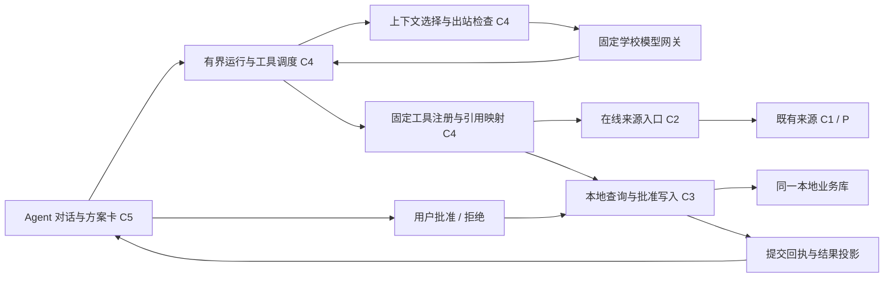
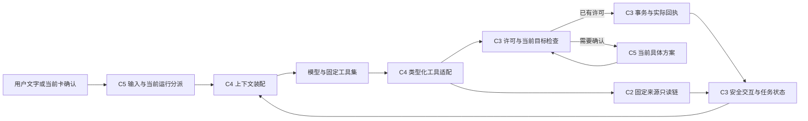

# M5 任务单：学生事务 Agent 与受控运行环境

状态：2026-10-14，总方案及 §21–23 修订已批准，真实 toolReady 已核验。[§23 上下文与执行权限重构](#23-m59-上下文与执行权限重构已批准)已完成工程、根全套/九套 Windows/Release，修订版真实模型与集中体验待验，详见[记录 12](records/12-context-and-permission-implementation.md)。§23 更新单对话上下文、私人内容读取策略及操作授权交互；既有单类别许可保留且不增加 TTL、不自动扩展，应用内私人内容和日常授权包仍须用户分别 opt-in。总方案提案提交为本地 `5680d92`，M0–M4 已验收关闭。本文件是 M5 唯一任务单；批准与验收分开，实际实施/失败/检查写 records，语音识别失败仍保留，M5 尚未验收关闭。

## 1. 目标与设计依据

M5 将默认 Agent 页接成真正可用的学生事务助手：用户用自然语言查询日程、任务和公开信息，获得带出处的回答，提出个人安排或任务时间规划，经可审查的确认后写入同一本地业务库。Agent 的效果不仅取决于模型回答，还取决于应用能否控制工具权限、上下文、提交事实、取消、历史和故障恢复。

| 依据 | 本阶段如何落实 |
|---|---|
| [07 产品约束](../../architecture/07-constitution.md) | 五条来源及本地业务保留；学校只读，密码/Key 分用途保护，单账号、北京时间、用户主权和来源连续性不变 |
| [08 目标架构](../../architecture/08-target-architecture.md) | C4 只调用 C2/C3/C0；不直接访问来源适配器、SQL、浏览器或任意文件；继续单 Flutter/Dart 工程 |
| [09 K-04/K-06/K-07](../../architecture/09-contracts.md) | 来源全局租约、模型 Key 固定出口、事务幂等、维护屏障、受控公开引用及知识库修订守卫 |
| [10 运行链路](../../architecture/10-runtime.md) | 模型运行与来源作业分开；清历史、清业务、重置先拒新并排空，迟到结果不能恢复已清资产 |
| [11 组件设计](../../architecture/11-component-designs.md) | 分开运行、等待用户、资源收口和提交事实；不以模型文本、来源 complete 或 UI 显示成功替代事务回执 |
| [12 横切约束](../../architecture/12-cross-cutting.md) | 本地事实、秘密、出站、历史、审计及安全展示的责任归属不变 |
| [13 验证登记](../../quality/13-risks-and-acceptance.md) | 重点补 V-02/04/05/06 的 Agent 部分，自动与真人证据分开，不关闭未覆盖的整体 V 项 |
| [14 审查方法](../../reviews/14-overall-review.md) | 机械一致性、场景走查、必要独立复核、根核实与裁决；不重复历史固定代理数量 |
| [15 项目工作流](../../workflow.md) | Sol / max 总负责，Luna / max 承接明确小块，Astra 按具体重大风险复核；根负责集成验收与本地提交 |
| [M4 任务单](../m4/plan.md)与[验收](../m4/acceptance.md) | 默认 Agent、Agent/日程两主页，任务在日程内，设置为辅助入口；沿用用户认可的画布、配色、教学时间轴和交互 |
| [来源参考](../../reference/sources/README.md)与[校园文本决定](../../decisions/public-text-knowledge.md) | M3 内部能力通过 Agent 正式使用；固定 7 项长期文本，时效通知只在线读取，财务搜索/FAQ 保持 unavailable |

已批准的修订继续有效：普通 WebView 边界不恢复 CAL/全协议封闭；JW/Young 共享学校密码但独立核验和分区；Young 只同步活动关联日程；定时重叠默认冲突、显式不冲突优先、全天不参与；教室优先展示且教务教师信息保留。M1 非空考试获批准后补，M5 不凭空补记通过。

## 2. 已批准首版边界

### 2.1 本次交付

| 用户需求 | M5 交付结果 |
|---|---|
| 自然语言对话 | 学校模型网关、受保护 Key、实际可用模型选择、流式回答、停止生成、明确失败与新一轮重试 |
| 查个人事务 | 日程窗口与详情、课程教室/教师、任务/截止/状态、规划块、冲突和来源新鲜度；消费与日程页相同的业务投影 |
| 查校园公开信息 | 评课课程/教师检索及详情/点评，教务与财务已登记栏目/文章，精选长期知识库检索/正文；显示出处、日期、版本、覆盖和未知适用性 |
| 管理本地业务 | 个人日程、Task、PlanBlock、出勤/听讲/备注/隐藏、冲突关系的受控变更；先展示具体方案，批准后由 C3 原子提交 |
| 安排任务时间 | 用户发起的有界规划：读当前日程与任务、找空闲窗口、生成时间块方案、提示冲突与未满足条件，确认后提交，可用现有受控撤销 |
| 请求刷新来源 | 用户明确要求时，复用 JW/Young 自动认证、选期/日期范围和 C2 同步/活动查询；学校挑战仍交用户，不隐式刷新所有来源 |
| 连续使用 | 本地会话列表、消息与结果卡、有限上下文整理、显式规划偏好、中断说明、重启后可查看历史并按新请求重新核验 |
| 维护与收口 | 单独清 Agent 历史/模型 Key，复用清业务与完全重置；旧流、工具、批准和摘要不能迟到复活 |
| 质量与诊断 | 合成场景评估、真实模型能力验核、安全计数/耗时/稳定失败码；不增加云端追踪或遥测出口 |

首版采用**单 Agent、有界工具循环、应用控制的审批和业务事务**。运行中的分析步骤、工具调用和检查可以不同，但不为每个角色增加独立模型调用。实施团队的 Sol/Luna/Astra 分工与产品内 Agent 的模型选择是两件事。

### 2.2 留给后续阶段

多 Agent 团队、用户自建工具/MCP/插件、任意浏览器或代码执行、通用互联网搜索、文件上传/运行时 OCR/下载管理、自动知识库扩充、向量库/Embedding、隐式长期画像、后台定时自主执行、跨进程长任务自动续跑、系统提醒及移动端不纳入本次。

学校业务写操作继续不提供，包括报名/退选、选课、提交表单、评课发帖和财务业务办理。Agent 可解释材料并提供来源链接，用户自行办理。原图中的公司案例及 Prompt→Context→Harness 阶段叙述作为讨论背景，不作为本项目新增权限或已验证事实。

## 3. 开源实现调研与技术选择

调研日期为 2026-10-13。“成熟”按维护的公开仓库、可读取的实现、文档与发布记录判断；不以星数或示例跑通代替本项目兼容性。下列是机制参考，未安装、复制或装配任何框架。

| 项目与一手资料 | 已查证的机制 | 本项目采用与取舍 |
|---|---|---|
| [OpenAI Agents SDK](https://github.com/openai/openai-agents-python)，MIT；[运行循环源码](https://github.com/openai/openai-agents-python/blob/main/src/agents/run.py)、[人工审批示例](https://github.com/openai/openai-agents-python/blob/main/examples/agent_patterns/human_in_the_loop.py) | 有界模型—工具循环、待审批中断、运行状态与会话区分 | 借鉴 Runner/Tool/RunState 的语义；不引入 Python/TS 运行时，不把框架状态替代 C3 回执与权限 |
| [LangGraph](https://github.com/langchain-ai/langgraph)，MIT；[持久执行](https://docs.langchain.com/oss/python/langgraph/durable-execution)、[interrupt](https://docs.langchain.com/oss/python/langgraph/interrupts)、[实现](https://github.com/langchain-ai/langgraph/blob/main/libs/langgraph/langgraph/types.py) | 检查点与人工中断；恢复可能重新进入节点 | 借鉴持久步骤和恢复前复验；不把 checkpoint 当作“未执行”证明，写入重放必须查 C3 回执 |
| [Vercel AI SDK](https://github.com/vercel/ai)，Apache-2.0；[工具及审批](https://ai-sdk.dev/docs/ai-sdk-core/tools-and-tool-calling)、[ToolLoopAgent](https://github.com/vercel/ai/blob/main/packages/ai/src/agent/tool-loop-agent.ts) | 步数上限、类型化工具、独立审批请求/响应 | 借鉴有界循环和 UI 审批交接；不搬入 TS 服务或以模型的 approval-response 代替应用用户决定 |
| [LangChain.dart](https://github.com/davidmigloz/langchain_dart)，MIT；[Executor](https://github.com/davidmigloz/langchain_dart/blob/main/packages/langchain/lib/src/agents/executor.dart)、[ToolsAgent](https://github.com/davidmigloz/langchain_dart/blob/main/packages/langchain/lib/src/agents/tools.dart) | Dart Agent/Tool 抽象、迭代/时间上限、工具解析 | 可作为 Dart 实现对照；通用执行器不具有本项目的持久审批/业务守卫，不作为首版事务编排依赖 |
| [Flutter AI Toolkit](https://github.com/flutter/ai)，BSD-3-Clause；[函数调用示例](https://github.com/flutter/ai/blob/main/example/lib/function_calls/function_calls.dart)、[包信息](https://pub.dev/packages/flutter_ai_toolkit) | 聊天 UI、流式消息与函数调用回调 | 参考交互组织；已有 Flutter 壳更适配本项目，默认 Provider 与包平台声明不能证明 Windows/学校网关兼容 |

建议继续采用原生 Dart，在 C4 实现小型受控运行环境，复用现有 SQLite、Markdown 渲染、平台保护及 C2/C3。实现重点是本项目新增的调用/批准/世代边界，不重写通用模型平台或图执行框架。若某轻量依赖能减少 SSE/类型解析成本，Sol 先核验许可证、Windows 支持、隐藏出站/日志和取消能力，再固定版本；不默认整体升级现有包。

[OpenAI 官方审批说明](https://developers.openai.com/api/docs/guides/agents/guardrails-approvals)把校验与人工审批区分；[官方可观测性说明](https://developers.openai.com/api/docs/guides/agents/integrations-observability)说明 SDK 默认追踪可能记录模型/工具数据。本项目只借鉴边界，在应用自己的本地安全摘要中观测，不启用外部追踪。

## 4. 学校模型网关：先确定能力，再接工具

### 4.1 当前可证与仍未知

校方[API 指南](https://llm.ustc.edu.cn/guide/api-usage/)给出 `https://api.llm.ustc.edu.cn/v1`、Bearer Key、`GET /models`、`POST /chat/completions` 和流式示例；[协议指南](https://llm.ustc.edu.cn/guide/protocol/)列举的是 OpenAI 兼容接口。它们不能证明每个可用模型都支持完整工具调用、严格 Schema、usage 或相同推理参数。

[模型指南](https://llm.ustc.edu.cn/guide/models/)当前列出 DeepSeek-V4-Flash、Qwen3.6 系列和 DeepSeek-V4-Pro，指南中的名称不是已验证的本用户可用 API ID。建议把高效通用模型作为候选，经本机能力和场景评估后选择默认；不按本对话的 Sol / max 设置产品模型，也不承诺模型/价格长期不变。

学校网关是唯一模型出口。OpenAI [function calling](https://developers.openai.com/api/docs/guides/function-calling)的结构化协议可作参考，但不能因“OpenAI 兼容”就假定支持 Responses、strict、托管工具或远端会话。首版优先实现校方公开确认的 Chat Completions 适配，不新增未批准网关。

### 4.2 M5.1 必须完成的能力验核

用户只在应用设置中提供 Key，不在聊天、工具或 Codex 消息里提供。明确启动的真实模型验核只发送合成文本/工具数据，不携带正式日程。应用返回脱敏能力摘要，根不读取 Key、认证头或原始响应。

| 验核项 | 通过条件与失败处置 |
|---|---|
| 固定 HTTPS 目标 | 精确 host/443/固定路径，无 userinfo/模型指定 URL；带 Key 的 3xx 拒绝，不跟随；TLS 与现有代理不降低 |
| Key 与模型 | Key 有效、实际列表/模型 ID 可核对；无权限/额度等分别报告，不猜测或自动换服务 |
| 普通/流式文本 | 增量拼接、完成标志、UTF-8 分段、错误与停止可区分；中断文字不记完整回复 |
| 原生函数调用 | 工具名称、调用 ID、分段参数、tool result 续轮可用；本地严格验证参数，不从普通回答文本正则提取执行指令 |
| 多工具/格式边界 | 多调用、坏 JSON、未知名称、缺参数、拒答、长度截断有确定处理；unsupported 参数不被悄悄替换成宽松执行 |
| 推理与计费字段 | 仅声明实际支持的参数；usage 缺失保持未知，不把推理原文保存/显示为任务进度 |
| 取消与异常 | 正常停止、超时、429、断流及应用关闭后无迟到调用；错误只投影固定码 |

能力分级为 `chatOnly` 与 `toolReady`。普通聊天通过可先验收 M5.1；M5 的查询/写入闭环关闭必须有 `toolReady` 模型。若候选不支持原生工具，禁用工具并另选同网关的已验证候选；不能用“让模型输出 JSON 再当命令”绕过此门槛。没有合适候选时将具体缺口交用户，不以合成模型替代正式能力。

### 4.3 Key 与配置契约

新增模型配置由 C3 唯一持久管理：受控 gateway ID、实际 model ID、配置修订、能力版本、受保护 Key 密文及保护元数据。配置与 Key 更新在同事务提交；保护/SQL 失败保留旧值。新 Key 可先用于用户主动的最小合成校验，成功后才替换持久事实。

复用 DPAPI 的平台原语，但模型 Key 使用独立用途和类型，不能复用学校密码租约、保护用途或 C1 认证出口。解密只交 C4 固定请求的不可序列化短期使用出口，用后收口；不回填保存的 Key，不保存明文或完整请求头。删除 Key/切模型推进配置修订，使旧请求与未执行方案失效；删除 Key 保留日程、学校密码和历史。配置授权不允许模型自己修改服务、Key、权限或预算。

## 5. 将附图的六层落实到现有架构

| 六层 | 实际职责 | 首版判断标准 |
|---|---|---|
| 上下文边界 | 版本化系统规则、当前用户问题、少量相关历史/摘要、按需工具结果；业务引用与秘密留在本地 | 不默认送整份课表/任务/知识库；来源数据不能升级成系统指令 |
| 工具系统 | 固定工具 Schema、调用校验、授权、引用/游标映射、稳定结果和引用卡 | 模型没有任意 URL、SQL、文件、脚本或用户批准能力 |
| 执行编排 | 单运行循环、步骤/耗时预算、同一运行的审批或学校挑战接续、可靠终态 | 不无限调用，不把 source idle 与 Agent idle 混为一态 |
| 记忆与状态 | C3 会话/步骤/方案/回执关联，历史摘要和显式偏好分类 | 会话文字、业务事实和批准权限不能互相替代 |
| 评估与观测 | 确定性场景/故障测试、受控真实模型验核、本地安全指标 | 从外部契约和用户结果验收，不以模型自评或测试数量宣布通过 |
| 约束与恢复 | 提交前守卫、停止/维护/历史世代、回执对账、重启中断说明 | 已提交可查，未提交拒旧，恢复不自动重放批准或业务写 |

“目标理解→信息检查→处理→输出→结果核验→必要修正”在一个有界循环中完成。普通问答可直接结束；只有确需工具才调度。不先强迫模型为每个问题生成长计划或暴露内部思考；复杂事务用可见执行清单与方案卡说明实际步骤。

## 6. 内部接口与模型可见契约

下列为总体接口语义；M5.1 已落实模型/会话/世代部分，后续字段由 Sol 在相应切片施工前定稿。C4 核心不依赖 Widget，C5 只消费投影与用户操作端口。

现有工程可复用与必须新增的边界已按源码核对：

| 已有端口/实现 | 可复用内容 | M5 必须补齐 |
|---|---|---|
| [LocalCalendarPort](../../../app/lib/core/calendar_contract.dart)、[LocalCalendarStore](../../../app/lib/data/local_calendar_store.dart) | `query/detail/prepare/commit`、CalendarContext、目标版本和事务回执 | 模型窄化读端口、方案批准绑定及有界批量事务；不能把普通命令里的 `confirmed: bool` 当真人批准 |
| [LocalTaskPort](../../../app/lib/core/task_contract.dart)、[Undo 实现](../../../app/lib/data/calendar_undo_store.dart) | `queryTasks/taskDetail/queryUndo`，Task/PlanBlock 命令，最近一次/24 小时的受控撤销 | 新任务与时间块的方案内依赖、同聚合动作版本处理、整组逆操作；继续使用同一撤销槽 |
| [PublicQueryPort](../../../app/lib/core/public_query_contract.dart)、[KnowledgeReadPort](../../../app/lib/core/knowledge_contract.dart) | `searchCourses/readCourse/browseCampus/readCampusArticle` 与 `searchKnowledge/readKnowledgeMaterial`，受控引用/游标 | 固定工具参数与安全结果适配，模型交付前的 history/run/授权复验；不扩大来源能力 |
| [WorkLeasePool](../../../app/lib/core/work_lease.dart)、[维护协调器](../../../app/lib/jobs/application_maintenance_coordinator.dart) | C2 单来源租约、维护 busy-before-intent、持久删除/回执与恢复 | 独立 Agent 所有权、停止/排空挂钩与历史维护，不把 Agent 整轮塞入同一来源池 |
| [Runtime](../../../app/lib/app/demo_runtime.dart)、[ProductApp](../../../app/lib/app/product_app.dart) | 组合根、日程/设置 builder、默认 Agent 空壳和现有关闭顺序 | `agentBuilder`/页面端口，模型与历史装配，先排空 Agent 再关闭依赖 |

M5.1 已在 schema 10→11 添加独立模型配置和 Agent 会话/运行/历史账本；后续证据与方案仍按切片增量迁移，不搬迁正式记录。

| 端口 | 提供方 / 使用方 | 最小语义 |
|---|---|---|
| `ModelGatewayPort` | C4 传输适配 / C4 Runtime | 接收已过出站检查的固定模型请求，流式返回文本/工具参数/完成/usage；支持 cancelAndDrain，不暴露 Key 或原始错误 |
| `AgentConversationPort` | C3 / C4、C5 | 创建/列出/读取会话，持久安全消息和运行步骤；复验 owner/reset/history 世代；清历史有持久意图与排空 |
| `AgentRuntimePort` | C4 / C5 | start、stop、批准/拒绝、继续当前学校挑战、观察实际状态；新输入不能伪装成应用批准 |
| `AgentLocalReadPort` | C3 适配 / C4 | 同一日程/任务/冲突投影，受控引用、范围/截断/新鲜度；不返回账号、密文或数据库 ID |
| `AgentSourcePort` | C2 适配 / C4 | 固定类型查询/明确同步、当前 busy/人工等待/收口；只取消本运行拥有的来源句柄 |
| `AgentPlanPort` | C3 受控业务服务 / C4、C5 | prepare 返回不可变规范方案与本地版本；用户 approve 后 commit，业务/批准消费/审计/回执同事务；支持查已有回执 |
| `AgentEvidencePort` | C4 映射 + C3 历史 / C5 | 区分可继续读取的活引用与只作历史展示的证据；标题/出处/定位来自已交付材料，不信模型编造 URL |

### 6.1 运行与工具结果

内部 `RunContext` 至少关联应用目录 owner、resetEpoch、historyEpoch、conversation/run 世代、模型配置修订、工具注册版本和当前授权。日程读/写再带 agendaEpoch/必要目标或快照版本；知识读取带 knowledgeEpoch/材料修订；在线结果保持原 C2 作业戳。内部值不序列化为模型参数。

全部清历史推进全局 historyEpoch，删除单会话只推进其 conversation 世代，停止仅作废当前 run；不因删除一个非活动会话取消其他会话的运行。保存的规划偏好独立修订，方案使用它时绑定该修订；偏好变更需要重新准备。完全重置复用 C3 resetEpoch 的全局拒旧边界。

模型只看到应用签发的短期引用，例如 `event_ref`、`task_ref`、`evidence_ref` 和受控 cursor。C4 映射到真实内部引用，拒绝未知/过期/跨运行伪造值；模型不能给出 accountId、owner、epoch、operationId、SQL ID 或审批令牌。新一轮重新签发，不能把历史中出现的引用当当前权限。

统一工具结果包含固定 `status`、有界 `data`、证据引用、范围/截断/可续读说明以及必要失败码。至少区分成功、完整空、busy、需授权、需学校人工操作、不可用、访问受限、过期、取消、限额、结构/网络/存储失败。`unavailable` 或未读取不能表示“没有信息”。结果经过模型安全投影后才入上下文。

### 6.2 建议首批工具族

| 工具族 | 模型可见输入 | 权限与输出 |
|---|---|---|
| `query_agenda` / `read_event` | 北京日期范围、种类/状态、有界数量 / 活引用 | C3 同一日程投影；地点/教师/观察状态；详情按需读，不预加载私人备注 |
| `query_tasks` / `read_task` | 固定状态、关键词、数量 / 活引用 | Task 与 PlanBlock 状态分开，截止北京时间，返回版本绑定引用 |
| `inspect_conflicts` / `find_free_slots` | 有界窗口、时长及用户显式偏好 | C3 共享冲突语义；全天不占定时冲突，显式不冲突优先；空闲计算表达采用的过滤/条件与未覆盖范围 |
| `search_knowledge` / `read_knowledge` | 关键词、固定提供方/主题、数量 / 引用和受控续读 | C3 已接受长期 Markdown；材料未载入/已清空单独说明，不隐式载入 |
| `search_courses` / `read_course` / `read_reviews` | 必要课程/教师词 / 引用、真实学期/排序与 cursor | C2 评课首次授权后只读；同名不同教师不合并；不发送学号、整份课表或备注 |
| `browse_campus` / `read_campus_article` | 固定栏目、可用关键词、数量 / 活引用 | 教务关键词可用；财务按已验栏目/条目，关键词/FAQ 不伪装可用；文件只给已核验链接 |
| `query_young_activities` | 固定查询条件/有界数量 | C2 Young 独立核验；活动列表不宣称本人报名成功；不提供报名动作 |
| `request_source_refresh` | 固定来源，已保存或受控选择的学期/日期范围 | 先生成应用刷新卡，用户确认具体来源/范围后才启动；C2 可用已授权密码，模型看不到账号/秘密；挑战暂停不绕过 |
| `propose_local_changes` | 固定动作枚举、草案值、当前目标引用 | 只准备具体方案，无业务写；C3 规范化/冲突检查后生成用户方案卡 |
| `propose_undo` | 本地签发的当前可撤销引用 | 只准备撤销卡；复用单次受控撤销，不回滚数据库或学校事实 |

工具表按任务和当前能力筛选，同一模型请求只带相关定义。首版工具顺序执行，避免共享来源租约和写入歧义；不同只读能力是否并行须有测量和独立状态契约，不预先增加复杂度。

## 7. 本地写、批准与规划

### 7.1 已批准默认审批政策

已告知出站/第三方权限后的普通只读查询不逐工具弹窗。**首版所有 Agent 本地写都先生成方案卡，用户一次批准一个有界方案**，包括新增日程/任务、修改状态/备注、隐藏、移动/删除、关系与时间规划。模型不能执行批准接口，外部资料和历史“同意”不能构成批准；修改方案必须重新确认。

学校来源刷新是既有采集/导入用例，不是任意模型写命令：Agent 先提出具体来源与学期/日期范围，由应用刷新卡取得本次用户启动许可，再走原 C2 自动链路。自然语言中的需求由模型识别，但不能靠模型自报“用户已授权”产生许可；不因普通查日程或外部文本要求而隐式启动同步。普通已授权在线只读查询无需此刷新卡。

模型 Key、学校密码、来源许可、第三方同意、清库、清历史和完全重置继续由设置或明确应用入口操作，不注册为模型可调用的危险维护工具。拒绝方案只取消该方案，保留数据；已提交后的“取消”不当作撤销。

### 7.2 方案与提交契约

规范方案至少包含受控方案身份/版本、所属 run、不可变动作集、目标当前版本、reset/agenda/history 与模型配置/必要权限版本、依赖的日程窗口修订、实际变更前后摘要、影响范围、冲突/未知提示和过期条件。动作最多 20 项作为初始预算；创建/移动的北京时间、重复范围、全天语义、Task/PlanBlock 关联明确展示。

用户在方案卡点击批准时，应用产生一次性决定，不接受模型参数里的 `approved=true`。C3 执行事务复验所有相关守卫、动作内容和版本；批准消费、业务变更、必要审计和稳定操作回执同事务提交。同一操作重放返回原回执；同 ID 改意图拒绝；任一动作失效整体零提交。不会先写部分动作再让 UI 假报整组回滚。

首版支持对已经由 M4 验收的命令进行适配，不直接修改来源课程/考试的名称、时间、地点或教师；学校事实只能由相应同步更新。个人重复事件必须区分整组与单次例外，默认缺信息先澄清；隐藏与删除、Task 完成与时间块 done/skipped 不混用。来源缺失仍可见并参加原有冲突规则。

若现有命令只有单聚合事务，Sol 增加有界计划提交服务并复用内部验证/变更逻辑；不通过多个独立外部 `execute` 调用冒充原子批量。不扩展为任意事务脚本或通用工作流框架。撤销只覆盖该计划可证明的本地变更，复验目标及关联范围版本；后续人工修改/来源更新使其失效时明确拒绝。

“新 Task＋两个 PlanBlock”不能在准备阶段伪造尚不存在的 TaskReference。方案内允许 C3 规范化的局部创建标识，时间块仅可依赖本方案新任务或已经核验的任务引用；同事务创建后解析为真实身份。拒绝未知/循环依赖及含糊重复动作。已有同一 Task 的多个动作先核验一次外部基线，再按批准顺序维护事务内版本，不能把自身前一动作误判为外部修改；任一失败整组回滚。

现有 Undo 载荷是单动作并覆盖同一槽。M5 将它扩展为版本化的整组逆操作和最终聚合/关系版本守卫，在一次事务内撤销整组，继续沿用最近一次与 24 小时期限；不能逐动作 `_recordUndo` 后假称可撤销整个方案。旧合法单动作槽兼容读取；新手动写/方案仍按原规则替换最近一次槽。首版注册的批量动作组合必须有整组撤销证据，不支持的组合在准备时拒绝，不降格成部分撤销。

### 7.3 有界时间规划

示例：“这周找两个晚上，各安排一小时复习，别和课冲突。”运行先解析有歧义的日期/时长并澄清，读取相应当前窗口与 Task，再由确定性服务枚举满足条件的空闲候选。模型选择并解释候选，C3 重验具体时间块。不能宣称全局最优，也不能为了“找出方案”隐藏已有日程、标不冲突或改变用户状态。

规划条件首版为截止/时长/分块、指定日期或时段、用户显式偏好、当前日程/冲突。硬约束违反不提交；软偏好无法满足时展示差异并让用户选择。不进行无人值守长期重排，普通规划不隐式采集学校最新数据；新鲜度不足时说明或询问是否刷新。

空闲与成对冲突是不同问题：已有两个日程被用户标为“不冲突”并不会把其时间变成空闲。默认空闲候选避开所选有效投影内的定时日程，明确是否包含隐藏/跳过项；截断窗口不能宣称找到了完整无冲突时段。全天按已批规则不进入定时占用，模型不得自行改变关系或出勤以腾出空档。

显式长期偏好限于用户主动保存的学习时段、单块时长、休息间隔和避开时段等结构化条件，独立版本化、可在设置查看/编辑/清除；Agent 建议保存也须方案确认。不从聊天暗中学习兴趣/身份/行为画像，不把摘要推断写成长期事实。

## 8. 上下文、隐私与引用

### 8.1 每次模型请求的组织

顺序为版本化系统规则 → 当前用户请求 → 必要会话摘要与最近完整交互 → 本轮结构化工具结果/方案状态。固定北京时间和应用能力由系统控制；检索文本与点评放在明确的数据位置。已提交事实从 C3 回执重建，待批准方案从应用状态重建，不由摘要重述来授权。

只有需要的日期窗口、字段和资料片段进入模型，不默认发送所有课程、任务描述、私人备注、全库 Markdown 或原始学校响应。私人备注/任务正文默认留在本地，确需处理时用户可以仅对本次允许提供选定文本；不因此打开全部记录。首次启用 Agent 清楚说明会向学校模型网关发送本次问题、必要历史和被请求的业务字段，后续普通查询不重复泛化确认。

用户输入在持久化与发送前做秘密检查：可识别的 Key/密码/认证资料提示移除或用脱敏版本重新发送；输入框不接管凭据用途。检索参数、工具结果、历史和生成摘要也经出站检查；漏检不能作为授权，项目不承诺通过正则识别所有任意秘密。Key/学校密码、密文、认证资产、内部账号/作业戳不进入模型、会话、安全审计或日志。

按需检索先返回候选/摘要，再读取匹配内容；有多个同名课程/任务先提供区别并澄清。现有中文文本检索支持首版 7 项知识库，不先搭向量服务。搜索改写限当前提供方与主题，最多一次有依据的关键词调整；结构/权限失败不通过反复搜词掩盖。

### 8.2 上下文整理与存储分开

本地保留安全会话内容；每次请求只选择有限内容。长会话采用最近完整工具交互加可重建摘要，不能切开 tool-call/tool-result 配对；摘要标注来源区间、摘要版本、history/agenda/knowledge 依赖和是否待刷新。模型摘要只作压缩，不作事实、批准或当前业务引用。

在线完整工具结果、评课快照和分页游标仍只在有界运行缓存中存在，不建立独立持久检索历史或评论库。持久对话保留用户消息、已展示安全回答、必要引用元数据/被引用片段及步骤状态摘要，不复制全部中间结果。活跃运行可使用完整有界工具配对；跨运行/重启只用安全会话与可重建摘要，需要当前材料时重新查询，不能把历史片段恢复成当前来源快照。

历史中的学校观察、旧规划和材料可能失效：新一轮再查相应服务；摘要中涉及已清业务/知识的依赖作废，不以历史正文恢复它们。旧事实可作为明确标记的历史供用户查阅，不能送入当前行动上下文冒充最新状态。普通历史文字不持有活引用/游标/秘密租约。

初始建议单请求输入约 8k token、输出不超过 2k token，整个运行最多 8 次模型调用、16 次工具调用、20 项变更。上下文上限还须取实际模型已验证窗口并为输出/工具留余量；token 计量不可用时使用保守字符/字节限制并明确估计。输入超限优先收窄/整理，不静默删掉当前问题、规则或必要待处理结果。参数由 M5.1/M5.2 的合成性能证据校准，属于技术调节，不宣称现已实测。

### 8.3 证据卡与安全 Markdown

正文使用现有受限 Markdown 展示，来源引用由应用为已交付证据签发。引用卡包含提供方、标题、原文/材料链接、可证日期、读取时间、本地版本/定位、覆盖和未知适用性；评课保留学期/排序/样本范围，评分人数与点评数量独立。

模型只能引用本轮已签发证据，未知引用标记无法验证；模型生成的任意 URL 不获得抓取或自动打开权限。正文和证据卡不自动加载远端图片、执行 HTML 或获取附件；外链按用户点击及既有来源规则处理。引用可展示不等于仍允许续读，旧引用过期后必须重新检索。

行动结果卡只由真实 C3 回执/C2 结果构造。“已保存/已导入”的权威是回执；模型回答不能覆盖提交状态。材料日期/适用性未知明确显示，不把老制度、在线通知或个别点评生成的意见表述为学校最新确定事实。

## 9. 运行状态、并发与失败恢复

### 9.1 单运行状态机

首版同一应用至多一个活动 Agent 运行，等待批准/学校挑战期间仍占 Agent 运行所有权。C2 来源租约独立：仅实际在线查询/同步占用；模型推理、本地读和等待本地批准不占 C2。手动来源作业可独立开始，但 Agent 的旧读取/方案必须在使用或提交时复验版本。

| 状态 | 可做什么 | 终结或接续 |
|---|---|---|
| `preparing` | 校验配置/出站/会话守卫，持久启动记录，组装必要上下文 | 失败不发模型请求 |
| `generating` | 有界接收模型流与工具参数 | 完整工具请求才进校验；分段 JSON 不执行 |
| `executingRead` | 调用固定 C2/C3 工具 | 结果交付前复验，busy/失败不能伪装空态 |
| `waitingForApproval` | 展示不可变方案，等用户批准/拒绝 | 批准后 C3 重验；拒绝/过期不会写入 |
| `waitingForSchool` | 展示原学校目标，等挑战完成/用户继续 | 保持同一 C2 作业；模型和文本不能替用户完成授权 |
| `committing` | C3 同事务提交批准的计划 | 以提交回执与取消先后裁决，UI 不先宣布成功 |
| `settling` | 保存可证结果并排空模型/所属来源与临时能力 | 收口成功才释放 Agent 所有权 |
| `recovery` | 只重试必要收口/回执读取，阻止第二运行 | 不重新生成并自动提交原方案 |
| 终态 | `completed` / `cancelled` / `failed` / `interrupted`，并分别保留已提交事实 | 新请求生成新运行，不复用旧批准 |

澄清问题作为当前轮的完整回复结束，不持有空闲来源资源；用户答复启动新轮。切换页面/查看其他会话不取消运行；新会话发送须先停止并收口当前运行。运行中改问题通过“停止后发送新请求”处理，首版不引入任意流中插入/多运行竞争。

活跃执行初始预算为 180 秒，等待用户时间另计；每个模型请求有首字/闲置/总时长限制，C2 保留现有来源预算，超预算停止新增步骤并收口。达到预算提示已完成/未完成范围，不自动开新运行绕过上限；一次继续由用户新请求触发。

### 9.2 确定的故障出口

| 反例 | 应用结果 |
|---|---|
| 流断开、拒答或输出达到长度上限 | 保存标注的部分回复，未收齐参数不执行；可发起新轮，不假记完整完成 |
| 未知工具/坏参数/权限缺失 | 拒绝该调用并给固定结果；最多一次明确修正，不能无限纠错或扩大权限 |
| 相同无进展调用反复出现 | 依据规范参数和结果检测循环，停止并说明当前限制 |
| 429/短暂网络错误 | 仅未交付结果的模型请求可按原预算重试一次，尊重 Retry-After；流已部分交付则结束并标中断，不拼接两次不同生成 |
| 401/403/3xx/TLS 或协议错误 | 固定失败，无跨网关、降 TLS 或重新转发 Key 的回退 |
| 来源 busy 或收口失败 | 不取消别人的作业；显示等待/失败；本运行的清理失败进入 recovery |
| 批准后目标/窗口/权限变化 | 整体零提交，刷新证据并形成新方案/新批准，不沿用旧点击 |
| 提交成功但保存最终回答失败 | 保留业务提交；通过稳定操作回执恢复结果卡，不重做写入，不假报零修改 |
| 取消早于提交 / 提交早于取消 | 前者未提交；后者 committed，停止可停止的后续，不倒写业务事实 |
| 关闭后旧流/查询/摘要/批准到达 | 世代与所有权复验拒绝，不能追加历史或业务 |

网络重试、工具修正、审批接续共享原 run 预算，不能每次重试重置计数。模型调用失败后也不重复执行已成功的来源采集或本地动作。

### 9.3 已批准重启规则

持久化会话、安全步骤、方案概要和关联回执，但不序列化平台句柄、明文凭据、活引用或模型私有运行状态。启动先完成 M4.4 已确认的维护/分区恢复，再核对未终结 Agent 运行。旧批准和引用失效；未提交运行标 interrupted，不自动重新发网络请求或写入。

已提交步骤按 C3 操作回执恢复成功事实；未提交方案可作为历史草案展示，用户“重新准备”后重新查询并确认。首版提供可解释的重启与重新发起，不承诺把断流、学校挑战或长期模型任务从任意节点无损续跑。持久回执避免重复提交，不以它宣称任意外部行为 exactly-once。

对账先判断维护与 reset/agenda/history 世代，再查同世代回执。现有清业务会删除相应业务回执和审计；跨世代且回执缺失只能说明“相关业务与回执已清理，不能进一步核对”，不能推断从未提交或重新执行。仍保存的旧成功卡保持历史说明，不伪装当前数据；不为 Agent 对账改变现有清业务范围而永久保留完整意图。

## 10. C3 存储、迁移和维护矩阵

### 10.1 必要持久事实

在现行业务 schema 10 上按切片增量扩展，不创建第二套 Agent 数据库或搬迁正式记录。逻辑实体如下，实际表拆分、索引和字段在相应切片定稿，不用表数作为目标：

| 逻辑实体 | 保存内容与约束 |
|---|---|
| 模型配置与秘密 | 固定服务/模型/能力/修订、Key 密文及用途元数据；无明文 |
| Conversation / Message | 应用签发身份、顺序、角色、安全正文、完成/中断标记、创建时间；消息不携带执行许可 |
| AgentRun / ToolStep | 当前世代、版本/预算计数、固定动作/状态、关联受控操作、提交/收口结果；先登记步骤再允许副作用 |
| ChangeProposal / Approval | 不可变规范方案与预期版本、用户决定/消费状态；批准只能由应用受控入口生成 |
| Evidence / Summary | 必要出处/有界片段/定位和历史依赖，明确历史或当前；不保存整页原始学校响应 |
| PlanningPreferences | 用户显式接受的结构化条件与版本，和推断摘要分开 |
| 生命周期账本 | historyEpoch/配置修订与必要恢复意图；最小世代/操作高水位不被清历史回退 |

业务操作回执继续由 C3 本地服务权威管理，Agent 步骤只关联它。持久步骤与业务/回执之间的退出窗口通过事务或启动对账处理；不能因聊天持久化失败而把已提交业务再执行一次。记录安全正文与规范结果，不存 Cookie/Token、密码/Key、raw HTTP、完整模型原始响应或推理链。

UI 流增量先在内存有界缓冲，按块保存安全部分/完成状态，不每 token 开事务。SQLite 写失败停止新增工具副作用，保留固定错误和可查提交事实。会话/正文设定存储预算，达到预算提示用户整理，不静默删除用户接受的历史、知识库或业务；不会把上下文压缩等同删除本地历史。

### 10.2 删除/保留矩阵

| 操作 | 删除/失效 | 保留 |
|---|---|---|
| 清单会话/全部 Agent 历史 | 相关消息、摘要、证据缓存和未执行方案；推进 history 世代并排空旧模型/工具/审批；去掉相关活引用 | 日程/任务/学校密码/目录/分区、模型 Key、显式规划偏好及独立业务回执/审计 |
| 删除模型 Key | Key 密文及未消费出口；旧模型配置修订的请求/方案失效 | 学校密码、来源资产、业务/知识库、历史和偏好；配置可显示未就绪 |
| 清日程与任务 | 沿用 M4.4 固定业务范围及 epoch；关联 Agent 方案/当前引用/摘要依赖失效 | 历史仅作历史，模型 Key、学校密码/分区/目录、知识库及界面/显式偏好 |
| 清知识库 | 沿用知识库 epoch/文本/索引；相关 Agent 活引用与摘要依赖失效 | 日程/任务、学校和模型秘密、历史的已标旧证据、来源权限 |
| 完全重置 | 扩展 M4.4 固定 reset 范围，含模型 Key/配置、全部 Agent 历史/草案/偏好/缓存；先持久屏障、排空再删除 | 安装与应用目录所有权、必要容器、单调世代/ID 高水位及最小恢复账本；不触碰其他项目或系统浏览器 |

单独清历史先持久意图/世代，拒新相关运行，作废旧流/查询/摘要/批准，排空后删除；失败保留恢复状态，启动先恢复，不自动创建原会话。删除某会话只影响其运行，全部清历史影响所有；模型 Key/学校密码删除的影响分别说明。

维护仲裁必须保持现行顺序：

- **清业务/完全重置**沿用 M4.4 的 `leases.acquire()` 准入，来源占用时在持久删除意图前返回 busy；用户可先停止相应来源，不能为了维护偷取消别人的作业。维护租约取得后，C3 持久屏障与 Agent 守卫同阶段推进，作废并排空没有来源占用的模型运行/批准，再执行既有固定清理与 SQL。此时 Agent 不能重新申请来源。
- **清历史**使用独立的 history admission，先持久作废相关运行并拒新，取消并排空它拥有的来源子作业；不先占其要释放的同一 C2 lease，不影响独立手动来源。C2 已提交事实保持原裁决，历史删除不能把业务提交倒记为未提交。
- **关闭**先拒新并排空 Agent，再关闭它依赖的 C2/C3 和保护出口，最后才释放目录所有权。原生/来源收口失败保持所有权和 recovery；失败退出恢复订阅时不能复活已关闭 Runtime 或过期批准。

完全重置在 Agent 尚未装配时也须能清理新增持久事实；metadata-only bootstrap 能恢复待处理意图，不能为了清理先启动模型或业务页面。部分激活/失败退出的既有 M4.4 行为继续保留。跨版本迁移事务回滚、已有课程/考试/地点教师/覆盖/个人例外/任务块/撤销/密码目录/知识/设置保留用合成副本验证，不读取正式记录。回退前校验版本，不让旧二进制写入未来 schema。

## 11. 前端与日常使用

保留现有两主页与已验日程画布。Agent 页面把空壳接成消息区、输入区、停止按钮、工具实际进度、证据卡及方案卡；显示“查询中/等你确认/等学校验证/已提交但收口中”等真实状态，不显示伪进度或内部推理。

用户消息不另标“你”；查询步骤和出处默认合并在紧凑折叠区，展开后保留覆盖/未知/出处细节。对话正文、活动状态、停止和待批准方案保持直接可见，不能为节省画面把审批或失败事实藏进查询详情。

会话列表作为 Agent 内的辅助区域，在窄窗口可收起，避免压缩日程画布。新建/查看/清理历史与当前运行状态衔接；日程/任务详情可以“交给 Agent 讨论”，只传应用签发的选择和必要字段，不传裸数据库 ID。模型给出的日期/事件链接可打开同一日程详情，但不因点击旧消息获得写权限。

设置增加“Agent”区：学校模型服务、主动 Key 输入/保存/删除、已验证模型选择、首次出站范围说明、显式规划偏好和历史维护；原四区不移动其业务边界。固定目标不提供任意 Base URL 编辑，普通产品界面不要求用户配置 SDK、Schema、内部 epoch 或 Trace。

批准卡直接列出每条变化的名称、北京时间、地点、重复/单次、任务关联、冲突和影响范围；允许拒绝或回到编辑，不默认选中“始终允许”。个人字段修改不会把学校事实变成本地改写；保存后同一日程/任务页即时刷新，Undo 的可用/冲突状态来自同一端口。

新用户无学校账号时仍可启用模型聊天和允许的公开查询/已接受知识库；不能伪造账号放行来源。知识库为空时说明并提供进入设置主动载入的入口，不能自动下载/重建。需要学校挑战时展示既有可见窗口及继续/取消，用户前台工作不被自动接管。

## 12. 分切片实施与协作

所有切片先明确新接口、字段归属/版本、失败语义和合成验收，再派发明确小块。下面是依赖顺序，不是机械等待每个模型角色过一遍。

| 切片 | 范围与实际交付 | 依赖 / 验收出口 |
|---|---|---|
| M5.1 模型入口与最短对话 | 固定模型传输、独立保护 Key、配置/能力记录、最小出站过滤、会话/运行世代及启动恢复守卫、Agent 页实际流式聊天/停止 | 计划批准；合成网络/保护/取消通过；用户在应用提供 Key，以合成问题核验学校模型，记录 chatOnly/toolReady |
| M5.2 只读工具与证据 | 固定注册、参数/引用校验、本地日程/任务、公开查询/知识库、状态/覆盖、出站最小化、引用 UI | M5.1 toolReady；按需读/分页/空/失败/不可信文本/权限撤销/来源 busy 合成通过，真实少量问答可核对 |
| M5.3 本地批准写与撤销 | 规范方案、应用批准、事务复验/回执、个人/Task/PlanBlock/覆盖/关系写、单次受控 Undo | M5.2；拒绝零改、改方案重新批准、版本冲突、原子多动作、重复/退出窗口有独立证据 |
| M5.4 时间规划与来源编排 | 确定性空闲候选、显式偏好、有界任务分块，明确来源刷新/学校挑战接续 | M5.3；不隐式刷新/重排，全天/跨日/来源缺失/显式不冲突成立，来源互斥与取消接续不变 |
| M5.5 历史、上下文与维护收口 | 长会话整理、完整历史体验、部分回复、重启中断/回执对账、清历史/Key/知识/业务/reset 集成 | 基础世代/取消从 M5.1 已存在，本切补完整矩阵；旧回调/批准不复活，M4 资产连续保留 |
| M5.6 评估与正式集成验收 | 场景基线、根全套 analyze/test/相关 Windows/default Release、真实模型/产品体验、文档与本地提交 | 前五切实际证据齐全；性能/额度指标可解释；用户按少量真实场景验收后才关闭 M5 |
| M5.7 用户追加的诊断与整体自检 | 参数共享规格/可修正拒绝、本地安全日志/主动导出、离线轨迹分析及独立整体审查修复 | 按 §19 执行；根闭合回归/Windows/Release，真实原句与统一体验仍由用户最终确认 |
| M5.8 本地中文听写 | Windows 按需短句录音、固定 SenseVoice INT8 本地 CPU 识别、草稿回填与撤销、模型分发/许可 | 按 §20 执行；合成/原生与真人录音分开，结果不自动发送，不注册语音工具 |

Sol / max 负责模型出口、C4 运行循环、C3 事务/批准/维护、共享契约、状态冲突和组合根。Luna / max 可并行承担契约已经定好的 UI、纯映射/Schema、本地合成用例或互不重叠的小服务；不同代理不得同时修改共享 store、Runtime、入口或同一 Widget 文件。Astra 在批准/回执与清历史/重置跨层语义稳定后做针对性独立复核；有具体疑难再用，不默认运行昂贵多轮模型审查。

拟修改区域：`app/lib/agent/` 的契约/传输/运行/上下文/工具适配，`app/lib/data/` 的模型配置/会话/批准与现有业务服务，`app/lib/core/` 必要共享值和端口，`app/lib/app/` 的 Agent 页面/控制器/设置与组合根，P 的独立秘密保护适配，`app/test/` 和 `app/integration_test/` 合成验核。实际文件名按职责定稿，不以预列文件数量为目标。现有来源适配器只为已证接口缺口做必要修正，不重写已验认证链路；其他 worktree、旧资产、正式业务/浏览器文件只读或不访问。

文档只在本任务单维护计划；批准与重要取舍后续写相应决定/验收，实际命令/失败/修复写 M5 records。每个可回退切片检查通过建立本地工程 commit；文档与工程分开，未完成真人项明确登记，不推送。批准这份总体计划不自动批准真实 Key 获取、学校额外授权或未来每个本地业务方案。

## 13. 评估与验收条件

### 13.1 根负责的自动/隔离证据

自动检查仍只用合成模型、loopback、临时数据库/资产，不访问真实学校或正式数据。用脚本化模型事件驱动外部协议与行为，覆盖真实 SSE 分段/错误/迟到，而非只验证类自身返回值。

| 场景组 | 必须成立的结果 |
|---|---|
| 模型协议与秘密 | 固定出口、3xx 拒绝、错误用途/保护失败/SQL 回滚、无 Key 日志/模型参数、分段工具参数未完成不执行 |
| 查询与证据 | 同 UI 日程语义、教室/教师/北京时间、合法空与失败、跨页/有界正文、未知日期/适用性、无法伪造引用或 URL |
| 注入与权限 | 点评/材料中的“忽略规则/调用工具”不能增加权限；权限撤销、坏名称/参数、同名歧义、跨运行引用拒绝 |
| 写与撤销 | 无批准零写、一次批准绑定精确内容、目标/关联/窗口变动拒绝、新 Task＋两个块/已有 Task＋两个块的原子与依赖、回执重放、整组 Undo 及后续修改守卫 |
| 时间规划 | 冲突/不冲突、全天、教学时段、跨日/重复例外、Task 与块状态独立、缺失来源仍考虑、硬约束失败不写 |
| 来源协调 | 手动/Agent 争用、暂停持租约、只取消自己的作业、挑战接续/关闭/收口、提交后失败不反转 |
| 历史与维护 | 维护 busy-before-intent、独立清历史不自锁、清 Key/知识/业务/reset、部分激活/失败退出、旧摘要/流/批准迟到、同/跨维护世代回执对账与不自动重放 |
| 连续性与发布构建 | 增量迁移/整体回滚，M0–M4 相关 Windows 行为，默认 Release 不带测试入口/原始调试日志/原始响应/秘密；M5.7 安全诊断按白名单启用 |

评估同时检查正确工具与范围、日期/地点、证据对应、操作提交和 UI 状态。确定性权限/事务/秘密边界零违例；不把 LLM judge 当审批者或唯一验收者。真实模型语义质量用小型有代表性的合成题集记录通过/失败类别、步骤与耗时，不先捏造成功率或费用节省比例。

性能先建立基线：流式首响应、日程/任务查询、资料检索、上下文组装、最长允许工具轮次、停止到收口、历史打开和批量提交；模型延迟与本地耗时分开。显示步骤数/可用 usage，缺计费字段说明未知，不声称精确费用。上线前固定实际模型/能力与提示词/工具版本，模型替换先回归核心场景。

### 13.2 用户负责的少量真实验收

不让用户重复机械失败矩阵。用户只在应用提供 Key、处理学校挑战及核对自己知道的业务对应关系。建议最后集中体验：

1. 实际流式聊天可停止，再问“明天有哪些安排”，核对北京时间、教室/教师及本地日程一致。
2. 问一项缓考/证明/报销流程及一个课程/教师，确认引用可查看，版本/覆盖/未知状态可理解；财务搜索不可用不会假报无信息。
3. 让 Agent 创建一个测试任务并安排时间块，先拒绝一次确认零改，再批准，日程/任务即时更新；一次移动/撤销顺手，冲突提示准确。
4. 明确请求一个学校来源刷新，自动认证/学校挑战/继续与实际同步一致；无需把账号、密码或日程明细贴回。
5. 正常退出重启能查看历史与提交事实；仅清测试会话后已有日程、密码和知识仍在。正式 reset 不要求真人重做。

根通过脱敏能力/运行摘要和隔离工程证据记录，不读取实际私人记录。真实缺少非空考试、未关联 Young 样本、财务 FAQ 等仍按原登记后补，不由 M5 文本问答推断已验。

### 13.3 M5 关闭门槛

工具就绪的学校模型已实际验证；六个切片按批准范围交付；本地读写/公开证据/规划/历史维护贯通；根 analyze/test/相关 Windows/default Release 和文档检查通过；用户真实体验通过且明确关闭。已证故障修复或明确保留，不能仅因为 UI 能聊天、SDK 示例通过或模型自评满意关闭。

首版关闭限 Windows 用户发起的 Agent；提醒、移动端、正式部署及完整 V 项按各自范围继续。M1/M2/M3 已关闭事实与原失败不被覆盖。

## 14. 批准范围与实施接续

用户已批准以下总方向，具体技术参数由 Sol 根据实证在范围内校准：

- **范围**：查询/证据、本地批准写、有界时间规划、用户明确发起的来源刷新、历史与维护一并交付，采用 M5.1–M5.6 分切片；多 Agent、后台自主执行和系统提醒后续。
- **写权限**：首版所有 Agent 本地写均通过具体方案卡批准；只读在已告知权限和本次请求范围内自动执行。
- **记忆与重启**：保留安全历史/可重建摘要，长期偏好只显式保存；重启恢复已提交事实但旧批准失效，未完成任务重新准备而不自动续跑。

网关支持哪些模型/工具参数由 M5.1 实证确定，不要求用户猜协议，Key 仅在应用里主动提供。以下 M5.1 定稿规格用于本切施工；总方案批准不替代真实模型能力与用户产品体验验收。

## 15. M5.1 施工规格

本切落实 07–12 的秘密/所有权/维护红线、13 V-02/04/06、14 场景核对与 15 Sol/Luna 协作，及本总方案已批准的单 Agent、固定学校网关、历史保留/拒旧与源作业独立仲裁。新增共享契约 `core/agent_contract.dart`，C4 模型端口 `agent/model_gateway_contract.dart`，C5 展示端口 `app/agent_workspace_contract.dart`；C3 在同一 JwStore 中增量 schema 10→11，模型保护用独立类型/用途复用 Windows DPAPI 原语。

本切先交付受保护 Key、公开模型目录与合成能力验核、流式基本对话/停止、最小会话与历史清理、配置/历史/运行世代及维护/退出挂钩。模型提出的业务工具不执行；只允许显式能力验核中的固定 echo_probe 合成函数，本切未验证的工具能力与 M5.2 业务工具保持未启用。

生产模型请求固定 HTTPS api.llm.ustc.edu.cn:443 的 /v1/models 和 /v1/chat/completions，无地址输入、无重定向、无 Cookie/校方认证资产；使用已有代理环境，例外不输出原异常。自动网络测试只能使用显式 loopback 测试装配及合成 Key。SSE 在完整终结前不交付可执行工具，UTF-8/行/事件/整流均有界；EOF、length/refusal、timeout、cancel 与正常 stop 分开。原生工具参数本地检查，不依赖网关 strict 支持，不从普通文字提取命令。

配置先完成保护，再于同一保存事务复验 authority 和写入配置，失败保留旧 Key/模型；模型与学校密码不共享保护用途/租约。authority 包含 owner、reset/history/config 及独立 requestEpoch；停止在 C3 推进 requestEpoch，异步保护后的旧保存、准备中的旧 run 和未消费 Key 出口一并失效。网络注册前在每次异步 Key 交接后再检查当前运行。每个请求消费一次短期 Key 出口，使用后尽力零化；配置变更/停止/维护撤销旧请求。已保存模型的联网同意可在设置撤销或重新开启，撤销保留 Key/历史但作废运行并阻止新出站。对话输入保存前与出站前检查可识别秘密；不保存原 HTTP/完整模型响应、推理或认证头。流式正文有界保存，旧 RunTicket 经 C3 再验，终结/清理后迟到结果拒绝。

清历史持久作废相关世代，排空模型后完成删除，启动在开放 Agent 前恢复；它不占 C2 来源租约。清业务/reset 保留 M4.4 busy-before-intent，C3 意图同时作废 Agent，维护 runner 在删数据前排空模型；reset 包含新增 Key/配置/历史，清业务保留它们。退出先排空 Agent 再关闭依赖；失败退出不复活已关闭运行。新增账本与 ID/世代不因清理回退。

修改范围：根持有共享契约、C3 store/migration、C4 coordinator、C5 controller、Runtime/入口与维护集成；Luna / max 分别承接已经定稿的模型传输和新 Agent 页面/设置页面，互不改共享文件。独立合成用例可另交 Luna / max；Windows/全套/build 与最终核实由根执行。不会改其他 worktree 或直接检查正式业务记录。

本切完成条件：固定请求/保护失败/SQL 回滚、增量保留、跨重启历史、停止/清历史/配置变更/维护/退出迟到结果、分段 SSE 与 tool_probe 合成契约通过；新页面与设置可操作，正常构建不暴露测试服务。用户在应用主动提供 Key 后运行最小合成验核，报告 chatOnly/toolReady，核对真实流式聊天/停止。没有真实能力摘要时仅记录工程完成，不关闭 M5.1 或启用后续业务工具。

## 16. M5.2 施工规格（含图片输入修订）

依赖已由 [真实 toolReady 摘要](acceptance.md)满足；设计依据为 07–12、13 查询/注入/维护场景、14 根核验方法及 15 工作流，继续遵循本任务单 6/8/9/10。本切仅只读，具体写、Undo、空闲规划与学校刷新分别留 M5.3/M5.4；不因读取本地日程启动采集。Young 活动编排留至 M5.4，现有应用入口继续可用。

注册 12 个固定只读函数：query_agenda、read_event、query_tasks、read_task、inspect_conflicts、search_knowledge、read_knowledge、search_courses、read_course、read_reviews、browse_campus、read_campus_article。参数只允许固定日期/过滤/关键词/数量及本轮签发的引用/游标，拒绝额外字段、路径、URL、SQL ID 和审批字段。日程最长 31 天、列表最多 20 项；正文最多 2400 字符，续读必须绑定原意图。课程学期按 5 项分页，点评读取采用同一公开端口的有界正文游标。任务正文/私人备注本切始终留在本地。工具数据标为不可信，来源文本不能修改注册表、权限或系统规则。

工具组由本轮人类问题选取，短追问最多继承上一条人类问题的主题，不能从外部正文或模型建议扩大范围；显式“只查公开资料/不读我的日程”排除本地读。普通聊天和仅附图的通用问题不附业务工具。系统提供收到问题的北京时间；本地查询时间不等于学校最近采集时间，Young 活动关联不等于已独立验证报名状态。

共享新增 agent_tool_contract 的只读会话、固定结果和结果复验；CalendarReadGuardPort 复验相同日程 context/revision，PublicResultGuardPort 复验确切已签发结果及来源/知识世代。每次工具执行前、结果进入模型前及模型输出后复验；维护、权限撤销、业务更新导致旧证据无法继续作为当前事实。C4 各运行独立映射短期随机引用；C3 身份/authority 不出站，跨轮引用拒绝。引用卡只由已交付证据构造，模型采用 [[e_…]] 引用标识，未知标识显示无法验证。链接仅展示应用核验出处，正文不自动加载图片或执行 HTML。

在线工具独占专门 PublicQueryCoordinator 实例，与手工查询共享同一 WorkLeasePool/C3；它只能取消自己的 HTTP/作业，不取消手工作业。评课仍须已有第三方同意，不能由模型开启。财务关键词/FAQ 明确 unavailable；未载入知识库不同于检索零命中，不自动载入。工具成功、完整空、部分覆盖、busy、权限/结构/网络/过期失败分别投影。

运行按完整原生工具回合顺序执行，不执行流中的半截参数；最多 8 次模型请求、16 次工具、180 秒，不因重试重置。单个工具结果连同出处最多 10000 UTF-8 字节；每次请求的文本/工具定义/参数/结果预算为 26000 UTF-8 字节，完整 tool-call/result 配对不能拆开，超限终止并说明收窄范围。此为字节控制，不声称精确 token 或费用。重复同一无进展调用终止，坏参数允许一次明确修正；存储失败、权限失效或收口失败结束本轮，不再调用模型。图像不混入工具 JSON，不作为权限或学校事实。

用户主动图片输入纳入本切：原生选择 PNG/JPEG/WebP，发送前预览/移除，最多 3 张；单个原文件最多 10 MiB、像素最多 1600 万，去元数据并等比缩至最长 1536 像素，规范 PNG 单张最多 3 MiB、合计最多 6 MiB。只把规范图片用固定网关的 content image_url/data URL 发送，无远程图片抓取/文件服务/图片持久化/自动截图。历史记录附件数量并说明原图未保留；仅图片输入有固定说明文字。模型拒绝图像时明确失败，不静默丢图重发。视觉质量须另行真人核验，不能由已有工具摘要推断。

C3 schema 11→12 增量增加消息的有界证据、步骤和图片计数，正文与必要引用元数据/片段持久化，中间整页/游标/原图不落库；Journal 保存同样复验 RunTicket。历史显示旧证据，跨轮上下文不重放旧工具事实作为当前记录；清历史/reset 包含新增字段，清业务/知识仍保留明确历史内容并使活读取失效。总存储预算包含引用/步骤，SQLite 失败停止新增查询。

文件分工：Sol 持有共享契约、C3/守卫/迁移、C4 循环和模型图片出口、组合根/维护；Luna / max 承接固定只读适配与对应合成测试、Agent 页引用/进度/附件 UI 与图片选择器；另一路只做互不重叠的 C3/运行合成验证。根集成后执行 analyze/unit/相关 Windows/default Release、文档检查和必要针对性审查。只修改本 worktree；不读真实业务、Key 或浏览器资产、不推送。

完成条件：同日程语义/教室教师/北京时间、严格参数/跨轮引用、分页/空/未载入/失败、注入不扩权、前后权限/修订复验、停止自己的来源、存储/维护/退出迟到、图片仅主动选择/限额/数据格式/无历史原图均有合成证据；用户只需核对少量日程/资料问答及一张非敏感图片。普通聊天/停止体验可与这次核对合并；未经真实反馈不记作体验通过或阶段关闭。

## 17. M5.3–M5.6 接续规格

设计依据为本任务单 6–10 节、07/09/10/11/12、13 验证登记与工作流。已批准修订是紧凑对话、每片自动验收和最终统一人工体验；应用中的业务方案批准继续有效，不能由本聊天的工程授权代替。

| 切片 | 接口与不变量 | 修改范围与依赖 | 非人工验收 |
|---|---|---|---|
| M5.3 | 固定本地变化、撤销与偏好提案；C3 发出不可变方案，C5 当前卡批准；一次事务、一次修订、一次整组撤销；同任务多个块的版本由 C3 重核 | C3 日程/Agent 增量存储，C4 动作适配与等待，C5 当前批准和历史事实；依赖真实 toolReady | 原子失败回滚、旧引用/批准拒绝、重复提交对账、整组撤销、停止前后提交事实、等待不耗主动预算、界面默认折叠 |
| M5.4 | 31 天内空闲规划；明确条件、半开区间、全天不占用，隐藏/跳过按显式筛选；JW/Young 固定刷新参数，来源作业独立所有权和挑战接续 | 纯规划服务、C2 来源适配、组合根；依赖 M5.3 应用批准，复用既有认证与租约 | 冲突/跨日/重复安排、范围/截止/偏好守卫、来源忙/取消/挑战、真实事务回执，不访问学校 |
| M5.5 | 会话文字不冒充当前业务；完整历史对、范围明确的整理、显式偏好；重启只显示历史，未提交批准不得重放 | C3 历史与维护、C4 上下文、C5 历史投影及日程衔接；依赖动作和来源事实契约 | 长会话、清历史/清业务/重置矩阵、停止/重启/迟到结果、提交后回答失败的事实保留 |
| M5.6 | 固定安全摘要与有界评估；不保存秘密、原始请求、推理或遥测；未观察项保留未知 | 合成场景、根检查、Windows/Release、文档与本地提交 | 根执行 analyze、全套单测及相关 Windows；有界循环/权限/恢复场景；构建可交付；真人体验保持待验 |

本地计划最多 20 个动作，可按计划内短键引用刚创建的 Task；提交前先核验所有原目标，再处理同聚合版本递增。逆操作先按 48 KiB 保守预算筛选，最终整组 Undo 上限 64 KiB；超限整体拒绝。实际 patch 与预览采用同一含义，未修改的私人字段原样保留，不作为方案摘要出站。窗口外的修改目标仍参加预览；单次重复例外只声明其有界窗口，整组无限重复保持部分覆盖，硬性空闲要求不能在部分覆盖下提交。

空闲工具最多返回 20 个候选，区间为北京日期的半开范围；工作日、每天开始/结束、单块上限、休息、避开来源及是否考虑隐藏/跳过项均按显式条件。现有“不冲突”只影响冲突关系判断，不让占用时间变为空闲。使用偏好的计划绑定偏好修订；requireFree 方案复验截止及实际占用，新任务安排不足估时明确提示剩余时间。

工具注册为 12 个只读函数加 4 个本地/规划函数（find_free_slots、propose_local_changes、propose_undo、propose_planning_preferences）和 3 个固定来源函数（query_source_options、request_source_refresh、query_young_activities）。来源目录每页最多 10 项，以短期引用分页，另给出上次成功学期；JW/Young 的 C2 作业使用专属实例与共同租约，自动认证继续沿用已批准凭据链路。来源读结果在每次模型交接复验实际 C3 作业和世代；许可撤销或新来源作业使旧结果过期。查询已提交但列表交付失败仍是失败，不能报告完整空结果；变更已提交事实不反转。

历史按页向前载入，模型只复用完整、安全且无旧业务证据的普通对话对；最近至多 6 对/8000 字符，更早的人类问题整理至多 12 条/2000 字符，并标明有限覆盖。日程/任务“交给 Agent 讨论”只预填，发送时重核目标；从本地出处返回日程用仅在本地保存的类型化定位，目标已失效则拒绝，定位不进入模型参数。显式“只查公开资料”撤销已预选的本地讨论范围。

等待当前方案批准和学校人工挑战暂停主动执行计时，不消耗 180 秒预算；网络/工具次数不重置。完成写入后丢弃旧业务工具结果并重新开放当前引用，同参数的新读取可执行；无进展重复仍拒绝。安全摘要给实际计数、主动/人工等待时间及存在的 usage，缺 token/计费字段保持未知，不增加遥测。

并行任务只领取明确且互不重叠的文件；跨层状态、事务与取消由 Sol 集成。子代理定向通过不替代根复验。实际失败、修复和检查写 records，最终人工确认写 acceptance。

## 18. 真人验收缺陷修订：安排意图与回复

用户在最终体验发现“下周二交作业，请帮我下周一安排一个小时”只得到查询/建议，并被告知没有创建工具，同时有英文过程旁白和过长免责声明。根已核对实际源码：旧动作筛选只识别“安排…作业”的单向词序，未向该问题提供提案函数；不是 C3 缺创建能力。

本次按 07–12、13/14、工作流及已批准 M5 本地提案范围修复，不新增产品权限。C4 只从人类本轮及必要的一个相邻澄清问题选择窄工具，补充新建/写入/安排的常见说法和词序无关规划；显式只建议/不写入/只查公开仍排除变更，普通新话题不无限继承旧写范围。准备方案不等于批准，当前卡与 C3 事务/停止/世代不变量不变。

系统提示按本轮真实清单生成，并登记固定版本，明确创建个人安排无需旧引用、学校网站只读不限制本地创建。默认简体中文，用户明确要求时切换语言；直接给结果/方案，过程由查询步骤展示，必要未知/失败与核验出处保留，不制造免责声明清单。使用 humanizer-zh 的自然表达原则，不新增第二次模型“润色”调用、不删真实不确定性或秘密守卫。

完整原生 tool_calls 回合中的过渡文字不并入最终正文/持久历史，但本轮网关续答仍保持完整工具调用/结果协议；正常终答继续流式，停止或断流时保留未完整回合的安全片段。根负责路由/提示词/C4 生命周期，Luna / max 只修改独立新回归文件：截图语句与反向词序、只建议/公开/新话题、原生提案零写→当前卡批准、中文规则及旧能力自述不决定当前权限、工具旁白不入终答/历史、普通停止不丢片段。每次相关 analyze/test/Windows/default Release 根复验，真实风格与闭合创建体验再待用户核对。

## 19. M5.7：参数修复、可导出诊断与整体自检

2026-10-14 用户授权连续完成本节，不等待中间真人监视；最终统一人工验收仍待验。依据 07–12（尤其 12 隐私/审计失败语义）、13 故障矩阵、14 独立根核验、15 工作流及 M5.1–.6 批准范围；本节新增本地安全诊断与主动导出，不增加 Agent 权限、模型出口或学校操作。业务审计仍由 C3 同事务负责，诊断文件不是审批/回执权威，也不存业务记录。

### 参数契约与失败交付

当前已知真实失败为两个提案 `invalidRequest`，旧摘要没有字段原因，无法追溯当时实际参数。不能猜为某个具体值。各动作允许/必填字段建立单一规格，工具描述显式说明任务依赖、时间块与北京时间格式；本地验证仍严格拒绝未知字段、null、旧引用和不合法时间。定型诊断只携带编译期原因、字段名、动作类别和 0–19 项索引，未知键名和值均不回显。反馈提供本动作规格及修正方法，模型最多修正一次；再次失败显示参数问题并保留准确终态，不谎报工具不存在或已创建。

Task 截止仍是精确时刻。用户只给截止日期时省略 `deadline`，在新任务描述中保留该日期；不能悄悄猜截止小时，规划所需硬约束与用户指定安排日期仍核对。方案准备零业务写，用户批准当前不可变卡后才 C3 原子提交；诊断不得放宽守卫或自动批准。

### 本地日志与导出接口

| 接口/归属 | 输入与输出 | 不变量与失败 |
|---|---|---|
| C0 `DiagnosticEvent/Record` | 编译期事件、阶段、工具/配置维护操作、终态、失败码、参数拒绝原因；计数/耗时/HTTP 状态及诊断独立随机 trace；每条保留产生时的构建/库/工具/提示词版本 | 无自由正文、任意 metadata、异常消息或堆栈；与 owner/run/account/business ID 无映射；记录协议 `ustc-diagnostics-v1`，解码拒绝额外字段并重建白名单 |
| P `DiagnosticsPort` 本地 journal | 非阻塞有界队列写入、flush、exportRecent、clear、close；view 报可用/丢弃/非法记录计数 | 仅本应用持有目录内固定诊断子目录和 4 个固定文件；每段最多 256 KiB、7 天；队列 128 条、单条 2 KiB；写入失败可见但不反转 C3 提交，不阻止业务收口 |
| C4/组合根发事件 | 启动/关闭、运行、每次模型请求、每个工具、审批/结果、停止、历史/配置/来源/维护 | 出站内容不入日志；阶段和结果来自实际守卫；来源 typed 身份/凭据/响应失败不能记成功，idle 不推断业务完成；停止/失败与此前已提交事实分别保留，不全称零写 |
| C5 主动导出最近日志 | 选择保存位置，导出最多 1000 条合法近期记录和固定版本/覆盖信息的 JSON 包；取消零导出；独立双确认清日志 | 不附带数据库、Key、密码、图片、提问/模型正文、实际模型 ID、URL、请求参数/响应、浏览器资产或用户路径；无上传；导出重验证，每个坏记录只计数不复制原文 |

目录排他取得后才创建诊断；复用 P 子路径/重解析检查，静态 junction/reparse/非普通文件拒绝，仍不承诺抵抗同一 Windows 用户主动实时篡改。坏尾行与超限/旧版文件安全跳过或隔离为计数，不向用户或日志写回原值；整段有界读取。重启按合法记录序号定位最新段，清理改写的文件时间不作为最新轨迹依据；导出/清理/关闭共享串行边界。打开、记录和导出时清理超过 7 天的事件，不运行后台定时服务。导出是安全事件包，不宣称能重播私人业务。复现依据是构建/协议/工具/提示词版本、运行轨迹、拒绝字段形状和合成场景；缺失日志或未知内部异常明确说明。

清历史、清 Key、清业务/知识不清诊断（无相应正文），提供独立清诊断。完全重置在已排空业务后清诊断，保留日志本身不能复活历史/凭据。正常关闭先记录实际收口并 flush，目录释放在后；日志不可用只报告诊断不完整，不把已提交业务报告为失败。未取得目录所有权的启动失败使用内存诊断和安全错误页的导出按钮，覆盖明确为 `startup_error_only`，不冒险打开诊断目录。维护者的 `app/tool/diagnostics_summary.dart` 只接受有界的安全导出 JSON，汇总版本、失败字段、运行轨迹和提交事实；不访问网络、数据库、环境秘密或浏览器资产。

### 成熟方法与本项目落地

- [Anthropic 工具设计](https://www.anthropic.com/engineering/writing-tools-for-agents)：采用明确类型/条件、分页范围和可修正的参数错误；不直接复制其额度或工具。
- [Anthropic Agent 评估](https://www.anthropic.com/engineering/demystifying-evals-for-ai-agents)：同时检查轨迹、终态和用户结果；权限、事务、停止与秘密由代码确定性判定，模型风格留真人体验，不捏造真实模型通过率。
- [OpenTelemetry 日志模型](https://opentelemetry.io/docs/specs/otel/logs/data-model/)及 [OpenAI Agents SDK trace redaction](https://openai.github.io/openai-agents-python/tracing/#sensitive-data)：借鉴时间/事件/关联及白名单投影，关闭输入输出敏感捕获；不用云追踪 SDK、Collector 或自动上传。

根负责参数共享规格、C4/P/C5 契约及装配；Luna / max 承接契约定稿后的 P journal、导出 UI/独立合成测试，互不写共享文件；Astra 定向只读复核跨层权限/审批/停止，发现缺陷由根证实并修复。整体审查逐项覆盖工具范围、注入、协议与额度、批准与事务、来源互斥、历史/维护、失败反馈、秘密出站和日志隐私。确定 bug 修复，推测优化和缺少真实证据分别登记。

完成条件：合成原生工具循环能从字段错误修正到准备→批准→一次提交；二次错误有明确失败且无此提案业务写；取消/既有提交不误报。日志跨重启可导出，轮转/过期/超限/坏尾/权限/目录异常/写失败与秘密哨兵不泄露，通过独立 UI 与 Windows 真实文件行为验核；最终根 analyze/test/相关 Windows/default Release、docs/diff 检查，本地 code/docs 提交。既有阶段真人待验与非空考试后补不改变，不读取正式业务或真实秘密来替代测试。

## 20. M5.8：本地中文短句听写

用户于 2026-10-14 选择调研推荐的 `record + sherpa_onnx + SenseVoice INT8`，要求按指定工作流尝试实现。依据 07–12 的用户发起、最少出站、目录/资产、取消/隐私约束，13 的分项证据和 15 的 Sol / max、Luna / max 分工；本切是输入辅助，C4 工具注册、学校/模型出口及 C3 批准写规则不变。

### 范围、接口与依赖

首版 Windows 中由用户在 Agent 输入框点击开始录音，再点击停止；目标为 3–15 秒普通话短句，硬上限 30 秒，达到上限自动结束并识别。只使用固定本地模型及 CPU；推理在独立 Dart isolate，模型首次听写时按需准备，启动不录音或加载模型。不做连续监听、唤醒词、实时字幕、云端 ASR、录音导入/保存、语音回复或 Agent 麦克风工具。未来移动端只保留接口可复用性，本切不宣称平台通过。

| 接口及归属 | 输入/输出 | 不变量 |
|---|---|---|
| C0 `SpeechInputPort/View` | start、finish、cancel、close；阶段、耗时、固定失败及私有一次性转写结果 | 转写只供当前输入草稿，无自动发送/批准/业务写；取消先撤销结果交付，再排空；失败可再试，清理失败保持 recovery |
| P `SpeechRecorderPort` | 固定 16 kHz、单声道 PCM16 流，权限检查、停止/关闭 | 只有用户点击才打开麦克风；最多 960000 字节，纯内存，不生成音频文件，不读取系统/浏览器资料 |
| P `SpeechRecognizerPort` | 固定模型 prepare、Float32 音频 recognize、close | 白名单模型/词表，校验随包固定版本/摘要，离线 CPU、原生推理不阻塞 UI；在途工作排空后释放资源，无任意网络/文件参数给 Agent |
| C5 输入框 | 开始/停止/取消、进度及转写草稿 | 结果绑定页面/会话/历史和开始时的草稿版本；页面离开、切换、维护或继续编辑后旧结果不覆盖新草稿；保留用户原文本和附图，用户自行修改并发送 |

最长输入 30 秒、最短 0.5 秒，静音/坏帧/断流/模型缺失明确失败；文本限 2000 字符。原声只在当前任务内存短暂存在，结束/取消/退出尽力清空，不承诺运行时所有副本绝对抹除。转写只在用户发送后按已有对话规则持久化，日志仅固定语音阶段/失败码、计数/耗时，不记录音频、原文或设备名称。

固定依赖初选 `record 7.1.2`、`sherpa_onnx 1.13.8`；参考 [录音插件](https://pub.dev/packages/record)、[Sherpa 平台接口](https://pub.dev/packages/sherpa_onnx)和 [SenseVoice 官方转换模型](https://k2-fsa.github.io/sherpa/onnx/sense-voice/pretrained.html)。模型公开二进制不进入 Git，由开发准备脚本取得固定版本、核验摘要和出处/许可，再随 Release 分发；应用不自动下载或安装模型，缺失时保留普通文字输入。录音流无需新增私有磁盘资产；库 schema 保持 13。

### 工作分工与验收

Sol 持有 C0 契约、录音/取消状态机、模型资产及 isolate/native 推理、组合根/维护/日志集成；Luna / max 在互不重叠文件承接录音插件适配、输入框 UI 和独立合成测试。接口缺口交回根，根实际 analyze/test/相关 Windows/Release/docs 检查后提交，不以子代理声明替代。

机械验收覆盖开始/停止/30 秒自动结束、单作业、空白/太短/坏帧/超限、权限/设备/模型失败、准备及识别途中取消/关闭、迟到结果、会话/草稿/维护守卫和日志秘密哨兵。Windows 原生模型验核只使用合成语音/TEMP，记录实际耗时与加载/释放结果，不自动打开真实麦克风、不访问学校/真实模型/正式业务。用户最后集中核对一次真实短句、取消、纠错及发送体验；课程/教师/教室准确率和真实设备延迟在取得反馈前保持未知，不改变 M5 统一人工待验。

## 21. 真人反馈修订：单对话、记住授权与个人安排

2026-10-14，用户反馈实际录音仅为“I.”，并批准根归纳的九项修改。现行依据为 07–12、13、15 及本节明确修订；历史工程通过保留，真实失败另记，不以合成 TTS 代替麦克风。实际记录放 `records/09-feedback-and-single-chat.md`，最终用户确认仍在 acceptance，本文件仍是唯一任务单。

### 本切范围与接口

1. 排查 Windows 实际捕获格式、流转、停止与识别语言；固定中文 `zh`，保持平台停止中的尾帧；仅在点击开始后经窄 native 通道取得普通系统默认 `eMultimedia` 捕获端点，不枚举/读取设备名、不开额外音频源。维持 30 秒上限、无录音文件/上传、拒旧交付/排空和固定安全诊断。自动检查只用合成/loopback/TEMP，不打开真实麦克风。
2. 产品只显示一条持续对话，移除新建/切换/左栏；C3 维护唯一主对话引用，选择已有有效对话并保留旧历史，不将所有旧会话合并出站或隐式删除。
3. C5 本地识别精确 `/compact` 和 `/clear`。compact 明确生成有界上下文摘要、原聊天保留；clear 清当前聊天与摘要/运行引用并拒绝迟到结果，不清业务、Key、知识、设置或记住的权限。无 Key 时清理仍可用，压缩失败保留原上下文。
4. 已完成审批、执行事实与查询/出处合并进同一折叠详情。当前待审批具体方案可见；读取进度不能冒充真实工具或业务提交。
5. 提供当前批准卡的“以后不再确认”，持久授权按固定工具及本卡实际操作类别管理；混合方案须全部类别获授权才免确认，不扩大到未选类别。应用设置可撤销。C3 持有许可事实，复验许可/账号/维护/版本/目标/提交不变量；模型不能授予权限，旧许可快照不能绕过撤销。审批 provenance 区分本次确认与已有许可，事务/回执/撤销规则保留；无许可仍逐次确认。来源额外登录/验证码及第三方出站同意继续有效。
6. 任务本体在日/周日历增加与全天相似的独立栏，时间块仍是执行安排；当前北京时间当天截止黄色圈感叹号、已过截止红色，完成/取消无逾期警示，过期优先。无截止任务提供清楚的待安排入口，不伪造日期，不让任务占用时段或触发日程冲突。
7. Agent 明确区分学校记录和本地个人计划，支持读取/修改所选事件的出勤、听讲和个人备注。私人内容仅在用户本轮请求相关字段时有界读取，未请求的备注不默认出站；可修改已明确提供的新值而不读取旧正文。
8. “今天下午的课不想去了”应读取今天本地课程并准备将出勤设为不参加。短答“可以”延续上一条人类业务请求；同日期/来源/筛选下日程页与 Agent 使用同一 C3 投影。无真实工具返回不能声称查到为空，不使用模型自述 JSON 作为证据。
9. 简洁中文说明真实结果和必要方案，工具名/参数/JSON/内部字段保留在折叠详情/安全日志之外的必要调试视图，不混入普通回复；检测到普通问答中的英文旁白/参数倾倒时允许一次有界纠正，重复则准确失败并不保存该正文。不得将工具数据升级为指令。

### 分工、依赖与完成条件

Sol / max 持有共享 C0、主对话/compact/clear、C3 增量迁移及持久授权、C4 意图/证据与备注出站、组合根和最终集成；Luna / max 在固定接口下独立承接语音、日历任务栏和随后 Agent 展示。明确限定文件，跨层缺口回根；Astra 按需独立核许可/历史失效和并发收口。旧数据、已批准方案回执、日程/任务/凭据/知识/设置保留。

根建立含用户原句和“可以”的合成工具调用轨迹，验真实课程命中、个人计划变更与正常中文；验不调用工具的虚构空结果拒绝/纠正及临界日期/筛选。覆盖旧历史保留、唯一主对话、compact 成功/失败/停止/重启、clear 拒旧且不清业务；许可保存/重启/撤销/混合/维护/SQL 失败不能越权；已完成审批折叠与任务临期/过期/完成/多日/密集窗口布局。录音适配必须补越过“仅合成 WAV”的真实插件契约证据，真实麦克风效果最后由用户确认。根执行相关及最终 analyze/test/Windows/正式 Release/docs/diff，建立本地工程/文档提交，不推送；不因工程交付直接关闭 M5。

## 22. 连续对话与麦克风不可用的修复

用户报告“下午的课不想上了”→“对的”失去上下文，以及点击麦克风立即不可用。本切沿用 §21 的已批准功能/保留/隐私边界，依据 07–12、13 和 15；属于原功能缺陷修复，不改变授权类别、数据库或学校/模型出口。实际失败与检查单独写 records/10-follow-up-and-microphone.md，真人效果在 acceptance 另记。

连续上下文保留安全的原人类请求。含工具/出处/操作的已完成回合只生成固定历史对话状态，不复制旧助手事实、工具参数/正文、私人字段、引用、行动卡详情或许可。有已提交回执而终答失败时可以保留该历史控制事实，不能据此再次执行。短答“对的/是的/没错/可以”等延续未提交的人类请求，原意实际进入 ModelRequest 而非仅用于路由；绑定原请求的北京时间收到时间，跨日续接不把原话的“今天”移到本轮日期，当前补充另按本轮解释。结束/拒绝/失败后的单纯肯定不继承写工具。明确的新动作仍走本轮查询、不可变方案、真实权限与 C3 提交。compact 后可恢复最后固定安全控制状态，clear 不跨档案；字数/回合界限及旧引用失效保持，不把旧事实升级为当前证据。

Windows 默认输入通道按 Flutter StandardMethodCodec 的真实语义接受空指针或 EncodableValue.IsNull，不将合法无参数调用拒绝为不可用；实参和未知方法仍拒绝。设备选择、资源回收、纯内存音频、30 秒上限及自行发送保持。机械回归必须经过真实 codec 编码/解码，不用绕过 native 的 mock 代替空值契约。自动测试不调用设备接口或打开麦克风，修复后真实听写另由用户复测。

Sol / max 持有意图、C4/context、根集成与裁决；Luna / max 独立承接 native codec 修复和 synthetic context/journey 回归，文件不重叠。完成条件为：原句及肯定变体进入真实 C4→C3 的 fresh 查询/方案/当前批准链，审批前零写、后续肯定不重复提交、清聊天不跨档案延续；历史只保留允许的控制信息。原生 codec 合法 null 接受/实参拒绝/未知方法拒绝通过，根相关及最终 analyze/test/Windows/Release/docs/diff 通过后本地工程/文档提交，不推送，M5 保持真人待验。

## 23. M5.9 上下文与执行权限重构（已批准）

批准日期：2026-10-14。用户审阅现状、调研及完整修复计划后明确批准 §23 并要求开始修复（“开始修复吧”）。本节为已批准的 M5.9 任务规格；依据 07–12、13、14 的机械核对/场景追踪/独立复核和 15 工作流。现状、资料出处及复核过程保留在[调研记录](records/11-context-and-permission-research.md)，本次批准与规格冻结见[记录 12](records/12-context-and-permission-implementation.md)。工具、授权、读取策略和上下文按本节实施，相关自动测试及根检查尚待执行；批准方案不等于应用内 opt-in、工程通过或真人验收。M5 不因规格批准或旧自动测试通过而关闭。

### 23.1 现状：截至 2026-10-14 调研时的已实现能力与实际限制

| 当前事实 | 对实际使用的影响 | 裁决 |
|---|---|---|
| 单一主对话已持久保存，可查看早期消息；模型每轮通常只收到最近 6 对、8000 字符以内的历史 | 界面可见不等于模型能看见，文字/UTF-8 裁剪也不等于模型上下文容量 | 改为预算驱动的上下文装配，界面历史与模型输入分别管理 |
| 普通纯文本问答可保留；带步骤、出处或操作的助手回复被替换成固定状态 | 丢掉刚才查到哪门课、有哪些候选、问了什么、用户选择了什么 | 保留近期经过投影的完整业务交互及具体语义 |
| 附图用户回合有结构内容，当前历史装配会排除整对；原图历史只保留数量 | 用户随后说“图里第二项”时，连原文字请求和已形成解读也可能丢失 | 保留原文字/附件存在标记及已允许的视觉解读，原图仍不落库或自动重传 |
| `/compact` 主要总结用户文字，不总结完整助手/工具交互 | 只能记住问过什么，未必记住已解决什么、仍缺什么 | 压缩完整安全交互，保存任务进展与待解决问题 |
| 短答和原请求承接依赖肯定词/续接词表；`approve` 不匹配；“请继续”可能把它当新主题 | 同一需求被截断，用户必须重复描述；补一个词仍会漏下一个说法 | 移除该词表在业务理解/工具可见性中的权威地位 |
| 生产注册共 19 个固定工具，按问句关键词逐轮筛选 | 模型“理解到了”也可能没有对应工具；多步需求、隐含表达及改主意容易漏选 | 向模型提供当前配置允许的固定工具集 |
| 来源刷新、Young 活动查询还要再次命中特定措辞 | 持久许可存在也不能保证操作链可进入 | 固定来源/参数与执行策略决定能否调用，不以精确措辞作入口 |
| 备注/任务正文还需要当轮文本含指定字段词和读取动词 | “给我备注”“看看这份作业内容”等正常表达可能被漏判 | 改成应用内的私人内容读取策略，按任务需要展开 |
| 引用与游标仅运行内有效，最长 10 分钟；运行结束撤销 | 下一轮无法继续用已选目标，常要重新搜索 | 增加会话目标别名，执行时重新解析当前对象 |
| 旧读取快照的整体 revision 变化可能使下一次模型交付失败 | 无关本地更新也可能打断回答 | 历史快照标记过时；严格目标/范围复验放在实际读取或提交边界 |
| 已有 22 个可记住/撤销的操作许可类别；没有目标级 TTL | C3 权限并非全部未开放，问题还在 C4 先裁工具和语义 | 保留许可粒度与撤销，不再叠加每轮“写关键词资格” |
| 确认按钮只处理真实当前方案；普通聊天的 `approve` 不等同该按钮 | 用户以为已经批准，模型却把它当下一轮普通问句 | 有当前卡时允许明确确认文本继续同一运行；无卡时只续接意图 |
| 单运行最多 8 次模型、16 次工具、180 秒主动时间；请求上下文加工具定义限 26000 字节 | 多步骤/纠错与中文上下文容易碰到局部硬限额 | 分开上下文容量、循环预算与事务/响应容量 |
| 英文/参数倾倒有一次纠正，重复即回复失败；顶部固定显示“只读查询可用” | 表达检查可影响正常答案；标签不能准确反映本地操作能力 | 表达以提示/质量评估为主，能力标签反映真实配置 |
| 现有端到端测试用合成 gateway 决定调用序列，上一轮根全套 1139 通过/1 跳过 | 证明指定序列能执行，不能证明真实模型会选择该序列或自然续接 | 保留工程测试，并增加模型行为与最终业务结果评估 |

截图已证明用户体验未通过：助手先列出一个明确课程目标并询问，用户回复 `approve`，之后“请继续”却又要求说明哪门课。源码中工具回合语义被删除、`approve` 未承接和工具筛选是确定事实；这一次真实模型具体收到的请求及逐步调用轨迹未读取，不能把静态推断写成已复现实机根因。截图另有听写“没有听到可识别的语言”，语音继续单独待定位，不作为本方案已解决项。

### 23.2 调研结论与本项目取舍

- [OpenAI 会话上下文示例](https://developers.openai.com/cookbook/examples/agents_sdk/session_memory)以用户回合连同助手与工具交互为保留单位，并比较裁剪和摘要。采用完整安全交互组，避免只保留问题。
- [OpenAI 审批生命周期](https://developers.openai.com/api/docs/guides/agents/guardrails-approvals)把审批中断和同一运行恢复分开。采用当前方案的应用侧确认，不把确认当新任务。
- [LangGraph 内存](https://docs.langchain.com/oss/python/langgraph/add-memory)要求裁剪后仍保持工具调用/结果协议完整；[LangChain 人工介入](https://docs.langchain.com/oss/python/langchain/human-in-the-loop)按具体工具/参数配置审阅。采用执行边界策略，取消问句关键词裁工具。
- [Anthropic 上下文工程](https://www.anthropic.com/engineering/effective-context-engineering-for-ai-agents)讨论过细的硬编码逻辑和过度压缩带来的问题。采用简明职责、按需工具与任务状态摘要。
- [Agent 评估方法](https://www.anthropic.com/engineering/demystifying-evals-for-ai-agents)区分执行轨迹、实际最终状态与交互质量。采用三者分别验证，避免只看“工具被调用”就判完成。

这是上述方法在本项目中的适配决定，不声称这些框架替我们决定隐私或权限策略。继续单 Flutter/Dart、既有学校 Chat Completions 网关与 C2/C3 业务服务；不迁移到 Python、不接远程 Agent 平台、不依赖网关尚未证明支持的 Responses 会话/压缩 API，不新增产品多 Agent 或通用文件/浏览器/SQL 工具。

### 23.3 目标结构与职责

模型负责理解连续对话、选择已有能力、查找必要资料和提出具体安排。应用负责提供可理解的上下文、明确读取/操作许可，在执行时检查真实对象、版本、事务、维护和回执。历史信息用于理解；当前许可和业务版本决定能否执行。

不再把“没有识别出某个词”当作模型缺少工具或用户没有业务意图。类型/日期/字段校验保留；自然语言意图检查用于处理歧义与质量提示，不作为新的模型裁判审批系统。

### 23.4 对话、历史结果与目标连续性

1. **保留完整安全交互。** C3 保存发给/收自模型的安全用户与助手文本、assistant tool-call/tool-result 配对、必要结果投影及操作状态。仅保存已经允许进入模型的字段，不存 Key、认证资产、原始学校响应、隐藏思考、原图或音频。前端仍以自然回复为主，过程放折叠详情。
2. **旧事实有时间，不直接丢掉。** 保留具体课程/任务/候选、助手问的选择题和用户答复，带观察时间、来源、范围、版本和历史标记。“刚才查到了什么”可据该历史回答；问当前状态或写入时才读取当前事实。实际提交状态从回执重建，助手自述不产生提交事实。
3. **原用户消息保持原角色与顺序。** 不再用寻找几条用户消息并拼成替代问句来承担连续语义。每条人类消息绑定北京时间收到时间，系统另提供本轮时间；跨日的原话和本轮补充分别理解。近期完整交互加摘要供模型解释“第二个”“按刚才那个”“继续”等自然说法。
4. **会话目标别名只定位。** C4/C3 保存别名到规范业务引用的本地映射，关联当前对话/账号/reset/业务生命周期。跨轮 `read_event`/`read_task` 或本地方案可用别名，应用重新取得当前目标和版本，并核对已确定的单次/系列、日期等目标范围；它不是许可、批准或 SQL ID。同一 ID 的课程从今天移到明天时，不能静默将旧范围意图套在新对象上；先交付变化、更新方案，只有实际歧义才问用户。删除/清业务/跨账号后失效，不能按近似名称悄悄替换。旧游标和空闲时段证明继续短期有效，不能借目标别名延长。
5. **过时结果局部处理。** 无关版本改变不清空整个对话或直接结束回复。受影响的当前结果转为历史/需更新，按需刷新；计划涉及的对象、冲突窗口和偏好仍在准备/提交时复验。批准卡涉及的具体内容改变则重新准备，旧确认不适用于变更后内容。
6. **摘要能保留做事进度。** 目标、选定对象及时间、用户约束、候选选择、已完成回执、未解决问题、下一步进入摘要。事实注明当时观察时间；权限和待批准状态由应用重建，摘要不能授予许可。`/compact` 使用同一装配/摘要能力；`/clear` 清当前交互、摘要、任务上下文和别名，保留原业务与设置/许可，不拉回归档。
7. **迁移不补造历史。** 已有聊天、出处与回执保留；旧版本没有存下的工具调用/结果不伪造为真实协议项。安全旧助手文字可保留为历史语义，下一次需要当前事实时实际读取；原图或旧私人字段未授权时不恢复。
8. **图片交互保留语义。** 保留带图的用户文字、附件数量和已经形成的安全视觉解读/后续选择，不因有图删整对。原图仍只用于当次主动输入，不新增图片文件或自动重传；后续只可依据已记录解读，尚未解读的细节需用户再次附图，不能声称仍看得到原图。

### 23.5 工具选择、调用与回复

当前配置已启用的 19 个固定工具向模型稳定提供，包括读本地日程/任务、评课/校园/知识、空闲规划、本地方案/撤销/偏好和固定来源协调。能力或依赖真正未启用时在返回值/能力说明中准确报告；字段未获读取许可时明确 `permissionRequired`，不伪装成空值或不存在。

移除 `_questionTools`、短答主题继承和 `_questionRequestsRefresh/_questionRequestsYoungActivities` 对“是否能看见/尝试工具”的关键词门禁；保留用户设置的硬只读/数据范围限制。模型可以自行澄清、查询、组合步骤；提案工具始终可准备规范的具体内容，执行依下节策略决定。保留现有工具名，统一描述“应用检查许可后执行或等待确认”，避免描述永远等待批准与已有免确认行为矛盾。

取消按句子分类强制第一步必须是某个工具，以及一次语言修正失败即丢整个回复的通用门槛。当前事实应有真实工具依据，历史事实应有历史依据；应用不接受模型在文字中模拟工具/回执。中文、自然简洁、完成具体请求主要通过精简提示、少量典型例子与评估保证，英文术语本身不是协议错误。请求信息齐全时推进到实际结果或具体卡，不用“我会准备”结束任务、不反复先问文字确认。对真正缺失的对象、日期或范围只问必要问题。

只读工具可在同一模型回合产生多个调用，首版顺序执行以尊重 C2/C3；会改变数据或等待确认的调用仍分开交付，避免未完成工具配对和错误批次。这是执行串行条件，不能再按用户用词禁掉整组能力。

### 23.6 读取、执行与自然确认策略

**应用内读取策略**分为“基本业务字段”和“按需包含个人内容”，二者由用户在应用中分别 opt-in；批准本设计不代表替用户完成 opt-in。基本模式可读取课程/考试/活动、个人安排和任务的名称、日期、地点、教师、状态、计划等正常字段；开启后，模型可围绕当前任务有界读取备注、任务正文和描述，不要求用户每轮精确点名字段或使用指定动词。应用在启用前说明必要私人内容会随本次模型请求发送到学校网关；默认列表仍简洁，详情按当前目标和工具参数展开，不预加载全库。

读取策略由应用持久保存并带修订。撤销后，受影响的私人工具结果、助手项、摘要及其后续派生项停止出站；从仍允许的结构化基本事实和用户输入重新投影，保留不受影响的交互。依赖标记用于保守排除，不宣称能从混合自然语言中精确擦除所有派生语义。不删除正式备注，不把清模型上下文当清业务。用户主动输入的文字仍按普通问句和秘密预检处理；彻底清当前问答使用 `/clear`。密码、Key、Cookie、认证存储和学校原始响应始终不进入此读取范围。

**执行策略**继续使用现有 22 类许可。新增“日常本地操作”授权包只把已有非删除的日程/任务/时间块创建、修改与状态、出勤/听讲/备注/可见性、关系调整、撤销和偏好类别合并为便捷设置，不新建第二套授权引擎；允许细项查看与撤销。推荐一次说明后选择该包，让明确的日常请求直接执行并给回执；删除个人日程/任务/时间块、学校来源刷新保留单独类别，不被该包自动授予。既有有效单项许可继续生效，不加 TTL、不悄悄收窄，也不把旧许可升级为新私人字段许可。

本项已由用户批准，不再是推荐选项。授权包严格按 17 类实现：个人日程/任务/时间块新建、更新、状态（9），出勤/听课/备注/可见性（4），关系保存/删除（2），撤销（1）及偏好（1）。用户在应用完成说明并主动 opt-in 后才启用；个人记录删除及 JW/Young 刷新不在包内。读取私人内容另需独立 opt-in。现有单类别许可继续有效，不加 TTL、不自动扩张或转成新包。

执行端的仅建议硬模式可保留提案卡供展示，但必须零本地提交、零学校来源刷新，即使已有记住许可也不能越过该模式。

| 操作情况 | 处理方式 |
|---|---|
| 当前读取策略内的本地/已同意公开查询 | 自动读取必要范围，无逐工具确认 |
| 当前已有许可的日常本地变更、整组撤销、偏好 | 准备规范意图，C3 核验后执行，给真实回执和受控撤销入口 |
| 没有该类别许可或超出其允许范围 | 显示一次具体方案卡；允许仅本次批准或记住相应类别 |
| 个人记录删除 | 默认具体卡；既有用户主动记住的删除类别仍有效，可单独撤销 |
| JW/Young 刷新 | 固定来源/学期/日期与既有许可；无许可时具体卡，有许可时可执行；学校挑战由用户完成 |
| 同一明确请求包含多条本地变化 | 按原事务容量整体准备/提交，不能仅因“批量”重新索取已具备许可 |
| 用户在应用选择“仅建议”/设置只读模式 | 可准备提案卡供展示；执行端硬拒绝本地提交和学校来源刷新，记住许可不覆盖该模式，模型/摘要不能更改模式 |
| 学校报名/退选/改成绩、任意 SQL/脚本/路径/URL、删除秘密或清库 | 仍不提供此类模型工具，设置/维护按原授权入口处理 |

自然语言“只看看、别改”等是应遵循的用户约束，进入任务状态并覆盖更早的建议；其交互质量须评估。应用输入框的“仅建议”提供确定性零提交和零来源刷新的保证。不能把另一个自然语言分类模型当安全证明，也不再以“没有识别出写关键词”拒绝合法方案。模型不能授予任何许可；已有许可只代表可执行的操作边界，不能使未明确的对象/时间变成已确定。

用户主动 opt-in 日常授权包意味着委托模型在该 17 类本地范围内选择动作。理解错误或资料中的诱导仍可能导致许可范围内的错误修改；来源标签、角色隔离和 C3 事务不能证明语义绝不会出错。通过按需数据、具体回执、撤销、可收回许可和下节行为评估降低及发现此类问题；用户可选仅建议或按卡确认。不能把“取消正则资格”包装成绝对防提示注入的安全保证。

**自然确认**采用两个场景：

1. 唯一当前审批卡仍有效、可见且内容未变时，C5 捕获独立输入的 `approve`、“确认”“可以”等明确确认控件命令，绑定发送瞬间的 run、卡 ID 和方案内容；通过现有决定入口继续同一未完成工具调用。卡按钮保留，否定对应拒绝。这里的少量命令解析只是按钮的文字入口，不负责判断任意业务意图。
2. 没有当前卡时，肯定或“请继续”进入正常连续对话，结合历史准备方案，按既有许可执行或出具体卡；不虚构已经批准或已经完成。没有卡的口头询问不能授权尚未生成的变化。已经提交/拒绝/中断或 clear 后的旧卡不能再次执行。

“确认，但改成明天”“可以，只改第一门”作为条件修改，不能批准旧卡；撤销旧提案后按新的具体范围准备并使用当前许可。模型不得调用确认/记住许可入口。重启只恢复事实与可续接语义，不自动恢复旧等待操作的批准、来源作业或业务写；用户提出新的继续请求时重新准备。

### 23.7 内部契约、存储与失效

| 契约/落实位置 | 需要确定的形状与责任 | 不变量 |
|---|---|---|
| C3 `AgentTranscriptPort`，复用现有会话/运行账本 | 交互项包含主对话、顺序、回合、角色、已允许文本、配对调用/结果、观察时间、隐私类别和结果状态；提供追加、按预算读取与摘要快照 | 有序、协议完整；只存安全投影，不把来源原文/秘密/异常堆栈升级为上下文 |
| C4 `AgentContextAssembler` | 输入当前原用户消息、允许的近期交互、历史摘要/任务状态、当前读取策略与预算；输出标准 `ModelChatMessage` 序列及装配统计 | 历史工具数据仍是数据；旧授权不变成 system 规则；原问句与相邻语义保留 |
| C3/C4 会话目标别名 | 本地映射会话别名、规范目标及生命周期；读取/准备时取得当前对象、版本和许可 | 跨轮可定位，跨账号/reset/清业务失效；不能猜 ID、复活删除项或沿用批准 |
| C3 读取策略与既有操作许可 | basic/personalContent 策略与修订；授权包映射既有类别；“仅建议”是应用持有的执行约束 | 新读取范围须主动同意；撤销即时生效；模型不能修改；旧类别保留 |
| C4/C5 现有 pending 决策接口 | 增加当前确认输入分派；卡 ID/run/方案内容匹配后调用现有 decide/approve 流程 | 接在同一个工具结果位置，只有一份决定；变条件不等于批准原卡 |
| C3 回执与任务状态 | 目标、选择、约束和未解决问题是会话辅助数据；committed/rejected 来自真实账本 | 模型摘要不是业务事实；回答失败不抹去已提交事实；许可和幂等复验仍在事务内 |
| C0/P 安全诊断 | 记录上下文项/裁剪/摘要计数、策略模式、工具可用性、执行决定/失效原因与版本，沿用固定码和诊断专用关联 | 不记录问句/回复/工具正文、私人值、业务 ID 或秘密；导出默认仍为原安全格式 |

采用 schema 14→15 增量迁移，保存安全交互、私人内容读取策略/修订、日常授权包 opt-in 状态及会话别名/任务状态；复用原 owner/epoch/迁移和事务，不另建全局工作流引擎，不覆盖或清除 schema 14 数据。schema 14 的日程、来源记录、备注/计划、任务/时间块、知识、模型 Key、学校密码、目录、历史、现有操作许可和显示设置均保留。旧未知交互不能伪造为原始工具输出；模型配置/业务清理的失效含义与现有维护一致。

存储预算是上下文资产预算，不是删除正式聊天或业务的许可。优先淘汰可重建的旧工具上下文副本，并保留其历史标记、用户选择和任务摘要；用户可见聊天仍按原规则保留。隐私修订影响出站重新投影，不能由“工具安全”的笼统标签绕过。旧私人结果参与生成的助手/摘要应带类别及依赖标记；撤销后保守排除受影响项并从允许的基础项重建，不能用字符串查找或模型“去污”声称彻底消除语义影响。

### 23.8 预算、压缩与恢复

预算以当前模型配置和实际 usage 为依据，区分模型容量、传输保护与业务事务限额。学校模型目录没有已核验的上下文容量，不能把模型名称或一次 toolReady 当容量证明。

本节已批准预算取代 M5.2 原始 8 次模型/16 次工具/180 秒及 26000 字节 C4 预算；§23.1 的数字只作为本次调查时旧实现的现状，不是 M5.9 的当前上限。

| 预算 | 冻结值/处理 | 完成标准 |
|---|---|---|
| 模型上下文 | 消息、固定工具定义、参数和结果的估算输入预算为 16000 token，输出预留/上限 2048；未知模型标“配置值，容量未核验” | 精确 tokenizer 可用时用精确值，否则用保守估算并对照 actual usage；超服务容量一次压缩/降低配置重试，不无限重发 |
| 自动摘要 | 达软预算约 75% 后压缩较早完整交互，保留最近交互、当前目标/选择及待处理结果 | 不能裁断 tool-call/result 组；摘要失败保留旧完整快照并尝试一次受控整组裁剪，不退化成无上下文 |
| 运行循环 | 标准上限 16 次模型请求、48 次工具调用、300 秒主动时间；保留异常循环保护 | 等审批/学校不计主动时间；有进展的多步工作可继续，重复无进展收口并解释具体阶段 |
| 本地事务/单次结果 | 先保留既有每方案 20 变化、列表分页/正文续读和受控来源范围等类型化上限 | 限额是容量，返回可继续的范围/建议；不把多条正常变化自动判危险，也不默默部分写 |
| 网关协议/传输 | 保留合法角色、工具配对、Schema/响应大小和固定目标保护；移除 C4 更小的 26000 字节通用截止，以估算 token 预算管理上下文 | 所有层的上限自洽；全工具定义、中文、多轮结果可在所选配置内发出 |

这些数字是本次已批准的默认配置，不是服务支持声明或增加费用的承诺。输入 token 为估算值，须在实现中保守计量并与 actual usage 对照；不要求用户理解字节或调参才能完成普通安排。未提供 token/费用的数据保持未知。

停止/超时/清历史/维护先撤销当前执行资格并排空；已提交写保留真实回执，未提交写拒绝迟到确认。上下文/目标的保存用于用户下一轮理解和重新准备，不自动重播原工具调用。主动恢复只对可重试读取或模型请求进行；提交必须走原操作身份和回执，不能因“没有最终回复”再创建一个同义新写。

本地调用恢复在 C3 依据实际 action/receipt 独立查询，不依赖模型最近 500 条消息或 8 MiB 可重建交互副本。应用在真实已签发方案上保存规范参数摘要；连续未完成回合的相同调用返回历史 committed 计数，零本轮写入。旧未分类真实回执明确 unknown。`propose_local_changes` 的可选 `new_operation=true` 仅表达用户明确要求另外一个新操作，仍走当前许可和事务；不把相同参数当所有请求的永久去重键，也不声称摘要可判断语义同义。完整回合结束后不自动复用旧执行结果；模型识别新旧操作属于独立行为验收。

### 23.9 实施顺序、文件范围与协作

本节已批准并作为 M5.9 实施基线；按以下依赖推进，不把全部内容一次派给 Luna。实施继续遵守正式业务、秘密、真实学校与用户应用操作边界；测试和用户验收单独记录，不以本次规格冻结代替。

当前 .0–.4 工程及 .5 根机械收口已完成，检查、失败和提交见[记录 12](records/12-context-and-permission-implementation.md)。.5 的真实模型/集中体验仍待用户确认，不将规格、合成驱动或根全套通过记为 M5 关闭。

| 切片 | 交付与依赖 | 主要修改范围及负责人 | 本切验收 |
|---|---|---|---|
| M5.9.0 契约与反例 | 先将获批取舍落实到 09 K-08、10/11/12、13；冻结交互项、别名、读取策略、确认分派与迁移规则；测完整 19 工具定义/提示占用 | Sol / max；`core/agent*contract.dart`、gateway/context 的规格与相关合成测试；canonical 设计和本任务单 | 以截图三轮和“选第二个”构造失败反例；断言模型实际收到的内容与工具能力，不把模型台词伪造为执行 |
| M5.9.1 上下文与持久连续性 | 依赖 .0，增加安全交互保存、目标别名、按预算装配和完整摘要；schema 增量保留；部分结果和回执可恢复为历史 | Sol 持有 `data/agent_store.dart`、`agent_chat_store.dart`、迁移/目标映射与 `agent_context.dart`、`agent_coordinator.dart`；Luna / max 在独立测试文件补交互/摘要反例 | 完整工具配对、课程/候选/选择和跨日语义保留；权限变化重新投影；重启不自动重放；失败/停止/clear 拒旧 |
| M5.9.2 工具与循环 | 依赖 .1，稳定工具集，移除词面注册/强制读/过严语言失败；读取和来源适配按当前策略返回结果；统一预算/局部过时处理 | Sol 处理 `agent_coordinator.dart`、`agent_read_tools.dart`、`agent_action_tools.dart`、`system_prompt`、gateway/组合根；Luna 独立工具契约/容量测试 | 不含特定关键词也能进入同一合法能力；全工具模型请求合法；有界多步/参数纠错不早停；固定网络/学校只读边界保持 |
| M5.9.3 权限与当前确认 | 依赖 .0–.2，复用许可存储实现日常包、按需私人字段与只读模式；在应用侧分派当前卡确认并恢复原运行 | Sol 持有 C3 许可/方案/事务及 C4 interactive 接口；Luna / max 在冻结后承接独立权限 UI/确认输入测试 | 许可真正影响执行；不加新 TTL；撤销和只读模式零写；确认一次、改条件不批准旧卡；私人内容未同意不出站 |
| M5.9.4 UI、诊断与行为评估 | 依赖 .1–.3，更新能力提示、紧凑策略设置/仅建议入口和折叠详情；补 value-free 上下文/决策原因；建立固定合成多轮场景 | Luna / max 承接 `agent_workspace_page.dart`/设置/独立 Widget 测试；Sol 集成诊断和测试驱动器；Astra 按需复核新取舍的实际实现 | 无新会话栏或大块调试信息；读取策略说明可理解；不把准备/确认/提交混淆；实际完成与交互质量分别评分 |
| M5.9.5 根收口与集中真人 | 依赖前切全部通过，根复核新设计/实现、运行全套及相关 Windows/Release，记录保留与残余项，建立工程/文档本地提交 | Sol / max；根 analyze/test、Agent/诊断/维护相关 Windows、默认 Release、docs/diff | 下节机械条件通过；应用保留旧资产；真实模型行为集中验证后才申请 M5 关闭 |

每份子代理提示显式带 07–15、批准的 §23 条款、接口/不变量、唯一文件范围、依赖和验收。跨层状态/事务/别名/失效由 Sol 处理；只有接口已定、文件互不重叠的 UI、纯映射与合成测试才交 Luna 并行，所有 Luna 显式 `max`。Astra 不替代根实际检查，不复用旧固定代理数/旧施工插件。每个工程节点经过相关测试和审查再本地 commit；不推送，不把生成资产/私有资料纳入 Git。

### 23.10 验收：业务完成与权限正确同时成立

| 场景 | 要验证的结果 |
|---|---|
| 原截图三轮：下午课程意图→`approve`→“请继续” | 目标、时间和原意持续存在；有当前卡时批准原卡，无卡时继续准备；有许可完成变化，无许可只出现一次具体卡；不能又询问已经唯一确定的课程 |
| 同义表达、英文肯定及无显式工具关键词 | 模型一直能看见相关固定能力，不要求重复完整需求；不能用补词后的 scripted 特例作为唯一通过条件 |
| “第二个”“还是明天”“地点不改”“只改今天这一节” | 保留候选顺序、用户选择和作用范围；个人系列/单次及学校本地覆盖不混淆，省略字段保持原值 |
| 带图询问后继续讨论已解读内容 | 用户原文字与已允许视觉解读在后续可理解；未存原图时不虚构重新查看能力，不新建图片资产 |
| 已有日常许可的一次或多条正常安排 | C3 实际写入正确目标与字段，不再口头询问已授权类别；同名/真正缺字段才澄清；多项在既有事务容量内原子提交 |
| 无许可、许可撤销、只读/仅建议 | 提案不自动越权；撤销阻止在途旧证明，重新授予不复活旧证明；硬仅建议无本地写或来源刷新 |
| 当前卡文本确认、否定、重复确认、确认并改条件 | 与按钮同一决定入口；只有当前不可变方案可提交；否定保留业务，改条件产生新方案，不接受迟到旧确认 |
| 历史事实与当前事实区分 | 能回答“刚才查到什么”而无需重新搜；写入前重新解析当前对象/版本及原已确定范围，课程移到另一日期不静默沿用旧范围，删除项不按名称替换，无关更新不使整个会话失忆 |
| 读取策略未同意/已同意/撤销 | 读取普通课程/任务不误报无数据；授权后按需读指定范围私人字段，无需精确措辞；撤销后旧私人结果/衍生摘要不继续出站；秘密哨兵仍阻止 |
| 长上下文、中文、多个工具、自动/manual compact | 全工具定义与合法调用/结果组在预算内；摘要保留目标/选择/约束/未解决项，失败保留上下文，不出现孤立 tool result |
| 跨日继续、重启、clear、清业务、reset、改账号 | 原请求日期与新补充不同；重启保留语义而不自动写；维护撤销旧运行/别名/确认，不从归档或迟到摘要复活 |
| 写入成功但模型终答失败/超时 | 实际 committed 不变成零写；能继续说明事实，但不会因没有终答新建同义操作再写一次 |
| 公开资料中含恶意指令/伪“approve”/旧令牌 | 硬边界验证不能修改设置/授予许可/批准卡片、控制任意 URL/脚本或绕过仅建议；日常自动下另评估模型是否被诱导进行许可范围内错误修改，不能把 C3 正确当成语义绝对安全 |
| 日常回复与展示 | 自然中文，回答/具体结果突出；不倾倒内部结构或重复说明学校不能改；能力状态反映实际查询/本地策略 |
| 工程与旧资产连续性 | 新合成 schema 14→15、副本重启/SQL 故障/回退可审查；旧聊天、课程/考试/二课、任务/备注/计划、秘密/目录、知识、许可和显示设置保持 |

**自动测试**仍只用合成/loopback/TEMP。保留旧业务/安全故障检查，修订那些把“丢弃业务语义、词面裁工具、每轮重搜”当正确行为的断言。合成 gateway 覆盖多种合法选择/顺序、错误与中断，结果断言检查真实 C3 最终状态/回执；不把工具次数或固定词句当唯一成功标准。根执行 analyze、全套 test、相关 Windows、Release、docs 与差异检查；原 ASR 未验项不被这组结果关闭。

**模型行为核验**必须与自动测试分开。建议增加临时内部验核入口，由用户在应用主动选择并启动，用当前已同意模型和合成业务端口运行固定多轮场景；C4 仍通过正常安全 Key 租约，开发代理不读取 Key、正式业务或真实问答。场景只含合成课程/任务/备注及 loopback 来源，不访问真实学校。初批 8 个代表场景，关键续接/目标修改另重复 3 次，设明确请求预算/停止入口并显示 actual usage；以目标命中、实际最终状态、重复追问、未知保留及回复质量分别记录。失败报告保留，不把第二个模型的分数当唯一裁决，也不把合成模型脚本当真实模型效果。若此入口未执行，真实模型质量仍标待验。

**最终体验**仅集中核对三个短流程：同一日程请求自然续接并完成/出卡、跨轮选择/改条件、已有许可和一次无许可的当前卡确认。用户不必重做迁移/SQL/停止/维护故障矩阵；这不替代读取/操作范围的主动同意。用户确认后才另记 M5.9 修订验收及 M5 总阶段关闭；没有确认不宣布解决真实模型行为。

### 23.11 已批准的三项取舍

1. **上下文与私人字段**：保留完整安全交互和逐条消息的北京时间收到时间；19 个固定工具稳定可见；跨轮会话别名只定位，由应用重取并核验当前目标及已确定范围。私人内容另由用户在应用 opt-in，按当前任务有界读取；撤销后受影响结果及派生内容停止出站并重新投影。
2. **日常执行方式**：用户可在应用 opt-in 恰好 17 类“日常本地操作”授权包，复用已有许可类别与撤销。删除个人记录和来源刷新不在包内；已存在的单类别许可继续有效，不加 TTL、不静默扩大。仅建议硬模式可准备展示卡，但应用执行端必须零本地提交、零来源刷新。模型语义在许可范围内仍可能误改，靠真实回执、撤销及可收回许可降低和纠正。
3. **确认交互**：当前唯一有效卡的明确自然语言确认由应用分派到同一运行；模型本身不能批准。无卡时短答只续接语义，条件变化须重新准备方案，不能批准旧卡。

冻结预算为估算输入 16000 token、输出 2048、最多 16 次模型请求/48 次工具调用/300 秒主动时间，采用 schema 14→15 增量迁移。该用户对设计的批准不替用户启用应用中的私人内容或授权包；应用 opt-in、实现、测试、集中真人验收与 M5 关闭分别保留各自边界。
