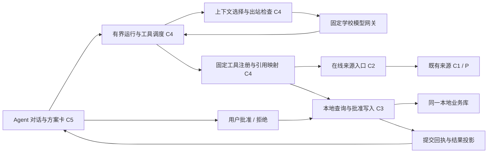

# M5 任务单：学生事务 Agent 与受控运行环境

状态：2026-10-13，总方案已批准，真实 toolReady 已核验，M5.1–M5.6 工程已完成并通过根最终检查。用户要求修订紧凑对话布局后持续工程、每片非人工测试保留、整个 M5 交付后统一真人体验，当前待该最终验收。总方案提案提交为本地 `5680d92`，M0–M4 已验收关闭。本文件是 M5 唯一任务单；批准与验收分开，实际实施/失败/检查写 records，M5 尚未验收关闭。

## 1. 目标与设计依据

M5 将默认 Agent 页接成真正可用的学生事务助手：用户用自然语言查询日程、任务和公开信息，获得带出处的回答，提出个人安排或任务时间规划，经可审查的确认后写入同一本地业务库。Agent 的效果不仅取决于模型回答，还取决于应用能否控制工具权限、上下文、提交事实、取消、历史和故障恢复。

| 依据 | 本阶段如何落实 |
|---|---|
| [07 产品约束](../../architecture/07-constitution.md) | 五条来源及本地业务保留；学校只读，密码/Key 分用途保护，单账号、北京时间、用户主权和来源连续性不变 |
| [08 目标架构](../../architecture/08-target-architecture.md) | C4 只调用 C2/C3/C0；不直接访问来源适配器、SQL、浏览器或任意文件；继续单 Flutter/Dart 工程 |
| [09 K-04/K-06/K-07](../../architecture/09-contracts.md) | 来源全局租约、模型 Key 固定出口、事务幂等、维护屏障、受控公开引用及知识库修订守卫 |
| [10 运行链路](../../architecture/10-runtime.md) | 模型运行与来源作业分开；清历史、清业务、重置先拒新并排空，迟到结果不能恢复已清资产 |
| [11 组件设计](../../architecture/11-component-designs.md) | 分开运行、等待用户、资源收口和提交事实；不以模型文本、来源 complete 或 UI 显示成功替代事务回执 |
| [12 横切约束](../../architecture/12-cross-cutting.md) | 本地事实、秘密、出站、历史、审计及安全展示的责任归属不变 |
| [13 验证登记](../../quality/13-risks-and-acceptance.md) | 重点补 V-02/04/05/06 的 Agent 部分，自动与真人证据分开，不关闭未覆盖的整体 V 项 |
| [14 审查方法](../../reviews/14-overall-review.md) | 机械一致性、场景走查、必要独立复核、根核实与裁决；不重复历史固定代理数量 |
| [15 项目工作流](../../workflow.md) | Sol / max 总负责，Luna / max 承接明确小块，Astra 按具体重大风险复核；根负责集成验收与本地提交 |
| [M4 任务单](../m4/plan.md)与[验收](../m4/acceptance.md) | 默认 Agent、Agent/日程两主页，任务在日程内，设置为辅助入口；沿用用户认可的画布、配色、教学时间轴和交互 |
| [来源参考](../../reference/sources/README.md)与[校园文本决定](../../decisions/public-text-knowledge.md) | M3 内部能力通过 Agent 正式使用；固定 7 项长期文本，时效通知只在线读取，财务搜索/FAQ 保持 unavailable |

已批准的修订继续有效：普通 WebView 边界不恢复 CAL/全协议封闭；JW/Young 共享学校密码但独立核验和分区；Young 只同步活动关联日程；定时重叠默认冲突、显式不冲突优先、全天不参与；教室优先展示且教务教师信息保留。M1 非空考试获批准后补，M5 不凭空补记通过。

## 2. 已批准首版边界

### 2.1 本次交付

| 用户需求 | M5 交付结果 |
|---|---|
| 自然语言对话 | 学校模型网关、受保护 Key、实际可用模型选择、流式回答、停止生成、明确失败与新一轮重试 |
| 查个人事务 | 日程窗口与详情、课程教室/教师、任务/截止/状态、规划块、冲突和来源新鲜度；消费与日程页相同的业务投影 |
| 查校园公开信息 | 评课课程/教师检索及详情/点评，教务与财务已登记栏目/文章，精选长期知识库检索/正文；显示出处、日期、版本、覆盖和未知适用性 |
| 管理本地业务 | 个人日程、Task、PlanBlock、出勤/听讲/备注/隐藏、冲突关系的受控变更；先展示具体方案，批准后由 C3 原子提交 |
| 安排任务时间 | 用户发起的有界规划：读当前日程与任务、找空闲窗口、生成时间块方案、提示冲突与未满足条件，确认后提交，可用现有受控撤销 |
| 请求刷新来源 | 用户明确要求时，复用 JW/Young 自动认证、选期/日期范围和 C2 同步/活动查询；学校挑战仍交用户，不隐式刷新所有来源 |
| 连续使用 | 本地会话列表、消息与结果卡、有限上下文整理、显式规划偏好、中断说明、重启后可查看历史并按新请求重新核验 |
| 维护与收口 | 单独清 Agent 历史/模型 Key，复用清业务与完全重置；旧流、工具、批准和摘要不能迟到复活 |
| 质量与诊断 | 合成场景评估、真实模型能力验核、安全计数/耗时/稳定失败码；不增加云端追踪或遥测出口 |

首版采用**单 Agent、有界工具循环、应用控制的审批和业务事务**。运行中的分析步骤、工具调用和检查可以不同，但不为每个角色增加独立模型调用。实施团队的 Sol/Luna/Astra 分工与产品内 Agent 的模型选择是两件事。

### 2.2 留给后续阶段

多 Agent 团队、用户自建工具/MCP/插件、任意浏览器或代码执行、通用互联网搜索、文件上传/运行时 OCR/下载管理、自动知识库扩充、向量库/Embedding、隐式长期画像、后台定时自主执行、跨进程长任务自动续跑、系统提醒及移动端不纳入本次。

学校业务写操作继续不提供，包括报名/退选、选课、提交表单、评课发帖和财务业务办理。Agent 可解释材料并提供来源链接，用户自行办理。原图中的公司案例及 Prompt→Context→Harness 阶段叙述作为讨论背景，不作为本项目新增权限或已验证事实。

## 3. 开源实现调研与技术选择

调研日期为 2026-10-13。“成熟”按维护的公开仓库、可读取的实现、文档与发布记录判断；不以星数或示例跑通代替本项目兼容性。下列是机制参考，未安装、复制或装配任何框架。

| 项目与一手资料 | 已查证的机制 | 本项目采用与取舍 |
|---|---|---|
| [OpenAI Agents SDK](https://github.com/openai/openai-agents-python)，MIT；[运行循环源码](https://github.com/openai/openai-agents-python/blob/main/src/agents/run.py)、[人工审批示例](https://github.com/openai/openai-agents-python/blob/main/examples/agent_patterns/human_in_the_loop.py) | 有界模型—工具循环、待审批中断、运行状态与会话区分 | 借鉴 Runner/Tool/RunState 的语义；不引入 Python/TS 运行时，不把框架状态替代 C3 回执与权限 |
| [LangGraph](https://github.com/langchain-ai/langgraph)，MIT；[持久执行](https://docs.langchain.com/oss/python/langgraph/durable-execution)、[interrupt](https://docs.langchain.com/oss/python/langgraph/interrupts)、[实现](https://github.com/langchain-ai/langgraph/blob/main/libs/langgraph/langgraph/types.py) | 检查点与人工中断；恢复可能重新进入节点 | 借鉴持久步骤和恢复前复验；不把 checkpoint 当作“未执行”证明，写入重放必须查 C3 回执 |
| [Vercel AI SDK](https://github.com/vercel/ai)，Apache-2.0；[工具及审批](https://ai-sdk.dev/docs/ai-sdk-core/tools-and-tool-calling)、[ToolLoopAgent](https://github.com/vercel/ai/blob/main/packages/ai/src/agent/tool-loop-agent.ts) | 步数上限、类型化工具、独立审批请求/响应 | 借鉴有界循环和 UI 审批交接；不搬入 TS 服务或以模型的 approval-response 代替应用用户决定 |
| [LangChain.dart](https://github.com/davidmigloz/langchain_dart)，MIT；[Executor](https://github.com/davidmigloz/langchain_dart/blob/main/packages/langchain/lib/src/agents/executor.dart)、[ToolsAgent](https://github.com/davidmigloz/langchain_dart/blob/main/packages/langchain/lib/src/agents/tools.dart) | Dart Agent/Tool 抽象、迭代/时间上限、工具解析 | 可作为 Dart 实现对照；通用执行器不具有本项目的持久审批/业务守卫，不作为首版事务编排依赖 |
| [Flutter AI Toolkit](https://github.com/flutter/ai)，BSD-3-Clause；[函数调用示例](https://github.com/flutter/ai/blob/main/example/lib/function_calls/function_calls.dart)、[包信息](https://pub.dev/packages/flutter_ai_toolkit) | 聊天 UI、流式消息与函数调用回调 | 参考交互组织；已有 Flutter 壳更适配本项目，默认 Provider 与包平台声明不能证明 Windows/学校网关兼容 |

建议继续采用原生 Dart，在 C4 实现小型受控运行环境，复用现有 SQLite、Markdown 渲染、平台保护及 C2/C3。实现重点是本项目新增的调用/批准/世代边界，不重写通用模型平台或图执行框架。若某轻量依赖能减少 SSE/类型解析成本，Sol 先核验许可证、Windows 支持、隐藏出站/日志和取消能力，再固定版本；不默认整体升级现有包。

[OpenAI 官方审批说明](https://developers.openai.com/api/docs/guides/agents/guardrails-approvals)把校验与人工审批区分；[官方可观测性说明](https://developers.openai.com/api/docs/guides/agents/integrations-observability)说明 SDK 默认追踪可能记录模型/工具数据。本项目只借鉴边界，在应用自己的本地安全摘要中观测，不启用外部追踪。

## 4. 学校模型网关：先确定能力，再接工具

### 4.1 当前可证与仍未知

校方[API 指南](https://llm.ustc.edu.cn/guide/api-usage/)给出 `https://api.llm.ustc.edu.cn/v1`、Bearer Key、`GET /models`、`POST /chat/completions` 和流式示例；[协议指南](https://llm.ustc.edu.cn/guide/protocol/)列举的是 OpenAI 兼容接口。它们不能证明每个可用模型都支持完整工具调用、严格 Schema、usage 或相同推理参数。

[模型指南](https://llm.ustc.edu.cn/guide/models/)当前列出 DeepSeek-V4-Flash、Qwen3.6 系列和 DeepSeek-V4-Pro，指南中的名称不是已验证的本用户可用 API ID。建议把高效通用模型作为候选，经本机能力和场景评估后选择默认；不按本对话的 Sol / max 设置产品模型，也不承诺模型/价格长期不变。

学校网关是唯一模型出口。OpenAI [function calling](https://developers.openai.com/api/docs/guides/function-calling)的结构化协议可作参考，但不能因“OpenAI 兼容”就假定支持 Responses、strict、托管工具或远端会话。首版优先实现校方公开确认的 Chat Completions 适配，不新增未批准网关。

### 4.2 M5.1 必须完成的能力验核

用户只在应用设置中提供 Key，不在聊天、工具或 Codex 消息里提供。明确启动的真实模型验核只发送合成文本/工具数据，不携带正式日程。应用返回脱敏能力摘要，根不读取 Key、认证头或原始响应。

| 验核项 | 通过条件与失败处置 |
|---|---|
| 固定 HTTPS 目标 | 精确 host/443/固定路径，无 userinfo/模型指定 URL；带 Key 的 3xx 拒绝，不跟随；TLS 与现有代理不降低 |
| Key 与模型 | Key 有效、实际列表/模型 ID 可核对；无权限/额度等分别报告，不猜测或自动换服务 |
| 普通/流式文本 | 增量拼接、完成标志、UTF-8 分段、错误与停止可区分；中断文字不记完整回复 |
| 原生函数调用 | 工具名称、调用 ID、分段参数、tool result 续轮可用；本地严格验证参数，不从普通回答文本正则提取执行指令 |
| 多工具/格式边界 | 多调用、坏 JSON、未知名称、缺参数、拒答、长度截断有确定处理；unsupported 参数不被悄悄替换成宽松执行 |
| 推理与计费字段 | 仅声明实际支持的参数；usage 缺失保持未知，不把推理原文保存/显示为任务进度 |
| 取消与异常 | 正常停止、超时、429、断流及应用关闭后无迟到调用；错误只投影固定码 |

能力分级为 `chatOnly` 与 `toolReady`。普通聊天通过可先验收 M5.1；M5 的查询/写入闭环关闭必须有 `toolReady` 模型。若候选不支持原生工具，禁用工具并另选同网关的已验证候选；不能用“让模型输出 JSON 再当命令”绕过此门槛。没有合适候选时将具体缺口交用户，不以合成模型替代正式能力。

### 4.3 Key 与配置契约

新增模型配置由 C3 唯一持久管理：受控 gateway ID、实际 model ID、配置修订、能力版本、受保护 Key 密文及保护元数据。配置与 Key 更新在同事务提交；保护/SQL 失败保留旧值。新 Key 可先用于用户主动的最小合成校验，成功后才替换持久事实。

复用 DPAPI 的平台原语，但模型 Key 使用独立用途和类型，不能复用学校密码租约、保护用途或 C1 认证出口。解密只交 C4 固定请求的不可序列化短期使用出口，用后收口；不回填保存的 Key，不保存明文或完整请求头。删除 Key/切模型推进配置修订，使旧请求与未执行方案失效；删除 Key 保留日程、学校密码和历史。配置授权不允许模型自己修改服务、Key、权限或预算。

## 5. 将附图的六层落实到现有架构

| 六层 | 实际职责 | 首版判断标准 |
|---|---|---|
| 上下文边界 | 版本化系统规则、当前用户问题、少量相关历史/摘要、按需工具结果；业务引用与秘密留在本地 | 不默认送整份课表/任务/知识库；来源数据不能升级成系统指令 |
| 工具系统 | 固定工具 Schema、调用校验、授权、引用/游标映射、稳定结果和引用卡 | 模型没有任意 URL、SQL、文件、脚本或用户批准能力 |
| 执行编排 | 单运行循环、步骤/耗时预算、同一运行的审批或学校挑战接续、可靠终态 | 不无限调用，不把 source idle 与 Agent idle 混为一态 |
| 记忆与状态 | C3 会话/步骤/方案/回执关联，历史摘要和显式偏好分类 | 会话文字、业务事实和批准权限不能互相替代 |
| 评估与观测 | 确定性场景/故障测试、受控真实模型验核、本地安全指标 | 从外部契约和用户结果验收，不以模型自评或测试数量宣布通过 |
| 约束与恢复 | 提交前守卫、停止/维护/历史世代、回执对账、重启中断说明 | 已提交可查，未提交拒旧，恢复不自动重放批准或业务写 |

“目标理解→信息检查→处理→输出→结果核验→必要修正”在一个有界循环中完成。普通问答可直接结束；只有确需工具才调度。不先强迫模型为每个问题生成长计划或暴露内部思考；复杂事务用可见执行清单与方案卡说明实际步骤。

## 6. 内部接口与模型可见契约

下列为总体接口语义；M5.1 已落实模型/会话/世代部分，后续字段由 Sol 在相应切片施工前定稿。C4 核心不依赖 Widget，C5 只消费投影与用户操作端口。

现有工程可复用与必须新增的边界已按源码核对：

| 已有端口/实现 | 可复用内容 | M5 必须补齐 |
|---|---|---|
| [LocalCalendarPort](../../../app/lib/core/calendar_contract.dart)、[LocalCalendarStore](../../../app/lib/data/local_calendar_store.dart) | `query/detail/prepare/commit`、CalendarContext、目标版本和事务回执 | 模型窄化读端口、方案批准绑定及有界批量事务；不能把普通命令里的 `confirmed: bool` 当真人批准 |
| [LocalTaskPort](../../../app/lib/core/task_contract.dart)、[Undo 实现](../../../app/lib/data/calendar_undo_store.dart) | `queryTasks/taskDetail/queryUndo`，Task/PlanBlock 命令，最近一次/24 小时的受控撤销 | 新任务与时间块的方案内依赖、同聚合动作版本处理、整组逆操作；继续使用同一撤销槽 |
| [PublicQueryPort](../../../app/lib/core/public_query_contract.dart)、[KnowledgeReadPort](../../../app/lib/core/knowledge_contract.dart) | `searchCourses/readCourse/browseCampus/readCampusArticle` 与 `searchKnowledge/readKnowledgeMaterial`，受控引用/游标 | 固定工具参数与安全结果适配，模型交付前的 history/run/授权复验；不扩大来源能力 |
| [WorkLeasePool](../../../app/lib/core/work_lease.dart)、[维护协调器](../../../app/lib/jobs/application_maintenance_coordinator.dart) | C2 单来源租约、维护 busy-before-intent、持久删除/回执与恢复 | 独立 Agent 所有权、停止/排空挂钩与历史维护，不把 Agent 整轮塞入同一来源池 |
| [Runtime](../../../app/lib/app/demo_runtime.dart)、[ProductApp](../../../app/lib/app/product_app.dart) | 组合根、日程/设置 builder、默认 Agent 空壳和现有关闭顺序 | `agentBuilder`/页面端口，模型与历史装配，先排空 Agent 再关闭依赖 |

M5.1 已在 schema 10→11 添加独立模型配置和 Agent 会话/运行/历史账本；后续证据与方案仍按切片增量迁移，不搬迁正式记录。

| 端口 | 提供方 / 使用方 | 最小语义 |
|---|---|---|
| `ModelGatewayPort` | C4 传输适配 / C4 Runtime | 接收已过出站检查的固定模型请求，流式返回文本/工具参数/完成/usage；支持 cancelAndDrain，不暴露 Key 或原始错误 |
| `AgentConversationPort` | C3 / C4、C5 | 创建/列出/读取会话，持久安全消息和运行步骤；复验 owner/reset/history 世代；清历史有持久意图与排空 |
| `AgentRuntimePort` | C4 / C5 | start、stop、批准/拒绝、继续当前学校挑战、观察实际状态；新输入不能伪装成应用批准 |
| `AgentLocalReadPort` | C3 适配 / C4 | 同一日程/任务/冲突投影，受控引用、范围/截断/新鲜度；不返回账号、密文或数据库 ID |
| `AgentSourcePort` | C2 适配 / C4 | 固定类型查询/明确同步、当前 busy/人工等待/收口；只取消本运行拥有的来源句柄 |
| `AgentPlanPort` | C3 受控业务服务 / C4、C5 | prepare 返回不可变规范方案与本地版本；用户 approve 后 commit，业务/批准消费/审计/回执同事务；支持查已有回执 |
| `AgentEvidencePort` | C4 映射 + C3 历史 / C5 | 区分可继续读取的活引用与只作历史展示的证据；标题/出处/定位来自已交付材料，不信模型编造 URL |

### 6.1 运行与工具结果

内部 `RunContext` 至少关联应用目录 owner、resetEpoch、historyEpoch、conversation/run 世代、模型配置修订、工具注册版本和当前授权。日程读/写再带 agendaEpoch/必要目标或快照版本；知识读取带 knowledgeEpoch/材料修订；在线结果保持原 C2 作业戳。内部值不序列化为模型参数。

全部清历史推进全局 historyEpoch，删除单会话只推进其 conversation 世代，停止仅作废当前 run；不因删除一个非活动会话取消其他会话的运行。保存的规划偏好独立修订，方案使用它时绑定该修订；偏好变更需要重新准备。完全重置复用 C3 resetEpoch 的全局拒旧边界。

模型只看到应用签发的短期引用，例如 `event_ref`、`task_ref`、`evidence_ref` 和受控 cursor。C4 映射到真实内部引用，拒绝未知/过期/跨运行伪造值；模型不能给出 accountId、owner、epoch、operationId、SQL ID 或审批令牌。新一轮重新签发，不能把历史中出现的引用当当前权限。

统一工具结果包含固定 `status`、有界 `data`、证据引用、范围/截断/可续读说明以及必要失败码。至少区分成功、完整空、busy、需授权、需学校人工操作、不可用、访问受限、过期、取消、限额、结构/网络/存储失败。`unavailable` 或未读取不能表示“没有信息”。结果经过模型安全投影后才入上下文。

### 6.2 建议首批工具族

| 工具族 | 模型可见输入 | 权限与输出 |
|---|---|---|
| `query_agenda` / `read_event` | 北京日期范围、种类/状态、有界数量 / 活引用 | C3 同一日程投影；地点/教师/观察状态；详情按需读，不预加载私人备注 |
| `query_tasks` / `read_task` | 固定状态、关键词、数量 / 活引用 | Task 与 PlanBlock 状态分开，截止北京时间，返回版本绑定引用 |
| `inspect_conflicts` / `find_free_slots` | 有界窗口、时长及用户显式偏好 | C3 共享冲突语义；全天不占定时冲突，显式不冲突优先；空闲计算表达采用的过滤/条件与未覆盖范围 |
| `search_knowledge` / `read_knowledge` | 关键词、固定提供方/主题、数量 / 引用和受控续读 | C3 已接受长期 Markdown；材料未载入/已清空单独说明，不隐式载入 |
| `search_courses` / `read_course` / `read_reviews` | 必要课程/教师词 / 引用、真实学期/排序与 cursor | C2 评课首次授权后只读；同名不同教师不合并；不发送学号、整份课表或备注 |
| `browse_campus` / `read_campus_article` | 固定栏目、可用关键词、数量 / 活引用 | 教务关键词可用；财务按已验栏目/条目，关键词/FAQ 不伪装可用；文件只给已核验链接 |
| `query_young_activities` | 固定查询条件/有界数量 | C2 Young 独立核验；活动列表不宣称本人报名成功；不提供报名动作 |
| `request_source_refresh` | 固定来源，已保存或受控选择的学期/日期范围 | 先生成应用刷新卡，用户确认具体来源/范围后才启动；C2 可用已授权密码，模型看不到账号/秘密；挑战暂停不绕过 |
| `propose_local_changes` | 固定动作枚举、草案值、当前目标引用 | 只准备具体方案，无业务写；C3 规范化/冲突检查后生成用户方案卡 |
| `propose_undo` | 本地签发的当前可撤销引用 | 只准备撤销卡；复用单次受控撤销，不回滚数据库或学校事实 |

工具表按任务和当前能力筛选，同一模型请求只带相关定义。首版工具顺序执行，避免共享来源租约和写入歧义；不同只读能力是否并行须有测量和独立状态契约，不预先增加复杂度。

## 7. 本地写、批准与规划

### 7.1 已批准默认审批政策

已告知出站/第三方权限后的普通只读查询不逐工具弹窗。**首版所有 Agent 本地写都先生成方案卡，用户一次批准一个有界方案**，包括新增日程/任务、修改状态/备注、隐藏、移动/删除、关系与时间规划。模型不能执行批准接口，外部资料和历史“同意”不能构成批准；修改方案必须重新确认。

学校来源刷新是既有采集/导入用例，不是任意模型写命令：Agent 先提出具体来源与学期/日期范围，由应用刷新卡取得本次用户启动许可，再走原 C2 自动链路。自然语言中的需求由模型识别，但不能靠模型自报“用户已授权”产生许可；不因普通查日程或外部文本要求而隐式启动同步。普通已授权在线只读查询无需此刷新卡。

模型 Key、学校密码、来源许可、第三方同意、清库、清历史和完全重置继续由设置或明确应用入口操作，不注册为模型可调用的危险维护工具。拒绝方案只取消该方案，保留数据；已提交后的“取消”不当作撤销。

### 7.2 方案与提交契约

规范方案至少包含受控方案身份/版本、所属 run、不可变动作集、目标当前版本、reset/agenda/history 与模型配置/必要权限版本、依赖的日程窗口修订、实际变更前后摘要、影响范围、冲突/未知提示和过期条件。动作最多 20 项作为初始预算；创建/移动的北京时间、重复范围、全天语义、Task/PlanBlock 关联明确展示。

用户在方案卡点击批准时，应用产生一次性决定，不接受模型参数里的 `approved=true`。C3 执行事务复验所有相关守卫、动作内容和版本；批准消费、业务变更、必要审计和稳定操作回执同事务提交。同一操作重放返回原回执；同 ID 改意图拒绝；任一动作失效整体零提交。不会先写部分动作再让 UI 假报整组回滚。

首版支持对已经由 M4 验收的命令进行适配，不直接修改来源课程/考试的名称、时间、地点或教师；学校事实只能由相应同步更新。个人重复事件必须区分整组与单次例外，默认缺信息先澄清；隐藏与删除、Task 完成与时间块 done/skipped 不混用。来源缺失仍可见并参加原有冲突规则。

若现有命令只有单聚合事务，Sol 增加有界计划提交服务并复用内部验证/变更逻辑；不通过多个独立外部 `execute` 调用冒充原子批量。不扩展为任意事务脚本或通用工作流框架。撤销只覆盖该计划可证明的本地变更，复验目标及关联范围版本；后续人工修改/来源更新使其失效时明确拒绝。

“新 Task＋两个 PlanBlock”不能在准备阶段伪造尚不存在的 TaskReference。方案内允许 C3 规范化的局部创建标识，时间块仅可依赖本方案新任务或已经核验的任务引用；同事务创建后解析为真实身份。拒绝未知/循环依赖及含糊重复动作。已有同一 Task 的多个动作先核验一次外部基线，再按批准顺序维护事务内版本，不能把自身前一动作误判为外部修改；任一失败整组回滚。

现有 Undo 载荷是单动作并覆盖同一槽。M5 将它扩展为版本化的整组逆操作和最终聚合/关系版本守卫，在一次事务内撤销整组，继续沿用最近一次与 24 小时期限；不能逐动作 `_recordUndo` 后假称可撤销整个方案。旧合法单动作槽兼容读取；新手动写/方案仍按原规则替换最近一次槽。首版注册的批量动作组合必须有整组撤销证据，不支持的组合在准备时拒绝，不降格成部分撤销。

### 7.3 有界时间规划

示例：“这周找两个晚上，各安排一小时复习，别和课冲突。”运行先解析有歧义的日期/时长并澄清，读取相应当前窗口与 Task，再由确定性服务枚举满足条件的空闲候选。模型选择并解释候选，C3 重验具体时间块。不能宣称全局最优，也不能为了“找出方案”隐藏已有日程、标不冲突或改变用户状态。

规划条件首版为截止/时长/分块、指定日期或时段、用户显式偏好、当前日程/冲突。硬约束违反不提交；软偏好无法满足时展示差异并让用户选择。不进行无人值守长期重排，普通规划不隐式采集学校最新数据；新鲜度不足时说明或询问是否刷新。

空闲与成对冲突是不同问题：已有两个日程被用户标为“不冲突”并不会把其时间变成空闲。默认空闲候选避开所选有效投影内的定时日程，明确是否包含隐藏/跳过项；截断窗口不能宣称找到了完整无冲突时段。全天按已批规则不进入定时占用，模型不得自行改变关系或出勤以腾出空档。

显式长期偏好限于用户主动保存的学习时段、单块时长、休息间隔和避开时段等结构化条件，独立版本化、可在设置查看/编辑/清除；Agent 建议保存也须方案确认。不从聊天暗中学习兴趣/身份/行为画像，不把摘要推断写成长期事实。

## 8. 上下文、隐私与引用

### 8.1 每次模型请求的组织

顺序为版本化系统规则 → 当前用户请求 → 必要会话摘要与最近完整交互 → 本轮结构化工具结果/方案状态。固定北京时间和应用能力由系统控制；检索文本与点评放在明确的数据位置。已提交事实从 C3 回执重建，待批准方案从应用状态重建，不由摘要重述来授权。

只有需要的日期窗口、字段和资料片段进入模型，不默认发送所有课程、任务描述、私人备注、全库 Markdown 或原始学校响应。私人备注/任务正文默认留在本地，确需处理时用户可以仅对本次允许提供选定文本；不因此打开全部记录。首次启用 Agent 清楚说明会向学校模型网关发送本次问题、必要历史和被请求的业务字段，后续普通查询不重复泛化确认。

用户输入在持久化与发送前做秘密检查：可识别的 Key/密码/认证资料提示移除或用脱敏版本重新发送；输入框不接管凭据用途。检索参数、工具结果、历史和生成摘要也经出站检查；漏检不能作为授权，项目不承诺通过正则识别所有任意秘密。Key/学校密码、密文、认证资产、内部账号/作业戳不进入模型、会话、安全审计或日志。

按需检索先返回候选/摘要，再读取匹配内容；有多个同名课程/任务先提供区别并澄清。现有中文文本检索支持首版 7 项知识库，不先搭向量服务。搜索改写限当前提供方与主题，最多一次有依据的关键词调整；结构/权限失败不通过反复搜词掩盖。

### 8.2 上下文整理与存储分开

本地保留安全会话内容；每次请求只选择有限内容。长会话采用最近完整工具交互加可重建摘要，不能切开 tool-call/tool-result 配对；摘要标注来源区间、摘要版本、history/agenda/knowledge 依赖和是否待刷新。模型摘要只作压缩，不作事实、批准或当前业务引用。

在线完整工具结果、评课快照和分页游标仍只在有界运行缓存中存在，不建立独立持久检索历史或评论库。持久对话保留用户消息、已展示安全回答、必要引用元数据/被引用片段及步骤状态摘要，不复制全部中间结果。活跃运行可使用完整有界工具配对；跨运行/重启只用安全会话与可重建摘要，需要当前材料时重新查询，不能把历史片段恢复成当前来源快照。

历史中的学校观察、旧规划和材料可能失效：新一轮再查相应服务；摘要中涉及已清业务/知识的依赖作废，不以历史正文恢复它们。旧事实可作为明确标记的历史供用户查阅，不能送入当前行动上下文冒充最新状态。普通历史文字不持有活引用/游标/秘密租约。

初始建议单请求输入约 8k token、输出不超过 2k token，整个运行最多 8 次模型调用、16 次工具调用、20 项变更。上下文上限还须取实际模型已验证窗口并为输出/工具留余量；token 计量不可用时使用保守字符/字节限制并明确估计。输入超限优先收窄/整理，不静默删掉当前问题、规则或必要待处理结果。参数由 M5.1/M5.2 的合成性能证据校准，属于技术调节，不宣称现已实测。

### 8.3 证据卡与安全 Markdown

正文使用现有受限 Markdown 展示，来源引用由应用为已交付证据签发。引用卡包含提供方、标题、原文/材料链接、可证日期、读取时间、本地版本/定位、覆盖和未知适用性；评课保留学期/排序/样本范围，评分人数与点评数量独立。

模型只能引用本轮已签发证据，未知引用标记无法验证；模型生成的任意 URL 不获得抓取或自动打开权限。正文和证据卡不自动加载远端图片、执行 HTML 或获取附件；外链按用户点击及既有来源规则处理。引用可展示不等于仍允许续读，旧引用过期后必须重新检索。

行动结果卡只由真实 C3 回执/C2 结果构造。“已保存/已导入”的权威是回执；模型回答不能覆盖提交状态。材料日期/适用性未知明确显示，不把老制度、在线通知或个别点评生成的意见表述为学校最新确定事实。

## 9. 运行状态、并发与失败恢复

### 9.1 单运行状态机

首版同一应用至多一个活动 Agent 运行，等待批准/学校挑战期间仍占 Agent 运行所有权。C2 来源租约独立：仅实际在线查询/同步占用；模型推理、本地读和等待本地批准不占 C2。手动来源作业可独立开始，但 Agent 的旧读取/方案必须在使用或提交时复验版本。

| 状态 | 可做什么 | 终结或接续 |
|---|---|---|
| `preparing` | 校验配置/出站/会话守卫，持久启动记录，组装必要上下文 | 失败不发模型请求 |
| `generating` | 有界接收模型流与工具参数 | 完整工具请求才进校验；分段 JSON 不执行 |
| `executingRead` | 调用固定 C2/C3 工具 | 结果交付前复验，busy/失败不能伪装空态 |
| `waitingForApproval` | 展示不可变方案，等用户批准/拒绝 | 批准后 C3 重验；拒绝/过期不会写入 |
| `waitingForSchool` | 展示原学校目标，等挑战完成/用户继续 | 保持同一 C2 作业；模型和文本不能替用户完成授权 |
| `committing` | C3 同事务提交批准的计划 | 以提交回执与取消先后裁决，UI 不先宣布成功 |
| `settling` | 保存可证结果并排空模型/所属来源与临时能力 | 收口成功才释放 Agent 所有权 |
| `recovery` | 只重试必要收口/回执读取，阻止第二运行 | 不重新生成并自动提交原方案 |
| 终态 | `completed` / `cancelled` / `failed` / `interrupted`，并分别保留已提交事实 | 新请求生成新运行，不复用旧批准 |

澄清问题作为当前轮的完整回复结束，不持有空闲来源资源；用户答复启动新轮。切换页面/查看其他会话不取消运行；新会话发送须先停止并收口当前运行。运行中改问题通过“停止后发送新请求”处理，首版不引入任意流中插入/多运行竞争。

活跃执行初始预算为 180 秒，等待用户时间另计；每个模型请求有首字/闲置/总时长限制，C2 保留现有来源预算，超预算停止新增步骤并收口。达到预算提示已完成/未完成范围，不自动开新运行绕过上限；一次继续由用户新请求触发。

### 9.2 确定的故障出口

| 反例 | 应用结果 |
|---|---|
| 流断开、拒答或输出达到长度上限 | 保存标注的部分回复，未收齐参数不执行；可发起新轮，不假记完整完成 |
| 未知工具/坏参数/权限缺失 | 拒绝该调用并给固定结果；最多一次明确修正，不能无限纠错或扩大权限 |
| 相同无进展调用反复出现 | 依据规范参数和结果检测循环，停止并说明当前限制 |
| 429/短暂网络错误 | 仅未交付结果的模型请求可按原预算重试一次，尊重 Retry-After；流已部分交付则结束并标中断，不拼接两次不同生成 |
| 401/403/3xx/TLS 或协议错误 | 固定失败，无跨网关、降 TLS 或重新转发 Key 的回退 |
| 来源 busy 或收口失败 | 不取消别人的作业；显示等待/失败；本运行的清理失败进入 recovery |
| 批准后目标/窗口/权限变化 | 整体零提交，刷新证据并形成新方案/新批准，不沿用旧点击 |
| 提交成功但保存最终回答失败 | 保留业务提交；通过稳定操作回执恢复结果卡，不重做写入，不假报零修改 |
| 取消早于提交 / 提交早于取消 | 前者未提交；后者 committed，停止可停止的后续，不倒写业务事实 |
| 关闭后旧流/查询/摘要/批准到达 | 世代与所有权复验拒绝，不能追加历史或业务 |

网络重试、工具修正、审批接续共享原 run 预算，不能每次重试重置计数。模型调用失败后也不重复执行已成功的来源采集或本地动作。

### 9.3 已批准重启规则

持久化会话、安全步骤、方案概要和关联回执，但不序列化平台句柄、明文凭据、活引用或模型私有运行状态。启动先完成 M4.4 已确认的维护/分区恢复，再核对未终结 Agent 运行。旧批准和引用失效；未提交运行标 interrupted，不自动重新发网络请求或写入。

已提交步骤按 C3 操作回执恢复成功事实；未提交方案可作为历史草案展示，用户“重新准备”后重新查询并确认。首版提供可解释的重启与重新发起，不承诺把断流、学校挑战或长期模型任务从任意节点无损续跑。持久回执避免重复提交，不以它宣称任意外部行为 exactly-once。

对账先判断维护与 reset/agenda/history 世代，再查同世代回执。现有清业务会删除相应业务回执和审计；跨世代且回执缺失只能说明“相关业务与回执已清理，不能进一步核对”，不能推断从未提交或重新执行。仍保存的旧成功卡保持历史说明，不伪装当前数据；不为 Agent 对账改变现有清业务范围而永久保留完整意图。

## 10. C3 存储、迁移和维护矩阵

### 10.1 必要持久事实

在现行业务 schema 10 上按切片增量扩展，不创建第二套 Agent 数据库或搬迁正式记录。逻辑实体如下，实际表拆分、索引和字段在相应切片定稿，不用表数作为目标：

| 逻辑实体 | 保存内容与约束 |
|---|---|
| 模型配置与秘密 | 固定服务/模型/能力/修订、Key 密文及用途元数据；无明文 |
| Conversation / Message | 应用签发身份、顺序、角色、安全正文、完成/中断标记、创建时间；消息不携带执行许可 |
| AgentRun / ToolStep | 当前世代、版本/预算计数、固定动作/状态、关联受控操作、提交/收口结果；先登记步骤再允许副作用 |
| ChangeProposal / Approval | 不可变规范方案与预期版本、用户决定/消费状态；批准只能由应用受控入口生成 |
| Evidence / Summary | 必要出处/有界片段/定位和历史依赖，明确历史或当前；不保存整页原始学校响应 |
| PlanningPreferences | 用户显式接受的结构化条件与版本，和推断摘要分开 |
| 生命周期账本 | historyEpoch/配置修订与必要恢复意图；最小世代/操作高水位不被清历史回退 |

业务操作回执继续由 C3 本地服务权威管理，Agent 步骤只关联它。持久步骤与业务/回执之间的退出窗口通过事务或启动对账处理；不能因聊天持久化失败而把已提交业务再执行一次。记录安全正文与规范结果，不存 Cookie/Token、密码/Key、raw HTTP、完整模型原始响应或推理链。

UI 流增量先在内存有界缓冲，按块保存安全部分/完成状态，不每 token 开事务。SQLite 写失败停止新增工具副作用，保留固定错误和可查提交事实。会话/正文设定存储预算，达到预算提示用户整理，不静默删除用户接受的历史、知识库或业务；不会把上下文压缩等同删除本地历史。

### 10.2 删除/保留矩阵

| 操作 | 删除/失效 | 保留 |
|---|---|---|
| 清单会话/全部 Agent 历史 | 相关消息、摘要、证据缓存和未执行方案；推进 history 世代并排空旧模型/工具/审批；去掉相关活引用 | 日程/任务/学校密码/目录/分区、模型 Key、显式规划偏好及独立业务回执/审计 |
| 删除模型 Key | Key 密文及未消费出口；旧模型配置修订的请求/方案失效 | 学校密码、来源资产、业务/知识库、历史和偏好；配置可显示未就绪 |
| 清日程与任务 | 沿用 M4.4 固定业务范围及 epoch；关联 Agent 方案/当前引用/摘要依赖失效 | 历史仅作历史，模型 Key、学校密码/分区/目录、知识库及界面/显式偏好 |
| 清知识库 | 沿用知识库 epoch/文本/索引；相关 Agent 活引用与摘要依赖失效 | 日程/任务、学校和模型秘密、历史的已标旧证据、来源权限 |
| 完全重置 | 扩展 M4.4 固定 reset 范围，含模型 Key/配置、全部 Agent 历史/草案/偏好/缓存；先持久屏障、排空再删除 | 安装与应用目录所有权、必要容器、单调世代/ID 高水位及最小恢复账本；不触碰其他项目或系统浏览器 |

单独清历史先持久意图/世代，拒新相关运行，作废旧流/查询/摘要/批准，排空后删除；失败保留恢复状态，启动先恢复，不自动创建原会话。删除某会话只影响其运行，全部清历史影响所有；模型 Key/学校密码删除的影响分别说明。

维护仲裁必须保持现行顺序：

- **清业务/完全重置**沿用 M4.4 的 `leases.acquire()` 准入，来源占用时在持久删除意图前返回 busy；用户可先停止相应来源，不能为了维护偷取消别人的作业。维护租约取得后，C3 持久屏障与 Agent 守卫同阶段推进，作废并排空没有来源占用的模型运行/批准，再执行既有固定清理与 SQL。此时 Agent 不能重新申请来源。
- **清历史**使用独立的 history admission，先持久作废相关运行并拒新，取消并排空它拥有的来源子作业；不先占其要释放的同一 C2 lease，不影响独立手动来源。C2 已提交事实保持原裁决，历史删除不能把业务提交倒记为未提交。
- **关闭**先拒新并排空 Agent，再关闭它依赖的 C2/C3 和保护出口，最后才释放目录所有权。原生/来源收口失败保持所有权和 recovery；失败退出恢复订阅时不能复活已关闭 Runtime 或过期批准。

完全重置在 Agent 尚未装配时也须能清理新增持久事实；metadata-only bootstrap 能恢复待处理意图，不能为了清理先启动模型或业务页面。部分激活/失败退出的既有 M4.4 行为继续保留。跨版本迁移事务回滚、已有课程/考试/地点教师/覆盖/个人例外/任务块/撤销/密码目录/知识/设置保留用合成副本验证，不读取正式记录。回退前校验版本，不让旧二进制写入未来 schema。

## 11. 前端与日常使用

保留现有两主页与已验日程画布。Agent 页面把空壳接成消息区、输入区、停止按钮、工具实际进度、证据卡及方案卡；显示“查询中/等你确认/等学校验证/已提交但收口中”等真实状态，不显示伪进度或内部推理。

用户消息不另标“你”；查询步骤和出处默认合并在紧凑折叠区，展开后保留覆盖/未知/出处细节。对话正文、活动状态、停止和待批准方案保持直接可见，不能为节省画面把审批或失败事实藏进查询详情。

会话列表作为 Agent 内的辅助区域，在窄窗口可收起，避免压缩日程画布。新建/查看/清理历史与当前运行状态衔接；日程/任务详情可以“交给 Agent 讨论”，只传应用签发的选择和必要字段，不传裸数据库 ID。模型给出的日期/事件链接可打开同一日程详情，但不因点击旧消息获得写权限。

设置增加“Agent”区：学校模型服务、主动 Key 输入/保存/删除、已验证模型选择、首次出站范围说明、显式规划偏好和历史维护；原四区不移动其业务边界。固定目标不提供任意 Base URL 编辑，普通产品界面不要求用户配置 SDK、Schema、内部 epoch 或 Trace。

批准卡直接列出每条变化的名称、北京时间、地点、重复/单次、任务关联、冲突和影响范围；允许拒绝或回到编辑，不默认选中“始终允许”。个人字段修改不会把学校事实变成本地改写；保存后同一日程/任务页即时刷新，Undo 的可用/冲突状态来自同一端口。

新用户无学校账号时仍可启用模型聊天和允许的公开查询/已接受知识库；不能伪造账号放行来源。知识库为空时说明并提供进入设置主动载入的入口，不能自动下载/重建。需要学校挑战时展示既有可见窗口及继续/取消，用户前台工作不被自动接管。

## 12. 分切片实施与协作

所有切片先明确新接口、字段归属/版本、失败语义和合成验收，再派发明确小块。下面是依赖顺序，不是机械等待每个模型角色过一遍。

| 切片 | 范围与实际交付 | 依赖 / 验收出口 |
|---|---|---|
| M5.1 模型入口与最短对话 | 固定模型传输、独立保护 Key、配置/能力记录、最小出站过滤、会话/运行世代及启动恢复守卫、Agent 页实际流式聊天/停止 | 计划批准；合成网络/保护/取消通过；用户在应用提供 Key，以合成问题核验学校模型，记录 chatOnly/toolReady |
| M5.2 只读工具与证据 | 固定注册、参数/引用校验、本地日程/任务、公开查询/知识库、状态/覆盖、出站最小化、引用 UI | M5.1 toolReady；按需读/分页/空/失败/不可信文本/权限撤销/来源 busy 合成通过，真实少量问答可核对 |
| M5.3 本地批准写与撤销 | 规范方案、应用批准、事务复验/回执、个人/Task/PlanBlock/覆盖/关系写、单次受控 Undo | M5.2；拒绝零改、改方案重新批准、版本冲突、原子多动作、重复/退出窗口有独立证据 |
| M5.4 时间规划与来源编排 | 确定性空闲候选、显式偏好、有界任务分块，明确来源刷新/学校挑战接续 | M5.3；不隐式刷新/重排，全天/跨日/来源缺失/显式不冲突成立，来源互斥与取消接续不变 |
| M5.5 历史、上下文与维护收口 | 长会话整理、完整历史体验、部分回复、重启中断/回执对账、清历史/Key/知识/业务/reset 集成 | 基础世代/取消从 M5.1 已存在，本切补完整矩阵；旧回调/批准不复活，M4 资产连续保留 |
| M5.6 评估与正式集成验收 | 场景基线、根全套 analyze/test/相关 Windows/default Release、真实模型/产品体验、文档与本地提交 | 前五切实际证据齐全；性能/额度指标可解释；用户按少量真实场景验收后才关闭 M5 |

Sol / max 负责模型出口、C4 运行循环、C3 事务/批准/维护、共享契约、状态冲突和组合根。Luna / max 可并行承担契约已经定好的 UI、纯映射/Schema、本地合成用例或互不重叠的小服务；不同代理不得同时修改共享 store、Runtime、入口或同一 Widget 文件。Astra 在批准/回执与清历史/重置跨层语义稳定后做针对性独立复核；有具体疑难再用，不默认运行昂贵多轮模型审查。

拟修改区域：`app/lib/agent/` 的契约/传输/运行/上下文/工具适配，`app/lib/data/` 的模型配置/会话/批准与现有业务服务，`app/lib/core/` 必要共享值和端口，`app/lib/app/` 的 Agent 页面/控制器/设置与组合根，P 的独立秘密保护适配，`app/test/` 和 `app/integration_test/` 合成验核。实际文件名按职责定稿，不以预列文件数量为目标。现有来源适配器只为已证接口缺口做必要修正，不重写已验认证链路；其他 worktree、旧资产、正式业务/浏览器文件只读或不访问。

文档只在本任务单维护计划；批准与重要取舍后续写相应决定/验收，实际命令/失败/修复写 M5 records。每个可回退切片检查通过建立本地工程 commit；文档与工程分开，未完成真人项明确登记，不推送。批准这份总体计划不自动批准真实 Key 获取、学校额外授权或未来每个本地业务方案。

## 13. 评估与验收条件

### 13.1 根负责的自动/隔离证据

自动检查仍只用合成模型、loopback、临时数据库/资产，不访问真实学校或正式数据。用脚本化模型事件驱动外部协议与行为，覆盖真实 SSE 分段/错误/迟到，而非只验证类自身返回值。

| 场景组 | 必须成立的结果 |
|---|---|
| 模型协议与秘密 | 固定出口、3xx 拒绝、错误用途/保护失败/SQL 回滚、无 Key 日志/模型参数、分段工具参数未完成不执行 |
| 查询与证据 | 同 UI 日程语义、教室/教师/北京时间、合法空与失败、跨页/有界正文、未知日期/适用性、无法伪造引用或 URL |
| 注入与权限 | 点评/材料中的“忽略规则/调用工具”不能增加权限；权限撤销、坏名称/参数、同名歧义、跨运行引用拒绝 |
| 写与撤销 | 无批准零写、一次批准绑定精确内容、目标/关联/窗口变动拒绝、新 Task＋两个块/已有 Task＋两个块的原子与依赖、回执重放、整组 Undo 及后续修改守卫 |
| 时间规划 | 冲突/不冲突、全天、教学时段、跨日/重复例外、Task 与块状态独立、缺失来源仍考虑、硬约束失败不写 |
| 来源协调 | 手动/Agent 争用、暂停持租约、只取消自己的作业、挑战接续/关闭/收口、提交后失败不反转 |
| 历史与维护 | 维护 busy-before-intent、独立清历史不自锁、清 Key/知识/业务/reset、部分激活/失败退出、旧摘要/流/批准迟到、同/跨维护世代回执对账与不自动重放 |
| 连续性与发布构建 | 增量迁移/整体回滚，M0–M4 相关 Windows 行为，默认 Release 不带测试入口/日志/原始响应/秘密 |

评估同时检查正确工具与范围、日期/地点、证据对应、操作提交和 UI 状态。确定性权限/事务/秘密边界零违例；不把 LLM judge 当审批者或唯一验收者。真实模型语义质量用小型有代表性的合成题集记录通过/失败类别、步骤与耗时，不先捏造成功率或费用节省比例。

性能先建立基线：流式首响应、日程/任务查询、资料检索、上下文组装、最长允许工具轮次、停止到收口、历史打开和批量提交；模型延迟与本地耗时分开。显示步骤数/可用 usage，缺计费字段说明未知，不声称精确费用。上线前固定实际模型/能力与提示词/工具版本，模型替换先回归核心场景。

### 13.2 用户负责的少量真实验收

不让用户重复机械失败矩阵。用户只在应用提供 Key、处理学校挑战及核对自己知道的业务对应关系。建议最后集中体验：

1. 实际流式聊天可停止，再问“明天有哪些安排”，核对北京时间、教室/教师及本地日程一致。
2. 问一项缓考/证明/报销流程及一个课程/教师，确认引用可查看，版本/覆盖/未知状态可理解；财务搜索不可用不会假报无信息。
3. 让 Agent 创建一个测试任务并安排时间块，先拒绝一次确认零改，再批准，日程/任务即时更新；一次移动/撤销顺手，冲突提示准确。
4. 明确请求一个学校来源刷新，自动认证/学校挑战/继续与实际同步一致；无需把账号、密码或日程明细贴回。
5. 正常退出重启能查看历史与提交事实；仅清测试会话后已有日程、密码和知识仍在。正式 reset 不要求真人重做。

根通过脱敏能力/运行摘要和隔离工程证据记录，不读取实际私人记录。真实缺少非空考试、未关联 Young 样本、财务 FAQ 等仍按原登记后补，不由 M5 文本问答推断已验。

### 13.3 M5 关闭门槛

工具就绪的学校模型已实际验证；六个切片按批准范围交付；本地读写/公开证据/规划/历史维护贯通；根 analyze/test/相关 Windows/default Release 和文档检查通过；用户真实体验通过且明确关闭。已证故障修复或明确保留，不能仅因为 UI 能聊天、SDK 示例通过或模型自评满意关闭。

首版关闭限 Windows 用户发起的 Agent；提醒、移动端、正式部署及完整 V 项按各自范围继续。M1/M2/M3 已关闭事实与原失败不被覆盖。

## 14. 批准范围与实施接续

用户已批准以下总方向，具体技术参数由 Sol 根据实证在范围内校准：

- **范围**：查询/证据、本地批准写、有界时间规划、用户明确发起的来源刷新、历史与维护一并交付，采用 M5.1–M5.6 分切片；多 Agent、后台自主执行和系统提醒后续。
- **写权限**：首版所有 Agent 本地写均通过具体方案卡批准；只读在已告知权限和本次请求范围内自动执行。
- **记忆与重启**：保留安全历史/可重建摘要，长期偏好只显式保存；重启恢复已提交事实但旧批准失效，未完成任务重新准备而不自动续跑。

网关支持哪些模型/工具参数由 M5.1 实证确定，不要求用户猜协议，Key 仅在应用里主动提供。以下 M5.1 定稿规格用于本切施工；总方案批准不替代真实模型能力与用户产品体验验收。

## 15. M5.1 施工规格

本切落实 07–12 的秘密/所有权/维护红线、13 V-02/04/06、14 场景核对与 15 Sol/Luna 协作，及本总方案已批准的单 Agent、固定学校网关、历史保留/拒旧与源作业独立仲裁。新增共享契约 `core/agent_contract.dart`，C4 模型端口 `agent/model_gateway_contract.dart`，C5 展示端口 `app/agent_workspace_contract.dart`；C3 在同一 JwStore 中增量 schema 10→11，模型保护用独立类型/用途复用 Windows DPAPI 原语。

本切先交付受保护 Key、公开模型目录与合成能力验核、流式基本对话/停止、最小会话与历史清理、配置/历史/运行世代及维护/退出挂钩。模型提出的业务工具不执行；只允许显式能力验核中的固定 echo_probe 合成函数，本切未验证的工具能力与 M5.2 业务工具保持未启用。

生产模型请求固定 HTTPS api.llm.ustc.edu.cn:443 的 /v1/models 和 /v1/chat/completions，无地址输入、无重定向、无 Cookie/校方认证资产；使用已有代理环境，例外不输出原异常。自动网络测试只能使用显式 loopback 测试装配及合成 Key。SSE 在完整终结前不交付可执行工具，UTF-8/行/事件/整流均有界；EOF、length/refusal、timeout、cancel 与正常 stop 分开。原生工具参数本地检查，不依赖网关 strict 支持，不从普通文字提取命令。

配置先完成保护，再于同一保存事务复验 authority 和写入配置，失败保留旧 Key/模型；模型与学校密码不共享保护用途/租约。authority 包含 owner、reset/history/config 及独立 requestEpoch；停止在 C3 推进 requestEpoch，异步保护后的旧保存、准备中的旧 run 和未消费 Key 出口一并失效。网络注册前在每次异步 Key 交接后再检查当前运行。每个请求消费一次短期 Key 出口，使用后尽力零化；配置变更/停止/维护撤销旧请求。已保存模型的联网同意可在设置撤销或重新开启，撤销保留 Key/历史但作废运行并阻止新出站。对话输入保存前与出站前检查可识别秘密；不保存原 HTTP/完整模型响应、推理或认证头。流式正文有界保存，旧 RunTicket 经 C3 再验，终结/清理后迟到结果拒绝。

清历史持久作废相关世代，排空模型后完成删除，启动在开放 Agent 前恢复；它不占 C2 来源租约。清业务/reset 保留 M4.4 busy-before-intent，C3 意图同时作废 Agent，维护 runner 在删数据前排空模型；reset 包含新增 Key/配置/历史，清业务保留它们。退出先排空 Agent 再关闭依赖；失败退出不复活已关闭运行。新增账本与 ID/世代不因清理回退。

修改范围：根持有共享契约、C3 store/migration、C4 coordinator、C5 controller、Runtime/入口与维护集成；Luna / max 分别承接已经定稿的模型传输和新 Agent 页面/设置页面，互不改共享文件。独立合成用例可另交 Luna / max；Windows/全套/build 与最终核实由根执行。不会改其他 worktree 或直接检查正式业务记录。

本切完成条件：固定请求/保护失败/SQL 回滚、增量保留、跨重启历史、停止/清历史/配置变更/维护/退出迟到结果、分段 SSE 与 tool_probe 合成契约通过；新页面与设置可操作，正常构建不暴露测试服务。用户在应用主动提供 Key 后运行最小合成验核，报告 chatOnly/toolReady，核对真实流式聊天/停止。没有真实能力摘要时仅记录工程完成，不关闭 M5.1 或启用后续业务工具。

## 16. M5.2 施工规格（含图片输入修订）

依赖已由 [真实 toolReady 摘要](acceptance.md)满足；设计依据为 07–12、13 查询/注入/维护场景、14 根核验方法及 15 工作流，继续遵循本任务单 6/8/9/10。本切仅只读，具体写、Undo、空闲规划与学校刷新分别留 M5.3/M5.4；不因读取本地日程启动采集。Young 活动编排留至 M5.4，现有应用入口继续可用。

注册 12 个固定只读函数：query_agenda、read_event、query_tasks、read_task、inspect_conflicts、search_knowledge、read_knowledge、search_courses、read_course、read_reviews、browse_campus、read_campus_article。参数只允许固定日期/过滤/关键词/数量及本轮签发的引用/游标，拒绝额外字段、路径、URL、SQL ID 和审批字段。日程最长 31 天、列表最多 20 项；正文最多 2400 字符，续读必须绑定原意图。课程学期按 5 项分页，点评读取采用同一公开端口的有界正文游标。任务正文/私人备注本切始终留在本地。工具数据标为不可信，来源文本不能修改注册表、权限或系统规则。

工具组由本轮人类问题选取，短追问最多继承上一条人类问题的主题，不能从外部正文或模型建议扩大范围；显式“只查公开资料/不读我的日程”排除本地读。普通聊天和仅附图的通用问题不附业务工具。系统提供收到问题的北京时间；本地查询时间不等于学校最近采集时间，Young 活动关联不等于已独立验证报名状态。

共享新增 agent_tool_contract 的只读会话、固定结果和结果复验；CalendarReadGuardPort 复验相同日程 context/revision，PublicResultGuardPort 复验确切已签发结果及来源/知识世代。每次工具执行前、结果进入模型前及模型输出后复验；维护、权限撤销、业务更新导致旧证据无法继续作为当前事实。C4 各运行独立映射短期随机引用；C3 身份/authority 不出站，跨轮引用拒绝。引用卡只由已交付证据构造，模型采用 [[e_…]] 引用标识，未知标识显示无法验证。链接仅展示应用核验出处，正文不自动加载图片或执行 HTML。

在线工具独占专门 PublicQueryCoordinator 实例，与手工查询共享同一 WorkLeasePool/C3；它只能取消自己的 HTTP/作业，不取消手工作业。评课仍须已有第三方同意，不能由模型开启。财务关键词/FAQ 明确 unavailable；未载入知识库不同于检索零命中，不自动载入。工具成功、完整空、部分覆盖、busy、权限/结构/网络/过期失败分别投影。

运行按完整原生工具回合顺序执行，不执行流中的半截参数；最多 8 次模型请求、16 次工具、180 秒，不因重试重置。单个工具结果连同出处最多 10000 UTF-8 字节；每次请求的文本/工具定义/参数/结果预算为 26000 UTF-8 字节，完整 tool-call/result 配对不能拆开，超限终止并说明收窄范围。此为字节控制，不声称精确 token 或费用。重复同一无进展调用终止，坏参数允许一次明确修正；存储失败、权限失效或收口失败结束本轮，不再调用模型。图像不混入工具 JSON，不作为权限或学校事实。

用户主动图片输入纳入本切：原生选择 PNG/JPEG/WebP，发送前预览/移除，最多 3 张；单个原文件最多 10 MiB、像素最多 1600 万，去元数据并等比缩至最长 1536 像素，规范 PNG 单张最多 3 MiB、合计最多 6 MiB。只把规范图片用固定网关的 content image_url/data URL 发送，无远程图片抓取/文件服务/图片持久化/自动截图。历史记录附件数量并说明原图未保留；仅图片输入有固定说明文字。模型拒绝图像时明确失败，不静默丢图重发。视觉质量须另行真人核验，不能由已有工具摘要推断。

C3 schema 11→12 增量增加消息的有界证据、步骤和图片计数，正文与必要引用元数据/片段持久化，中间整页/游标/原图不落库；Journal 保存同样复验 RunTicket。历史显示旧证据，跨轮上下文不重放旧工具事实作为当前记录；清历史/reset 包含新增字段，清业务/知识仍保留明确历史内容并使活读取失效。总存储预算包含引用/步骤，SQLite 失败停止新增查询。

文件分工：Sol 持有共享契约、C3/守卫/迁移、C4 循环和模型图片出口、组合根/维护；Luna / max 承接固定只读适配与对应合成测试、Agent 页引用/进度/附件 UI 与图片选择器；另一路只做互不重叠的 C3/运行合成验证。根集成后执行 analyze/unit/相关 Windows/default Release、文档检查和必要针对性审查。只修改本 worktree；不读真实业务、Key 或浏览器资产、不推送。

完成条件：同日程语义/教室教师/北京时间、严格参数/跨轮引用、分页/空/未载入/失败、注入不扩权、前后权限/修订复验、停止自己的来源、存储/维护/退出迟到、图片仅主动选择/限额/数据格式/无历史原图均有合成证据；用户只需核对少量日程/资料问答及一张非敏感图片。普通聊天/停止体验可与这次核对合并；未经真实反馈不记作体验通过或阶段关闭。

## 17. M5.3–M5.6 接续规格

设计依据为本任务单 6–10 节、07/09/10/11/12、13 验证登记与工作流。已批准修订是紧凑对话、每片自动验收和最终统一人工体验；应用中的业务方案批准继续有效，不能由本聊天的工程授权代替。

| 切片 | 接口与不变量 | 修改范围与依赖 | 非人工验收 |
|---|---|---|---|
| M5.3 | 固定本地变化、撤销与偏好提案；C3 发出不可变方案，C5 当前卡批准；一次事务、一次修订、一次整组撤销；同任务多个块的版本由 C3 重核 | C3 日程/Agent 增量存储，C4 动作适配与等待，C5 当前批准和历史事实；依赖真实 toolReady | 原子失败回滚、旧引用/批准拒绝、重复提交对账、整组撤销、停止前后提交事实、等待不耗主动预算、界面默认折叠 |
| M5.4 | 31 天内空闲规划；明确条件、半开区间、全天不占用，隐藏/跳过按显式筛选；JW/Young 固定刷新参数，来源作业独立所有权和挑战接续 | 纯规划服务、C2 来源适配、组合根；依赖 M5.3 应用批准，复用既有认证与租约 | 冲突/跨日/重复安排、范围/截止/偏好守卫、来源忙/取消/挑战、真实事务回执，不访问学校 |
| M5.5 | 会话文字不冒充当前业务；完整历史对、范围明确的整理、显式偏好；重启只显示历史，未提交批准不得重放 | C3 历史与维护、C4 上下文、C5 历史投影及日程衔接；依赖动作和来源事实契约 | 长会话、清历史/清业务/重置矩阵、停止/重启/迟到结果、提交后回答失败的事实保留 |
| M5.6 | 固定安全摘要与有界评估；不保存秘密、原始请求、推理或遥测；未观察项保留未知 | 合成场景、根检查、Windows/Release、文档与本地提交 | 根执行 analyze、全套单测及相关 Windows；有界循环/权限/恢复场景；构建可交付；真人体验保持待验 |

本地计划最多 20 个动作，可按计划内短键引用刚创建的 Task；提交前先核验所有原目标，再处理同聚合版本递增。逆操作先按 48 KiB 保守预算筛选，最终整组 Undo 上限 64 KiB；超限整体拒绝。实际 patch 与预览采用同一含义，未修改的私人字段原样保留，不作为方案摘要出站。窗口外的修改目标仍参加预览；单次重复例外只声明其有界窗口，整组无限重复保持部分覆盖，硬性空闲要求不能在部分覆盖下提交。

空闲工具最多返回 20 个候选，区间为北京日期的半开范围；工作日、每天开始/结束、单块上限、休息、避开来源及是否考虑隐藏/跳过项均按显式条件。现有“不冲突”只影响冲突关系判断，不让占用时间变为空闲。使用偏好的计划绑定偏好修订；requireFree 方案复验截止及实际占用，新任务安排不足估时明确提示剩余时间。

工具注册为 12 个只读函数加 4 个本地/规划函数（find_free_slots、propose_local_changes、propose_undo、propose_planning_preferences）和 3 个固定来源函数（query_source_options、request_source_refresh、query_young_activities）。来源目录每页最多 10 项，以短期引用分页，另给出上次成功学期；JW/Young 的 C2 作业使用专属实例与共同租约，自动认证继续沿用已批准凭据链路。来源读结果在每次模型交接复验实际 C3 作业和世代；许可撤销或新来源作业使旧结果过期。查询已提交但列表交付失败仍是失败，不能报告完整空结果；变更已提交事实不反转。

历史按页向前载入，模型只复用完整、安全且无旧业务证据的普通对话对；最近至多 6 对/8000 字符，更早的人类问题整理至多 12 条/2000 字符，并标明有限覆盖。日程/任务“交给 Agent 讨论”只预填，发送时重核目标；从本地出处返回日程用仅在本地保存的类型化定位，目标已失效则拒绝，定位不进入模型参数。显式“只查公开资料”撤销已预选的本地讨论范围。

等待当前方案批准和学校人工挑战暂停主动执行计时，不消耗 180 秒预算；网络/工具次数不重置。完成写入后丢弃旧业务工具结果并重新开放当前引用，同参数的新读取可执行；无进展重复仍拒绝。安全摘要给实际计数、主动/人工等待时间及存在的 usage，缺 token/计费字段保持未知，不增加遥测。

并行任务只领取明确且互不重叠的文件；跨层状态、事务与取消由 Sol 集成。子代理定向通过不替代根复验。实际失败、修复和检查写 records，最终人工确认写 acceptance。
