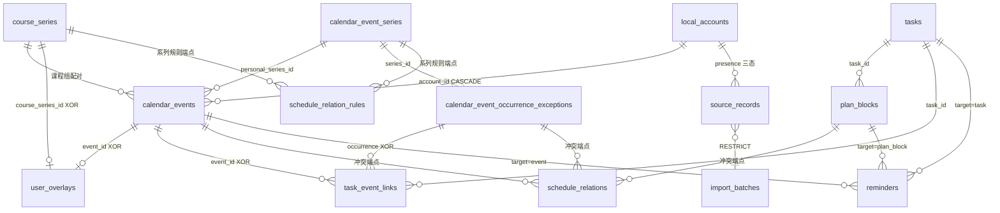

# 09a 数据模型可视化（calendar_events × tasks：字段与交叉逻辑）

> 产出日期：2026-08-14 ｜ 配套 `09-contracts.md` §7.6（CT-C3-08~16）
> ｜ **权威声明**：字段与约束的唯一权威 = `03-data-storage.md` §4.2 数据字典
> （main 代码逐行核实）+ `09-contracts.md` 冻结语义；本文件是**派生可视化**，
> 两者冲突时以权威为准。
> ｜ 本图只画字段与交叉逻辑；**状态机转移表属第 4 层**（`11-component-designs.md`）。

## 1. 阅读说明

- ASCII 图任何 Markdown 查看器可读；`mermaid` 代码块在 VS Code（Markdown Preview
  Mermaid Support 插件）/ GitHub / Typora 渲染。
- v7 与 v8 下这两张表形状**完全相同**（v8 只动 campus 三表/undo_slot/action_logs/
  agent_settings/agent_permission_policies/local_accounts/source_configs，见 09 §7.2），
  故本图对 M1（v8）同样有效。

## 2. calendar_events 字段卡（按职责分组）

```
┌─ calendar_events ─────────────────────────────────────────────────────┐
│ 身份与归属                                                            │
│   id                      TEXT PK（uuid）                             │
│   account_id              FK → local_accounts  ON DELETE CASCADE      │
│   source                  TEXT NOT NULL（'ustc_jw'|'ustc_young_…'|'user'）│
│   external_id             TEXT NULL —— 学校稳定身份                    │
│   source_series_external_id TEXT NULL —— 学校侧系列外键（如开课组）    │
│ 个人系列锚（仅个人重复事件相关）                                       │
│   personal_series_id      TEXT NULL  FK → calendar_event_series CASCADE│
│   occurrence_key          TEXT NULL —— 某次发生（锚定/投影用）         │
│ 时间表示（两形态，CHECK 互斥）                                         │
│   [定时] start_at / end_at          epoch ms INTEGER                   │
│   [全天] all_day=1 + start_date / end_date_exclusive（YYYY-MM-DD）     │
│   timezone                TEXT NOT NULL（业务时区 'Asia/Shanghai'）    │
│ 生命周期                                                               │
│   status   active|tentative|cancelled|completed|skipped|hidden         │
│   completed_at            INTEGER NULL（completion_policy 决定写入）    │
│   deleted_at              INTEGER NULL —— 软删除                       │
│ 内容                                                                   │
│   title / description / location_name / building_name / campus_name    │
│   participants_json       NOT NULL DEFAULT '[]'                        │
│   type ∈ {course, exam, second_class, personal, entertainment,         │
│           meal, campus_affair, travel, study, system}                  │
│ 用户语义                                                               │
│   importance（normal|high|low）/ color / tags_json                     │
│   completion_policy（auto_complete 等）                                │
│ 来源透明度（只存规范化业务数据，无原始 HTML/敏感键）                    │
│   source_details_json     NOT NULL DEFAULT '{}'                        │
│ 审计                                                                   │
│   created_at / updated_at  epoch ms NOT NULL                           │
│ 唯一性与一致性                                                         │
│   UNIQUE(account_id, source, external_id)          ← 学校稳定身份      │
│   UNIQUE(account_id, personal_series_id, occurrence_key)               │
│   CHECK：timed 需 end_at > start_at；all-day 需                          │
│           end_date_exclusive > start_date；timed/all-day 表示互斥；      │
│           type/status 枚举（B-5 整改补全）                              │
└────────────────────────────────────────────────────────────────────────┘
```

## 3. tasks 字段卡（按职责分组）

```
┌─ tasks ───────────────────────────────────────────────────────────────┐
│ 身份                                                                   │
│   id TEXT PK（uuid） / account_id FK → CASCADE                         │
│ 状态机四态（唯一持久化事实；派生投影不落库）                            │
│   state ∈ {active, blocked, completed, cancelled}                      │
│   blocked_reason    TEXT NULL —— blocked 时说明                        │
│   completed_at / cancelled_at —— 终态时间戳（CHECK 精确对应）：        │
│      state=completed ⇔ completed_at 非空 且 cancelled_at 空             │
│      state=cancelled ⇔ cancelled_at 非空 且 completed_at 空             │
│      state=active/blocked ⇔ 两者皆空（B-5 整改补全）                    │
│   deleted_at        INTEGER NULL —— 软删除（不改 state）               │
│ 计划                                                                   │
│   deadline_at       epoch ms NULL                                      │
│   estimated_minutes INTEGER NULL（CHECK：NULL 或 >0）                  │
│ 内容                                                                   │
│   title / description / user_notes / importance / tags_json            │
│ 审计                                                                   │
│   created_at / updated_at                                              │
│ 派生（查询计算，task_projection.dart；CT-C3-09）                       │
│   「计划中/临近截止/待确认」三态投影                                    │
│   「今天该做吗 / 逾期吗」——全部由查询推导，不写列                      │
└────────────────────────────────────────────────────────────────────────┘
```

## 4. 全景地图：三条主链 + 交叉层

```
┌─ 学校主链（只读；不物理删，仅隐藏）─────────────────────────┐
│ SourceBundle ──► course_series ──► calendar_events           │
│                  (course/exam)     稳定身份 upsert            │
└──────────────────────────────────────────────────────────────┘
┌─ 个人主链（重复系列）───────────────────────────────────────┐
│ calendar_event_series（recurrence_json 规则）                │
│    ├──► occurrence_exceptions（override/cancelled 锚点）     │
│    └──► 投影 projectRange ──► calendar_events(occurrence_key)│
└──────────────────────────────────────────────────────────────┘
┌─ 任务主链───────────────────────────────────────────────────┐
│ tasks ──► plan_blocks（挂任务、进周网格）                    │
│ tasks ──► task_event_links ──► calendar_events / exceptions  │
└──────────────────────────────────────────────────────────────┘
┌─ 交叉层（横跨三条主链）─────────────────────────────────────┐
│ user_overlays：        事件级 eo / 系列级 so 覆盖（XOR）      │
│ schedule_relations：   显式冲突（event/plan_block/exception）│
│ schedule_relation_rules：系列级冲突规则（按发生日生效）       │
│ reminders：            三类目标 event/task/plan_block        │
│ jw_day_moves：         调休投影（从不改写源事件）            │
│ source_records：       presence 三态过滤有效事件             │
│ undo_slot + action_logs：全部写事务的横切伴随                │
└──────────────────────────────────────────────────────────────┘
```

## 5. 交叉逻辑 ①：有效事件派生链（读路径主干）

```
calendar_events e
  ──LEFT JOIN course_series cs（course_series_id 配对）
  ──LEFT JOIN user_overlays eo（event_id = e.id）       事件级覆盖
  ──LEFT JOIN user_overlays so（course_series_id = cs.id） 系列级覆盖
  → COALESCE 链：eo.*  >  so.*  >  e.*
      （display_title / location / importance / hidden / color /
        foreground_priority / attendance_* / listening_*）
  → 过滤：deleted_at IS NULL
          AND status NOT IN (cancelled, hidden, skipped)
          AND (source='user' OR 存在 presence<>'missing_within_scope' 的 source_record)
  → 调休投影：ustc_jw/course 定时事件按北京日期匹配 jw_day_moves（移到目标日）
  → 有界合并：RecurringEventProjector.projectRange（366 天 / 1000 次）
  → EffectiveEvent → ScheduleConflictProjection.conflictsForItems（有界冲突投影）
  → ScheduleGridItem → buildWeek 周网格（7:00 前入凌晨带、重叠分组）
```

## 6. 交叉逻辑 ②：冲突判定序（阶梯；派生对从不落库）

```
第 1 级  显式 occurrence 关系   schedule_relations（规范键 "kind:id|kind:id"）
第 2 级  系列规则               schedule_relation_rules
                                （left/right series_type+id；按发生日命中
                                  effective_from/effective_through）
第 3 级  时间重叠派生           overlap_engine（纯函数）
第 4 级  无冲突
───────────────────────────────────────────────────────────
· 第 3 级派生对只存在于投影结果，从不写库（红线 2.2-3 的"冲突可解释"落点）
· 全量投影 resolvedConflictIdsFor 已废弃，统一走 conflictsForItems 有界路径
```

## 7. 交叉逻辑 ③：重复系列投影与例外锚点

```
calendar_event_series（title/event_type/status/all_day/start_at+duration_minutes/
                      anchor_start_date+duration_days/recurrence_json v1：
                      daily|weekly|monthly / effective_from~through）
   │
   ├─ 投影：RecurringEventProjector 只读范围投影，【不物化】occurrence 到
   │        calendar_events；跨系列上限 1000 次、窗口 366 天
   ├─ 锚点：occurrence_exceptions（kind ∈ {override, cancelled}）
   │        UNIQUE(account_id, series_id, occurrence_key)
   │        ensureOccurrenceAnchor：投影到的每次发生都可被锚定
   │        （no-op 锚点可复用——它是"这次发生可被单独引用"的身份证）
   └─ 三作用域生命周期：only_this / this_and_future（分裂系列）/
                        whole_series；影响预览（366 天/无限标记）
· v7 起三处直接引用锚点：task_event_links / schedule_relations / reminders
  （occurrence_exception_id 外键）
```

## 8. 交叉逻辑 ④：任务 ↔ 计划块 ↔ 事件链接

```
tasks ──1:N──► plan_blocks
                 status ∈ {suggested, accepted, done, skipped,
                           rescheduled, cancelled}
                 locked / review_note / reviewed_at
                 rescheduled ⇔ rescheduled_to_plan_block_id（CHECK）
                 └─► 与事件统一进 ScheduleGridItem → 周网格
tasks ──N:M──► calendar_events 或 occurrence_exceptions
                 （task_event_links：PK(account_id, task_id, target_id)
                   CHECK XOR(event_id, occurrence_exception_id)）
· 任务完成/取消 → PlanBlockLifecyclePort 联动批量取消未来计划块
· 计划块结束由用户确认（红线 2.2-4：不自动完成）
```

## 9. 交叉逻辑 ⑤：提醒协调链（CT-C3-14 冻结默认值）

```
6 张表 watch（calendar_events / calendar_event_series /
              calendar_event_occurrence_exceptions / tasks /
              plan_blocks / reminders）
  → ReminderService.reconcileAll
  → ReminderDefaults：
      定时 course/personal/… [15]；exam [1440,120]；second_class [120]
      全天 []（不提醒）；Task [1440,120]；PlanBlock [10]
  → 显式覆盖 ReminderOverrideService.setOffsets
  → 禁用哨兵：state='cancelled' 且 offset_minutes IS NULL → 抑制默认重建
  → reminders 行（state=desired, trigger_at）
     幂等键 reminder:<type>:<target>:<trigger>
  → 定时器 → 投递：delivered | failed(notification_unavailable) | missed
· 系列 31 天前瞻；过去触发记 missed
```

## 10. 交叉逻辑 ⑥：写事务同心圆（审计 + 撤销）

```
        ┌──────────────────────────────────────┐
        │      database.transaction()          │
        │   ┌────────────────────────────────┐ │
        │   │ 业务写（写前乐观锁 TOCTOU 复验）│ │
        │   └────────────────────────────────┘ │
        │   + action_logs（safeSummary，无 id/ref/原文）   ← 永远伴随
        │   + undo 快照（undo_slot 单行；Agent 写 = NoopUndoRecorder 不占槽）
        └──────────────────────────────────────┘
· Agent 写事务更宽：业务提交 + agent 业务日志 + 用户确认日志 + 权限变更
  （remember/ask_first_time）同一 Drift 事务，任一失败整体回滚
  （SQLite fault-injection 回归验证，CT-C4-05）
· 撤销：单槽 + 启动清槽（ADR-010）；11 类实体恢复器 + composite 复合恢复；
  他账号槽绝不删除/改写；失败保槽
```

## 11. 交叉逻辑 ⑦：导入快照对齐（presence 三态）

```
SourceBundle（完整快照，非增量）→ import_batches（幂等：bundleId/digest）
  → source_records：observed / outside_scope / missing_within_scope
  → calendar_events：sourceRecords 中 cancelled → status=cancelled，余 active
  → 有效事件流过滤 missing_within_scope
  → 学校课程/考试/二课不物理删（红线 2.2-2），仅用户明确同意后
    user_overlays.hidden 本地隐藏
```

## 12. 日程与任务 ER 子图（供支持 Mermaid 渲染的查看器）



## 13. 与 09 冻结语义的对照表

| 09 契约 | 语义 | 本图 | 状态机转移表归属 |
|---|---|---|---|
| CT-C3-08 | 学校稳定身份 upsert | §2 UNIQUE(account_id, source, external_id) | — |
| CT-C3-09 | Task 只持久化四态 | §3 | 第 4 层（TaskLifecycleService） |
| CT-C3-10 | PlanBlock 六态 + 禁止字段 | §8 | 第 4 层（PlanBlockService） |
| CT-C3-11 | 个人事件：单次/全天/跨日/基础重复 | §2/§7 | — |
| CT-C3-12 | 重复系列：稳定身份 + 单次例外 + 366 天/1000 次 | §7 | 第 4 层 |
| CT-C3-13 | 冲突判定序（显式 > 系列规则 > 派生 > 无） | §6 | 第 4 层（投影纯函数） |
| CT-C3-14 | 提醒默认偏移（L2-01 冻结） | §9 | — |
| CT-C3-16 | 出勤与听讲（user_overlays 两列系） | §5 COALESCE | — |
| CT-C3-17 | 撤销：单槽 + 启动清槽 + 11 类恢复器 | §10 | 第 4 层 |
| CT-C4-05 | Agent 写四日志同事务 + 不占槽 | §10 | 第 4 层（审批门） |

- v8 变更集（09 §7.2）不触及本图两张表本身；本图对 v7 与 v8（M1 目标态）同样成立。
- 若第 4 层状态机设计发现需要改这两张表 → 触发 ADR-011：开 ADR 修正 v8 冻结清单。
